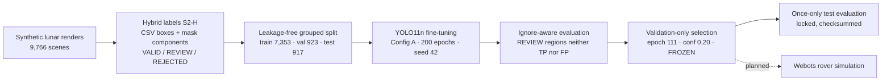

# Artemis-X: AI perception for lunar rock detection

Artemis-X is a planned autonomous lunar rover platform. **This repository holds its perception component**: a YOLO11n detector
that finds rocks and obstacles in rover-camera imagery. It was trained, selected and tested through an auditable research
pipeline.

> **Provisional results.** All training and evaluation labels were generated automatically (S2-H policy) and have **not** been
> verified by humans. All metrics come from **synthetic** lunar renders. They do not establish performance on real lunar imagery
> or readiness for rover deployment.

| | Status |
|---|---|
| **Completed** | Dataset research and cleaning · annotation policy · leakage-free YOLO dataset · YOLO11n training (200 epochs) · validation-only model selection · once-only locked test evaluation · reproducible notebooks |
| **Planned** (not implemented) | Webots simulation · spatial localisation of detections · navigation / obstacle avoidance · Mission Control dashboard |

## Problem

A rover must see rocks before it drives into them. Lunar scenes are hard for vision:
- harsh shadows and black sky;
- low texture contrast;
- thousands of small rocks;
- very few labelled real images.

Public synthetic data exists, but its original labels cover only **large** rocks (about 1.9 per image). That isn't enough to
train a detector that also sees small and distant obstacles.

## Approach



**Key contributions**
1. **Hybrid annotation policy (S2-H).** The original CSV boxes plus boxes derived from the semantic masks label about 15 times more
   rocks per image. Every box gets an explicit **VALID / REVIEW_REQUIRED / REJECTED** status, so uncertain rocks are never taught as
   background.
2. **Ignore-aware evaluation.** Predictions on uncertain regions are neither rewarded nor punished (COCO crowd semantics). This
   avoids an artificial penalty of about 0.12 AP50.
3. **Leakage-free splits.** Near-duplicate renders are grouped with perceptual hashing and ORB feature matching before splitting.
4. **Guarded, auditable training.** Explicit authorisation, effective-argument verification and blocking of silent retries or
   OOM batch changes. Every run is registered, fingerprinted and checksummed.
5. **Pre-registered selection and a locked test.** Selection rules were fixed before threshold metrics were computed. The test
   split was evaluated exactly once with the frozen configuration.

## Results (held-out test split, 917 images, evaluated once)

Frozen configuration: `best.pt` (epoch 111), imgsz 736, **conf 0.20**, NMS IoU 0.60, max 300 detections, boxes < 50 px² removed.

| Policy | Precision | Recall | F1 | FP / image | AP50 | AP50-95 |
|---|---|---|---|---|---|---|
| **Primary: REVIEW regions ignored** | **0.698** | **0.774** | **0.734** | **9.48** | **0.777** | **0.428** |
| Secondary: + *proposed* sub-threshold ignores | 0.779 | 0.774 | 0.777 | 6.21 | 0.803 | 0.440 |
| No ignore regions (reference) | 0.534 | 0.774 | 0.632 | 19.17 | 0.664 | 0.370 |
| *Validation, primary (used for selection)* | *0.696* | *0.775* | *0.734* | *9.47* | *0.776* | *0.432* |

| Rock size (bounding-box area) | Test recall | 95% CI* | Val recall |
|---|---|---|---|
| small < 400 px² | 0.743 | 0.736–0.749 | 0.740 |
| medium 400–2,500 px² | 0.842 | 0.833–0.850 | 0.849 |
| **large ≥ 2,500 px²** | **0.788** | 0.766–0.810 | 0.807 |

\*Wilson intervals assuming independent boxes; true uncertainty is larger.

**About one large rock in five is missed.** That is why the detector alone is **not** a sufficient obstacle-avoidance system. Full
tables, error analysis and caveats are in [docs/RESULTS.md](docs/RESULTS.md).

## Getting started: three workflows

Requirements: Windows 11 (tested) or Linux, Python 3.12, [uv](https://docs.astral.sh/uv/). The locked environment installs PyTorch
2.14.1 with CUDA 13.0, a multi-GB download.

```powershell
# 1. Clone and 2. install (exact locked environment: backend/uv.lock)
git clone <repository-url>; cd <repository>
uv sync --project backend
uv run --project backend python scripts/verify_artifacts.py      # frozen model + published evidence hashes
```

| Workflow | For | Needs | How |
|---|---|---|---|
| **A: Scientific review** | Jury, reviewers | This repository only, no dataset and no GPU | 3. Read notebooks 01–08 directly on GitHub, or `uv run --project backend --with jupyterlab jupyter lab` |
| **B: Inference** | Anyone with images | This repository; CPU or NVIDIA GPU | 4. `uv run --project backend python scripts/demo_inference.py frame.png --save detections.json`, or notebook 08 |
| **C: Training reproduction** | ML practitioners | Prepared dataset release (≈ 1.8 GB), NVIDIA GPU ≥ 8 GB, ≈ 70 min | 5. `uv run --project backend python scripts/download_dataset.py --source <approved release>`, then 6. open notebook 09 and launch explicitly |

> **Dataset release status:** the prepared `yolo-rock-v1.1-configA` release is **not published yet**, pending confirmation of
> the source-image licence. `download_dataset.py` fails clearly until an approved source exists. The file-level SHA-256
> manifest that a release will be verified against is already in `data/release/`. See
> [docs/DATASET_DISTRIBUTION_PLAN.md](docs/DATASET_DISTRIBUTION_PLAN.md).

Notebook 09 re-runs the historical 200-epoch experiment through the same guarded trainer. Training is **off by default**: Run All
performs only preflight checks and a dry run. A run starts only after you set `RUN_TRAINING = True` and type the authorisation
phrase. Outputs go to `experiments/reproductions/`, and the frozen model and historical results are never touched.

```python
import sys; sys.path.insert(0, "src")
from artemis_x.ml.inference import RockDetector
det = RockDetector()                 # verifies the frozen SHA-256; CUDA if available, else CPU
result = det.predict("frame.png")    # frozen imgsz / conf / NMS / max_det + 50 px² post-filter
print(len(result.detections), "rocks in", round(result.inference_ms, 1), "ms on", result.device)
```

A CPU-only installation path and the notebook environment are described in [docs/REPRODUCIBILITY.md](docs/REPRODUCIBILITY.md).

## Notebooks

Notebooks 01–08 read pre-computed artifacts, so they render on GitHub without execution and **never** train, rebuild datasets or
touch the test split. Notebook 09 is the only one that *can* train, and only after explicit opt-in. Open them with `uv run --project backend --with jupyterlab jupyter lab`.

| # | Notebook | Content |
|---|---|---|
| 01 | [Dataset exploration](notebooks/01_dataset_exploration.ipynb) | Sources, resolution, distributions, quality register |
| 02 | [Annotation analysis](notebooks/02_annotation_analysis.ipynb) | S1 vs S2, VALID / REVIEW / REJECTED, human vs automated review |
| 03 | [Data preprocessing](notebooks/03_data_preprocessing.ipynb) | S2-H cleaning pipeline, v1 → v1.1, source preservation |
| 04 | [YOLO dataset preparation](notebooks/04_yolo_dataset_preparation.ipynb) | Label format, grouped split, Config A vs B, leakage checks |
| 05 | [Model training analysis](notebooks/05_model_training_analysis.ipynb) | YOLO11n settings, losses, convergence, GPU telemetry |
| 06 | [Model selection](notebooks/06_model_selection.ipynb) | 22-checkpoint comparison, ignore-aware policy, threshold choice |
| 07 | [Final evaluation](notebooks/07_final_evaluation.ipynb) | Once-only test results, size analysis, error analysis |
| 08 | [Inference demo](notebooks/08_inference_demo.ipynb) | Load and verify the frozen model, run it, latency on CPU/GPU |
| 09 | [Reproduce training](notebooks/09_reproduce_training.ipynb) | Opt-in re-run of the 200-epoch experiment: preflight, dry run, guarded launch, comparison |

## Repository structure

```text
src/artemis_x/        public package: frozen model registry, inference, evaluation wrapper, artifact loaders, plots,
                      dataset release verification, training reproduction helpers
notebooks/            9 research notebooks (01-08 analysis and demo; 09 opt-in training reproduction)
models/               frozen detector (5.5 MB) + model card
artifacts/            published evidence: metrics, figures, reports, provenance (all hash-verified)
data/manifests/       split manifest and data YAMLs (metadata only: no images, no boxes)
data/release/         prepared-dataset release record + per-file SHA-256 manifest (release not yet published)
docs/                 architecture, dataset, distribution plan, methodology, results, reproducibility, limitations,
                      licensing, roadmap, audits
scripts/              verify_artifacts, demo_inference, download_dataset, inspect_environment, sanitize_checkpoint,
                      export_artifacts, build_notebooks, build_release_manifest, audit tools
tests/                29 tests: artifact integrity, model loading and parity, metrics, dataset contracts, notebooks,
                      download verification, training-reproduction safeguards
backend/              historical research pipeline (Tasks A-F) and its locked uv environment; 52 regression tests
future/               Webots integration plan (not implemented)
```

Local-only folders (git-ignored): `dataset/` (source and processed data), `experiments/` (full run outputs, checkpoints,
predictions, reproductions) and `frontend/` (an unmodified Turborepo starter reserved for the future Mission Control, kept out of
the scientific delivery).

## Data and model availability

- **Datasets** are not redistributed: the licence of the Artificial Lunar Landscape renders and of the NASA POLAR images has not
  been confirmed. [docs/DATASET.md](docs/DATASET.md) explains how to obtain them.
- **POLAR-Sim** labels (github.com/uwsbel/POLAR-Sim) are CC0.
- **Model:** `models/artemis_rock_yolo11n.pt`, SHA-256 `413d0481a728a310f5b919d069676ee5ddd2091e81b4b663831e1e977a0752eb`. It was
  trained with Ultralytics YOLO, whose licence (AGPL-3.0) applies. See [models/model_card.md](models/model_card.md) and
  [docs/MODEL_PRIVACY_AND_LICENSING.md](docs/MODEL_PRIVACY_AND_LICENSING.md), which covers a path-free distributable copy and
  licensing decisions still pending.

## Limitations

- Labels are automated and not human-validated.
- Results are synthetic-only.
- There is one training seed.
- About 21% of large rocks are missed.
- Dark, shadowed and dense boulder scenes are the main failure modes.

See [docs/LIMITATIONS.md](docs/LIMITATIONS.md).

## Roadmap

1. Human review of the annotations (E.1b).
2. Webots camera integration with a domain-gap check.
3. Projection of detections to rover-frame positions.
4. Hazard map and navigation.
5. Mission Control dashboard.

See [docs/ROADMAP.md](docs/ROADMAP.md) and [future/WEBOTS_INTEGRATION_PLAN.md](future/WEBOTS_INTEGRATION_PLAN.md).

## Licence, attribution and citation

- **Project licence: not yet chosen by the owner.** Until a `LICENSE` file is added, all rights are reserved by the author.
- **Third-party components:**
  - Ultralytics YOLO11, AGPL-3.0;
  - PyTorch, BSD-style;
  - Artificial Lunar Landscape dataset (Kaggle), licence to be confirmed;
  - NASA POLAR dataset, terms to be confirmed;
  - POLAR-Sim, CC0. Please cite the POLAR-Sim paper listed in its README when using its labels.
- **Citation:** see [CITATION.cff](CITATION.cff).
