<div align="center">

# ARTEMIS-X

### AI-Powered Lunar Reconnaissance & Resilient Mission Intelligence

**Perceive. Localize. Transmit. Visualize.**

**ATEC'26 — Project C.R.A.T.E.R**


</div>

Artemis-X is a fully software-emulated, end-to-end lunar reconnaissance prototype. A simulated six-wheel rover in
Webots runs a frozen YOLO11n rock detector on its own camera frames. It fuses each detection with aligned depth and
wheel odometry into obstacle coordinates and a local occupancy map. Only compact binary telemetry crosses an emulated
lunar link with packet loss, delay, bandwidth limits and blackouts. A DTN-inspired store-and-forward queue with
selective acknowledgements protects critical observations. A FastAPI + MongoDB ground station reconciles what actually
arrives, and a Next.js Mission Control displays it with its age and uncertainty. It never shows data it did not receive.

<div align="center">

[**Jury quickstart**](docs/JURY_QUICKSTART.md) ·
[Architecture](#5-end-to-end-architecture) ·
[Measured results](#18-measured-results-and-benchmarks) ·
[Quick start](#21-quick-start) ·
[Known limitations](#24-known-limitations) ·
[Screenshots](docs/screenshots/r6/)

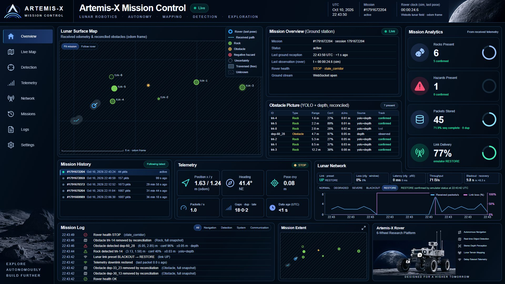

<sub>Mission Control during a real run, right after a BLACKOUT → RESTORE cycle. Every value on screen was received
from the rover through the emulated lunar link.</sub>

</div>

> [!IMPORTANT]
> **This is a simulation prototype. All perception metrics are provisional.**
> - The detector was trained and evaluated on **synthetic** lunar renders.
> - All training and evaluation labels were generated **automatically** and have not been verified by humans.
> - The rover follows a **scripted course**: it detects, localizes and reports obstacles, but does not steer around them.
>
> Nothing here claims flight readiness or validation on a physical rover.

---

## Contents

| | | |
|---|---|---|
| 1. [Project Identity](#1-project-identity) | 10. [Binary Telemetry Protocol](#10-binary-telemetry-protocol) | 19. [Repository Structure](#19-repository-structure) |
| 2. [Executive Summary](#2-executive-summary) | 11. [Lunar Network Emulator](#11-lunar-network-emulator) | 20. [Installation and Prerequisites](#20-installation-and-prerequisites) |
| 3. [Problem Statement and Mission Context](#3-problem-statement-and-mission-context) | 12. [DTN-Inspired Resilience](#12-dtn-inspired-resilience) | 21. [Quick Start](#21-quick-start) |
| 4. [The Four Core Pillars](#4-the-four-core-pillars) | 13. [Ground Station Backend](#13-ground-station-backend) | 22. [Automated Testing](#22-automated-testing) |
| 5. [End-to-End Architecture](#5-end-to-end-architecture) | 14. [MongoDB Data Model](#14-mongodb-data-model) | 23. [Engineering Decisions and Trade-offs](#23-engineering-decisions-and-trade-offs) |
| 6. [Technology Stack](#6-technology-stack) | 15. [REST API and WebSocket](#15-rest-api-and-websocket) | 24. [Known Limitations](#24-known-limitations) |
| 7. [Datasets and AI Model Development](#7-datasets-and-ai-model-development) | 16. [Mission Control Dashboard](#16-mission-control-dashboard) | 25. [Added Value and Potential Applications](#25-added-value-and-potential-applications) |
| 8. [Computer Vision and Edge Perception](#8-computer-vision-and-edge-perception) | 17. [Network Scenarios and Demonstration](#17-network-scenarios-and-demonstration) | 26. [Future Improvements](#26-future-improvements) |
| 9. [Spatial Localization and Mapping](#9-spatial-localization-and-mapping) | 18. [Measured Results and Benchmarks](#18-measured-results-and-benchmarks) | 27. [Team, Acknowledgements and References](#27-team-acknowledgements-and-references) |

---

## 1. Project Identity

| | |
|---|---|
| **Competition** | ATEC'26 — Project C.R.A.T.E.R |
| **What it is** | A software-only engineering prototype. It runs perception, spatial mapping, constrained telemetry, a ground segment and Mission Control as real processes on one machine. |
| **Implemented scope** | **R1–R4:** Webots simulation, edge perception and mapping. **R5:** binary telemetry, lunar-link emulation, store-and-forward, ground station and database. **R6/R6.1:** Mission Control. |
| **Rover motion** | A scripted 55-move course with closed-loop wheel-odometry segments. Perception and safety layers inform, but never command, the motors. |
| **Frozen model** | `models/artemis_rock_yolo11n.pt` (YOLO11n, 2,590,035 parameters, 1 class `rock`), SHA-256 `413d0481a728a310f5b919d069676ee5ddd2091e81b4b663831e1e977a0752eb` |
| **Validated on** | Windows 11, Webots R2025a, NVIDIA RTX 5060 Laptop GPU, Docker Desktop, Microsoft Edge |
| **Not claimed** | Flight readiness, a physically validated rover, a live video downlink, autonomous path planning |

### Documentation map

The README is the entry point. Each topic has a detailed report with the full evidence:

| Topic | Document |
|---|---|
| Jury setup, run and verification | [docs/JURY_QUICKSTART.md](docs/JURY_QUICKSTART.md) |
| Dataset, methodology, results, model card | [DATASET](docs/DATASET.md) · [METHODOLOGY](docs/METHODOLOGY.md) · [RESULTS](docs/RESULTS.md) · [model card](models/model_card.md) |
| Webots simulator and rover behaviour | [R1/R2](docs/WEBOTS_R1_R2_REPORT.md) · [R3 YOLO integration](docs/WEBOTS_R3_YOLO_REPORT.md) · [rover behaviour](docs/ROVER_BEHAVIOUR.md) |
| Spatial mapping and safety layers | [R4 progress and validation](docs/WEBOTS_R4_PROGRESS.md) · [R4.3 safety report](docs/WEBOTS_R4_3_SAFETY_REPORT.md) · [R4 plan](docs/WEBOTS_R4_MAPPING_PLAN.md) |
| Telemetry, link emulation and resilience | [R5.1 protocol](docs/TELEMETRY_R5_1_PROTOCOL.md) · [R5.2 UDP transport](docs/TELEMETRY_R5_2_TRANSPORT.md) · [R5.3 emulator](docs/TELEMETRY_R5_3_NETWORK_EMULATOR.md) · [R5.4 store-and-forward](docs/TELEMETRY_R5_4_STORE_AND_FORWARD.md) |
| Ground station, database, API | [R5.5 ground backend](docs/TELEMETRY_R5_5_GROUND_BACKEND.md) |
| Mission Control | [R6 dashboard](docs/DASHBOARD_R6_MISSION_CONTROL.md) · [R6.1 workspaces](docs/DASHBOARD_R6_1_WORKSPACES.md) |
| Live demo runbook (French) and video project | [docs/DEMO_ATEC_26.md](docs/DEMO_ATEC_26.md) · [demo/README.md](demo/README.md) |
| Reproducibility, licensing, data distribution | [REPRODUCIBILITY](docs/REPRODUCIBILITY.md) · [MODEL_PRIVACY_AND_LICENSING](docs/MODEL_PRIVACY_AND_LICENSING.md) · [DATASET_DISTRIBUTION_PLAN](docs/DATASET_DISTRIBUTION_PLAN.md) |

Real screenshots are in [`docs/screenshots/r6/`](docs/screenshots/r6/) (dashboard and onboard Webots panels), and
simulator figures are in [`docs/figures/webots/`](docs/figures/webots/).

A demonstration video was produced with the separate [`demo/`](demo/README.md) project. The rendered MP4 is a
generated artifact excluded from Git and is not published at a stable public URL yet.

---

## 2. Executive Summary

**What Artemis-X is.** Artemis-X is a complete perception-to-operator chain for a lunar rover, built and measured
entirely in software:
- a Webots simulation of a six-wheel K-Team Koala rover with a forward RGB camera and a pixel-aligned depth sensor;
- an onboard AI and mapping stack;
- a custom binary telemetry protocol over UDP;
- a lunar network emulator;
- a ground station with a database and a versioned API;
- a Mission Control web application.

**The problem it addresses.** A lunar rover works under three constraints at once:
- **No GPS:** every position must come from the rover's own sensors.
- **Limited onboard computing:** perception has to run on modest hardware.
- **A slow, lossy and regularly interrupted link to Earth.** Sending raw video to the ground for analysis is impractical.

Mission Control therefore works from compact, delayed and sometimes incomplete information. It must know **how old**
and **how uncertain** that information is.

**Why edge intelligence matters.** Detection, depth association, localization, tracking and mapping all run on the
rover side. Only their results cross the link:
- a rover pose is a **33-byte** packet;
- each obstacle adds a **26-byte** record;
- a health event is **28 bytes**.

A single 720 × 480 BGRA camera frame on the local inference link is about 1.38 MB. The complete telemetry stream of a
mission averaged **219 bytes per simulated second**.

**Why interruption-tolerant telemetry matters.** On a link with 30–50 % loss or a total blackout, fire-and-forget
messages are lost. Artemis-X classifies messages as CRITICAL, NORMAL or LOW:
- CRITICAL and NORMAL messages are stored until the ground acknowledges them, or until a TTL or attempt cap expires.
- Retries use an adaptive timeout.
- Stale poses are coalesced instead of replayed.

**What was measured:**
- In live Webots runs, **19/19**, **36/36** and **39/40** critical packets generated *during* blackouts reached the
  ground after restoration.
- Without store-and-forward, **0/7** blackout events arrived.

**How the system works:**
1. Webots renders RGB and depth. A separate local process runs the frozen YOLO11n detector on each RGB frame.
2. The detections are matched to the same capture's depth and to the odometry pose at capture time. They are projected
   into metres in the rover's `odom` frame.
3. A log-odds occupancy grid, a cost layer, a health monitor and a persistent obstacle tracker run in the controller.
4. A telemetry adapter encodes poses, obstacle records and events into CRC-protected binary packets. A store-and-forward
   queue sends them over UDP through the lunar-link emulator.
5. The ground station validates each datagram, ACKs it over the impaired reverse link, and reconciles it by
   *observation* time. It persists it in MongoDB and publishes it over WebSocket.
6. Mission Control shows the map, obstacles, telemetry and link state as **LIVE**, **STALE** or **DISCONNECTED**.

**What makes this implementation valuable:**
- **Measured, not mocked.** Every reported result comes from real processes on real sockets, with real packets
  from the simulated rover. The ground and dashboard never fabricate, interpolate or extrapolate telemetry.
- **Honest freshness.** The rover's simulation clock and the ground's UTC reception clock are never mixed. A blackout
  produces a greyed, aging map rather than a frozen "live" view.
- **Bounded and inspectable.** The queues, retries, memory and latency budgets are bounded. Their behaviour is counted
  and exported, and drops are reported rather than hidden.
- **Reproducible.** The model is hash-pinned and the test split was evaluated only once. The Webots course is
  deterministic, and the official workflows write per-run evidence.

> [!NOTE]
> **Two kinds of autonomy, stated precisely.**
>
> | Implemented onboard, without operator action | Not implemented |
> |---|---|
> | Perception: detection, depth association, localization, tracking, occupancy and cost mapping, health assessment | Path planning, obstacle avoidance, or any perception-driven motor command |
> | Communication: prioritization, store-and-forward, adaptive retransmission, link-state detection and probing | Reaction to the health monitor: its OK / DEGRADED / STOP state is **advisory** and never stops the motors |
>
> The validated course is a precomputed 55-move tour. Each segment closes on wheel odometry, but the route itself is
> scripted.

---

## 3. Problem Statement and Mission Context

| Operational challenge | Why it matters | How Artemis-X addresses it | Section |
|---|---|---|---|
| **No GPS infrastructure** | Positions must be self-estimated and drift over time | Wheel odometry defines an `odom` frame. Every coordinate is tagged with that frame and carries a 1-σ uncertainty. Odometry uncertainty is modelled and propagated. | [9](#9-spatial-localization-and-mapping) |
| **Constrained edge computing** | Perception has to fit modest onboard hardware | YOLO11n (2.59 M parameters, 5.48 MB). Standard-library-only mapping inside the controller, at 3.9 Hz with a cycle p95 of 10.8–14.9 ms on an unloaded machine. | [8](#8-computer-vision-and-edge-perception), [9](#9-spatial-localization-and-mapping) |
| **Hazardous, uncertain terrain** | Rocks, boulders and crater bowls endanger the rover | Depth-based positive and negative hazards, and YOLO + depth fusion for small rocks. A conservative cost layer treats unknown space as never traversable. | [9](#9-spatial-localization-and-mapping) |
| **Visual perception challenges** | Harsh shadows, a black sky, low contrast and thousands of small rocks | Hybrid S2-H labels and ignore-aware evaluation. A measured domain-gap study on Webots scenes covers two sun angles and a dedicated failure-mode test course. | [7](#7-datasets-and-ai-model-development), [8](#8-computer-vision-and-edge-perception) |
| **Limited bandwidth** | Raw video cannot be sent continuously | Binary protocol v1 with 1 mm quantization. Snapshots carry only changes, with a periodic full snapshot. Duplicate depth clusters are removed. | [10](#10-binary-telemetry-protocol) |
| **Packet loss, latency and blackouts** | Fire-and-forget telemetry loses critical observations | Configurable lunar-link emulator. A DTN-inspired priority queue with selective ACKs, Karn's algorithm and link probing. | [11](#11-lunar-network-emulator), [12](#12-dtn-inspired-resilience) |
| **Stale or incomplete ground knowledge** | Operators may act on outdated pictures | Reconciliation by observation time. UTC-based freshness (LIVE / STALE / DISCONNECTED). The last picture is kept and greyed, never extrapolated. | [13](#13-ground-station-backend), [16](#16-mission-control-dashboard) |

The one-way Earth–Moon light time is about 1.3 s. The emulator's SEVERE preset uses a 1,300 ± 300 ms one-way delay to
represent it.

---

## 4. The Four Core Pillars

The four official ATEC'26 objectives map one-to-one onto implemented subsystems.

### PERCEIVE — local visual hazard detection

| | |
|---|---|
| **Engineering problem** | Detect rocks and obstacles in the rover's own camera frames, locally, under lunar lighting, without cloud services |
| **Approach** | YOLO11n fine-tuned on synthetic lunar renders with hybrid S2-H labels. It was frozen after validation-only selection and served by a local inference process. A detection becomes an obstacle track only when depth supports it. |
| **Technologies** | Ultralytics 8.4.174, PyTorch 2.14.1 (CUDA 13.0), OpenCV, NumPy; Webots `Camera` (720 × 480, 1.0 rad HFOV) and pixel-aligned `RangeFinder` |
| **Output** | Per-frame boxes and confidences matched to their frame ID. Persistent `trk-<n>` rock tracks. |
| **Validation evidence** | Held-out synthetic test: **AP50 0.777**, recall 0.774, F1 0.734 (917 images, evaluated once). Webots domain gap: precision 1.00 / 0.71, recall 0.72 / 0.60 (spheres / Poly Haven scans). Latest full tour: 2,001 of 2,001 frames answered, 0 failed. |
| **Known limitations** | Synthetic training data with automated labels. About 21 % of large rocks are missed on the test split. Recall is 0.31–0.33 on the deliberately hard Webots course viewpoints. Near-field boulders under low sun produce fragment false positives. |

### LOCALIZE — detections to spatial coordinates

| | |
|---|---|
| **Engineering problem** | Convert image detections into metric positions without GPS, and keep a usable local hazard map |
| **Approach** | Optical-axis depth → camera frame → rover base (mount extrinsics) → `odom` with the encoder-odometry pose interpolated at capture time. A log-odds occupancy grid, an inflated cost layer, YOLO + depth fusion and a persistent tracker. |
| **Technologies** | Pure Python standard library inside the Webots controller: pinhole model, SE(2) transforms, log-odds grid |
| **Output** | `artemis.obstacles.v1`: id, type, `x_m`/`y_m` in `odom`, radius, confidence, 1-σ uncertainty, observation time, source (`yolo+depth` or `depth`), status, protection flag |
| **Validation evidence** | Depth points vs true surfaces: p50 **4.3 mm**, p95 15 mm. Track centres: median **0.034 m**, p95 0.162 m. Free-cell precision **0.997**. **0** "corridor clear while blocked" cycles in 8 safety scenarios. |
| **Known limitations** | Odometry drift is unbounded, and the kinematic simulator has no wheel slip and ideal depth. One occluded object (a white ball) is missed. 4 of 35 exported tracks are not on a true object. |

### TRANSMIT — compact telemetry over lossy, constrained links

| | |
|---|---|
| **Engineering problem** | Deliver what matters over a link with loss, delay, bandwidth caps and blackouts |
| **Approach** | Custom binary protocol v1 (CRC-16, sequence numbers, observation timestamps) over UDP. A lunar-link emulator in both directions. DTN-inspired store-and-forward with three priorities and selective ACKs. |
| **Technologies** | Python `struct` and sockets (standard library only); separate emulator process with a live control port |
| **Output** | POSE 33 B · EVENT 28 B · OBSTACLES 26 B + 26 B per record · ACK 25–277 B |
| **Validation evidence** | **86.4 %** smaller than equivalent compact JSON on real exports. Critical packets generated in blackouts and delivered: **19/19, 36/36, 39/40**, versus 0/7 events without DTN. |
| **Known limitations** | Best effort only. In the SEVERE stress case, 82/110 critical packets were delivered. In-memory queue, no congestion control. CRC detects corruption but does not authenticate. |

### VISUALIZE — Mission Control with data age and uncertainty

| | |
|---|---|
| **Engineering problem** | Give operators a truthful picture: what is known, how old it is, and how uncertain |
| **Approach** | The ground station ingests only validated packets and reconciles them by observation time. It persists them to MongoDB and streams them over WebSocket. Mission Control computes LIVE / STALE / DISCONNECTED from UTC reception time only. |
| **Technologies** | FastAPI, Pydantic, PyMongo async, structlog, MongoDB 8.0; Next.js 16 App Router, React 19, TypeScript, Tailwind CSS 4, shadcn/ui, Lucide, Recharts, TanStack Table |
| **Output** | Live `odom`-frame map. Obstacle catalog with confidence, uncertainty and provenance. Telemetry, network control, mission history and logs, in two display modes (Clean workspace and Unified Mission Control). |
| **Validation evidence** | **1,073 / 1,073** forwarded packets persisted, including through a 10 s MongoDB outage. 3,658 WebSocket events with complete envelopes. Dashboard E2E **12/12** (R6) and **24/24** (latest jury run). |
| **Known limitations** | No camera downlink. The occupancy grid is not transmitted. Local-only, unauthenticated API. A ground ACK means "received", not "persisted". |

---

## 5. End-to-End Architecture

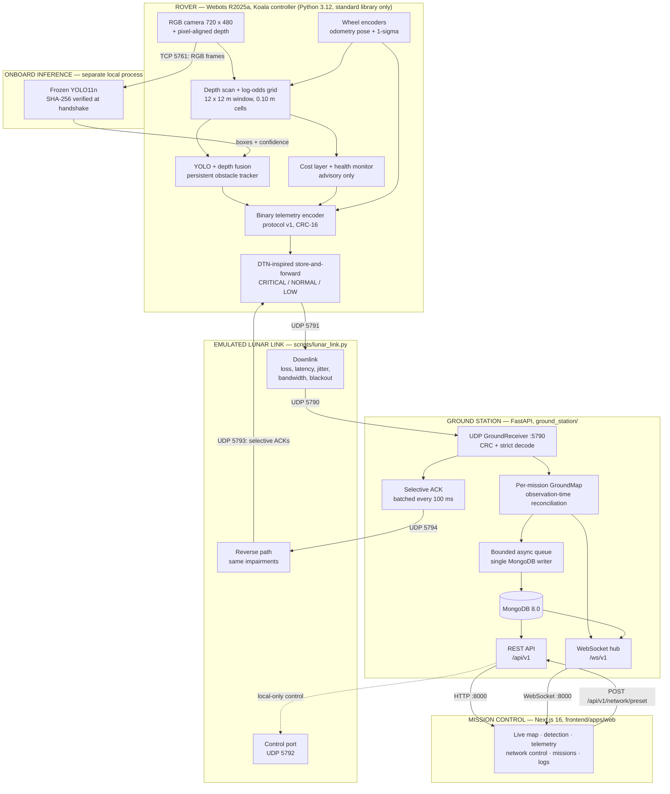

### Three domains, one boundary

| Domain | Processes | What crosses the lunar link |
|---|---|---|
| **Rover** (Webots controller + local inference process) | Sensors, YOLO11n inference, mapping, fusion, tracking, safety layers, telemetry encoder, DTN queue | — |
| **Emulated channel** (`lunar_link.py serve --reverse`) | Downlink and reverse path with configurable impairments | **Only** binary telemetry downstream (poses, obstacle records, events) and ACKs upstream |
| **Ground infrastructure** (FastAPI, MongoDB, Next.js) | Reception, validation, reconciliation, persistence, REST, WebSocket, Mission Control | — |

Camera frames, depth images, the occupancy grid and the cost layer **never cross the link**.

The TCP link on port 5761 between the controller and the inference process exists only because Webots runs its
controller under a plain Python without PyTorch. It is a local inter-process channel that represents onboard
computing, not a cloud API. A lunar-link blackout cuts telemetry and ACKs, but local perception continues.

### Data flow, from photons to the operator's screen

1. The controller samples one RGB and one depth image from the same sensor step every 64 ms of simulated time.
2. The RGB frame goes to the inference process, which returns boxes. These are matched by frame ID to the buffered depth
   image and to the odometry pose at that capture instant.
3. Each box becomes a metric measurement in `odom`. The tracker associates it with an existing track or starts a new one.
   Depth evidence updates the log-odds grid every 0.256 s.
4. On idle simulation steps, the telemetry adapter emits:
   - map-reset and health events;
   - a pose every 0.5 s;
   - an obstacle snapshot every 2 s (changes only, with a full snapshot every 10 s).
5. Each packet enters the store-and-forward queue with a priority, then goes out over UDP to the emulator.
6. The emulator drops, delays, throttles or blacks out traffic, then forwards the surviving bytes unchanged to UDP 5790.
7. The ground receiver checks the CRC and decodes strictly. It ACKs every valid packet back through the emulator's
   reverse path, and updates that mission's GroundMap.
8. Deltas go to the WebSocket hub at once. A bounded queue feeds a single MongoDB writer that retries with backoff.
9. Mission Control loads history over REST, applies WebSocket events every 200 ms, and computes freshness from UTC
   reception time.

### Ports

| Service | Endpoint |
|---|---|
| Mission Control / FastAPI / MongoDB | TCP 3000 / 8000 / 27017 (all bound to localhost) |
| Frozen inference server | TCP 5761 (the automated R6 validation uses 5771) |
| Rover → emulator → ground | UDP 5791 → 5790 |
| ACK: ground → emulator → rover | UDP 5794 → 5793 |
| Emulator control | UDP 5792 |
| Headless Edge debugging (E2E only) | TCP 9333 |

> [!WARNING]
> Exactly **one** receiver may own UDP 5790. The FastAPI ground station includes its own receiver. Do not also start
> the standalone `scripts/ground_receiver.py`.

---

## 6. Technology Stack

Versions are those pinned in the lockfiles and manifests: `backend/uv.lock`, `ground_station/uv.lock`,
`frontend/pnpm-lock.yaml`, the `package.json` files and `docker/compose.yml`.

| Layer | Technology | Role in Artemis-X | Why it was selected |
|---|---|---|---|
| **Simulation & robotics** | Webots R2025a | Lunar scene, rover kinematics, camera and depth sensors, supervisor ground truth (offline evaluation only) | Open-source simulator with an official lunar sample world, a Python controller API and deterministic headless runs |
| | K-Team Koala (Webots PROTO) | Six-wheel rover: two driven middle wheels, wheel encoders, extension slot for sensors | Rover-like platform available in the simulator, with documented geometry |
| | Python 3.12 (controller) | Motion scripts, sensor scheduling, mapping, telemetry | Runs under Webots' own interpreter with the standard library only, so the controller needs no compiled dependencies |
| | RGB camera + RangeFinder | 720 × 480, 1.0 rad HFOV, pixel-aligned depth (0.05–15 m) | Aligned depth turns 2D boxes into metric points without stereo matching |
| **AI & computer vision** | YOLO11n (Ultralytics 8.4.174) | Single-class rock detector | Smallest YOLO11 variant: real-time on a laptop GPU, 5.48 MB of weights |
| | PyTorch 2.14.1 + torchvision 0.29.1 (CUDA 13.0 wheels) | Training and inference runtime | Required by Ultralytics; the locked CUDA build matches the training GPU |
| | OpenCV 5.0, NumPy 2.5 | Image handling, dataset analysis, evaluation | Standard, well-tested numerical and imaging tools |
| **Localization** | Pinhole projection, SE(2) transforms, wheel odometry, log-odds occupancy grid, ROS-style cost layer | Pixels → metres → `odom`; local hazard map | Transparent, testable mathematics that fits a Python step budget of a few milliseconds |
| **Communication** | Custom binary protocol v1 (`struct`), UDP, CRC-16/CCITT-FALSE, u32 sequence numbers | Rover → ground telemetry | Fixed-size, strictly validated records; 7.4 × smaller than equivalent JSON |
| | Lunar network emulator | Loss, latency, jitter, bandwidth, blackout in both directions | Repeatable, seeded impairments switchable live, on real sockets |
| | DTN-inspired store-and-forward + selective ACK | Delivery of critical observations across outages | Retention and retry where it matters, without TCP's head-of-line blocking |
| **Ground backend** | FastAPI 0.143, uvicorn 0.54 | Versioned REST + WebSocket service | Async-native, typed, generates OpenAPI at `/docs` |
| | Pydantic 2.14, pydantic-settings 2.15 | Response models, request validation, `.env` configuration | Schema-validated contracts shared by REST, WebSocket and tests |
| | PyMongo 4.18 (native async API) | MongoDB access from the event loop | Official driver, no extra ODM layer |
| | structlog 26.1 | JSON logs with UTC timestamps and request IDs | Structured, machine-readable operational logs |
| **Database & infrastructure** | MongoDB 8.0.4 (pinned image) | Mission archive: poses, obstacles, packets, link metrics | Document model fits heterogeneous telemetry; unique indexes give idempotent ingestion |
| | Docker Compose | Local MongoDB with health check, named volume, localhost-only port | One-command, reproducible database |
| | uv | Locked Python environments (`backend/`, `ground_station/`) | Fast, exact, hash-locked installs; two independent projects |
| **Frontend** | Next.js 16.3 (App Router), React 19.2 | Mission Control application | Persistent layouts keep a single WebSocket session across pages |
| | TypeScript 7.0, Tailwind CSS 4 | Typed API contracts, styling | Compile-time checking of the ground API v1 types |
| | shadcn/ui (Base UI), Lucide icons, Recharts 3, TanStack Table 8 | Components, icons, charts, data tables | Accessible primitives, source-owned components |
| | pnpm 11.25 + Turborepo 2 | Workspace and task runner | Lockfile-exact installs and cached multi-package builds |
| **Testing** | `unittest`, `node --test`, headless Microsoft Edge (Chrome DevTools Protocol) | Unit, integration and full-stack browser E2E | No extra test framework in the protected ML environment |

---

## 7. Datasets and AI Model Development

### 7.1 Datasets investigated, and what each was actually used for

| Dataset | Content | Role in Artemis-X | Licence status |
|---|---|---|---|
| **Artificial Lunar Landscape** (Kaggle) | 9,766 synthetic 720 × 480 scenes: photorealistic render, semantic ground mask, clean mask; CSV of large-rock boxes; author anomaly lists; 36 real lunar photos (PCAM/TCAM) | **The only source of training, validation and test data** | Not confirmed; no pixels are redistributed |
| **NASA POLAR** ([IRG PolarDB](https://ti.arc.nasa.gov/dataset/IRG_PolarDB/)) | Real stereo images of a lunar-analogue testbed (12-bit in 16-bit PNG), exposure brackets, LiDAR | **Exploration only.** Excluded from every metric until a validated 12-bit → 8-bit conversion exists. Not used for training. | Not confirmed |
| **POLAR-Sim** labels ([uwsbel/POLAR-Sim](https://github.com/uwsbel/POLAR-Sim)) | YOLO boxes and polygons for POLAR | Annotation reference only | CC0 1.0 |
| **Webots scenes** (this repository) | Generated paired scenes and the nine-zone test course | Domain-gap and mapping evaluation only. **Never used for training.** | Generated here; rock scans from Poly Haven (CC0) |

The 36 real lunar photographs in the Kaggle archive were **not** evaluated. No result in this repository is a
real-imagery result.

### 7.2 From scenes to labels: the S2-H hybrid annotation policy

The original CSV boxes cover only **large** rocks, about 1.9 per image. That is not enough to teach a detector small or
distant obstacles. The S2-H policy combines two sources:
- the authoritative CSV boxes;
- connected components of the semantic masks, which label about 15 times more rocks per image.

Every box then receives an explicit status.

| Step | Rule |
|---|---|
| CSV large-rock boxes | Kept as authoritative instances |
| Mask components | Added when ≥ 50 px |
| Merged blobs | Split by watershed (neck ratio 0.7) |
| Visibility | Edge ≥ 100 or contrast ≥ 25 |
| **VALID** | Training and evaluation target |
| **REVIEW_REQUIRED** | Never taught as background: excluded or masked in training, *ignored* in evaluation |
| **REJECTED** | Discarded |

`curated-dataset-v1.1` contains **261,239 VALID**, 192,784 REVIEW_REQUIRED and 50,005 REJECTED boxes.

### 7.3 Cleaning, normalization and leakage-free splitting

- **Exclusions:** 573 author-flagged anomaly frames are removed, leaving **9,193** eligible frames.
- **Near-duplicates:** renders are clustered with perceptual hashing and ORB feature matching *before* splitting, so
  near-identical views never straddle train and test.
- **Split:** grouped by cluster, stratified 80 / 10 / 10, seed `20261011`. This gives train 7,353 · validation **923** ·
  test **917**.
- **Training configuration A:** the **1,903** training scenes without uncertain (REVIEW) rocks. Configuration B, which
  masks REVIEW regions across all 7,353 scenes, is defined but was not trained.
- **Integrity:** content hashes for each dataset version (`artifacts/provenance/VERSIONS.json`), plus pre- and post-run
  fingerprints of every source dataset.

### 7.4 Training

| Setting | Value |
|---|---|
| Initialization | Official COCO-pretrained `yolo11n.pt` |
| Data | `yolo-rock-v1.1` Configuration A: 1,903 train / 923 validation scenes, 1 class `rock` |
| Schedule | 200 epochs, batch 16, image size 736, SGD (lr0 0.01, momentum 0.937, weight decay 5e-4, cosine), 3 warm-up epochs, AMP, `close_mosaic` 10, seed 42 |
| Hardware | NVIDIA GeForce RTX 5060 Laptop GPU: 68.7 min wall clock, median 125 images/s, peak VRAM 5.5 GB, no OOM, NaN or thermal throttling |
| Safeguards | Explicit authorization (environment variable + flags). Blocking of silent retries and OOM batch changes. Effective-argument verification. Every run registered, fingerprinted and checksummed (42 verified checkpoints). |

### 7.5 Evaluation methodology and model selection

- **Ignore-aware evaluation.**
  - Predictions under 50 px² are removed.
  - The remaining predictions are matched to VALID boxes at IoU ≥ 0.5, greedily by confidence.
  - An unmatched prediction overlapping a REVIEW region (IoU or IoA ≥ 0.5) is *ignored*, following COCO crowd
    semantics.
  - AP uses 101-point interpolation; AP50-95 averages IoU 0.50:0.95:0.05.
- **Pre-registered selection.** 22 checkpoints were scored on validation only. The rules were fixed in code before any
  threshold metric was computed:
  - keep `best.pt` unless a candidate beats it by more than 0.005 AP50;
  - choose the lowest confidence whose F1 is within 0.02 of the best. This is recall-oriented, because a missed obstacle
    costs more than a false alarm.

  The result is epoch 111, confidence 0.20.
- **Once-only test.** A guard refuses any second evaluation of the test split and leaves `TEST_RUN_LOCK.json` behind.

### 7.6 Results on the held-out synthetic test split

These results cover 917 images (25,987 VALID boxes), evaluated **once**, with the frozen configuration: image size 736,
conf 0.20, NMS IoU 0.60, max 300 detections, boxes < 50 px² removed.

| Policy | Precision | Recall | F1 | FP / image | AP50 | AP50-95 |
|---|---|---|---|---|---|---|
| **Primary: REVIEW regions ignored** (approved) | **0.698** | **0.774** | **0.734** | **9.48** | **0.777** | **0.428** |
| Secondary: + proposed sub-threshold ignores (not approved) | 0.779 | 0.774 | 0.777 | 6.21 | 0.803 | 0.440 |
| Reference: no ignore regions | 0.534 | 0.774 | 0.632 | 19.17 | 0.664 | 0.370 |
| *Validation, primary (used for selection)* | *0.696* | *0.775* | *0.734* | *9.47* | *0.776* | *0.432* |

| Rock size (box area) | n (test) | Test recall | Validation recall |
|---|---|---|---|
| small < 400 px² | 17,110 | 0.743 | 0.740 |
| medium 400–2,500 px² | 7,544 | 0.842 | 0.849 |
| **large ≥ 2,500 px²** | 1,333 | **0.788** | 0.807 |

Interpretation:
- **Test reproduces validation within ±0.004** on every headline metric, so selection did not overfit validation.
  This agreement is not evidence of generalization to real imagery, because both splits share one synthetic
  distribution and the same automated labels.
- **About one large rock in five is missed**, and at least one large rock is missed in 40 % of the test images that
  contain one. The detector alone is therefore not a sufficient obstacle-avoidance system. That is why Artemis-X
  confirms tracks with depth and maps hazards from depth independently.

Full tables, error analysis and caveats are in [docs/RESULTS.md](docs/RESULTS.md).

<p align="center">
  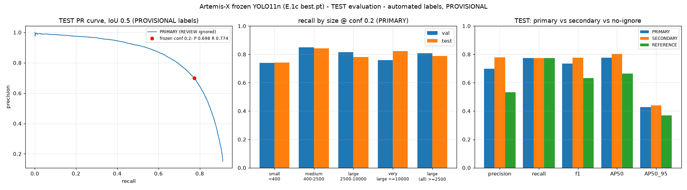
</p>

### 7.7 Frozen model and reproducibility

| Artifact | Value |
|---|---|
| Weights | `models/artemis_rock_yolo11n.pt`, 5.48 MB stripped inference checkpoint, tracked in Git |
| SHA-256 | `413d0481a728a310f5b919d069676ee5ddd2091e81b4b663831e1e977a0752eb` |
| Architecture | YOLO11n, **2,590,035** parameters, 1 class `{0: "rock"}` |
| Frozen configuration | `artifacts/provenance/FROZEN_MODEL_CONFIG.json` |
| Integrity check | `scripts/verify_artifacts.py` (frozen model, Task F checksums, protected baseline, every published artifact) |
| Runtime enforcement | `RockDetector` and the inference server refuse any other hash; the rover client checks it at handshake |

Notebooks 01–08 render the scientific narrative from published artifacts and never train. Notebook 09 is an opt-in,
guarded reproduction of the 200-epoch run. See [notebooks/](notebooks/) and
[docs/REPRODUCIBILITY.md](docs/REPRODUCIBILITY.md). The prepared training dataset is **not published**, pending licence
confirmation ([distribution plan](docs/DATASET_DISTRIBUTION_PLAN.md)). The runtime demonstration does not need it.

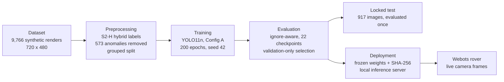

### 7.8 Limitations of the training data

- **No human verification.** Every label comes from deterministic S2-H rules. AI-assisted reviews are recorded as
  automated evidence, not as human validation.
- **Label artefacts.** Crater rims, cliff faces and shadows are sometimes boxed as rocks, and touching boulders are
  sometimes merged.
- **One synthetic domain, one seed, one configuration.** Checkpoint differences of about ±0.01 AP50 cannot be
  distinguished from noise.
- **Metrics depend on the evaluation policy.** Test AP50 ranges from 0.664 to 0.803 with the ignore policy; only the
  primary policy is approved.

---

## 8. Computer Vision and Edge Perception

### 8.1 Acquisition and hand-off

| Stage | Implementation |
|---|---|
| **Acquisition** | Every 64 ms of simulated time, the controller reads one camera image (BGRA) and one depth image from the same sensor step |
| **Hand-off** | A bounded asynchronous client with one pending slot and one request in flight. A newer frame replaces an unsent older one, so frames are dropped rather than queued. |
| **Association** | An 8-frame ring buffer keeps each frame's depth and estimated pose by frame ID. Replies older than 1 s of simulated time are flagged `stale`. A reply for an evicted frame is never matched to another frame's depth. |
| **Inference** | `scripts/inference_server.py` on `127.0.0.1:5761` loads the frozen detector through `load_frozen_spec()`. It reports its SHA-256 in a `hello` handshake and applies the frozen settings (imgsz 736, conf 0.20, NMS IoU 0.60, max 300, < 50 px² removed). |
| **Fault tolerance** | A missing, slow or killed server never blocks motion. The mapper raises `inference_unavailable` within 0.28–0.64 s (measured) and keeps mapping from depth alone. |

### 8.2 From a box to a metric measurement

1. **Foreground surface point.** Inside the central 50 % of the box, valid depth pixels are back-projected and the nearer
   half (foreground) is kept. Their median is the visible-surface point. If fewer than 20 % of sampled pixels have
   valid depth, the detection is **rejected with a reason**. A distance is never inferred from box size.
2. **Footprint centre.** In the fusion stage, the centre is placed one estimated radius behind the surface point, along
   the viewing ray. The 1-σ uncertainty is
   $\sigma = 0.03 + 0.02 \cdot r$ m, where $r$ is the range.
3. **Occlusion handling.** A depth gap larger than 0.30 m inside the box marks it bimodal. The dominant cluster is used
   and σ doubles.
4. **Small-rock rule.** Depth points 2–5 cm high inside a *confirmed* rock's box become grid hits. YOLO only lowers the
   height threshold where it points. It never clears a cell.
5. **Tracking.**
   - A track starts tentative and is confirmed after 2 **depth-supported** hits within 2 s.
   - A track is marked lost after 4 misses, counted only when it should be visible. Lost tracks are kept and flagged.
   - IDs (`trk-<n>`) are never reused within a mission.

### 8.3 What stays on the rover and what is transmitted

| Stays onboard | Transmitted |
|---|---|
| RGB frames (≈ 1.38 MB per BGRA frame on the local link) | Rover pose: x, y, yaw, σ_xy (33 B) |
| Depth images | Obstacle records: id, type, position, radius, confidence, uncertainty, observation time, source, status (26 B each) |
| The full occupancy grid, cost layer and provenance layer | Health, map-reset and inference events (28 B) |
| Tentative tracks, raw detections | Selective ACKs travel in the other direction |

**Why raw video is not transmitted.** At the SEVERE preset's 1,000 B/s, one uncompressed frame would occupy the link
for more than 20 minutes. Artemis-X sends structured knowledge instead: a complete mission of poses, obstacle updates
and events averaged 219 B per simulated second. Mission Control therefore has **no live camera panel**. The camera, AI
and depth views exist onboard, in the Webots monitor panels.

<p align="center">
  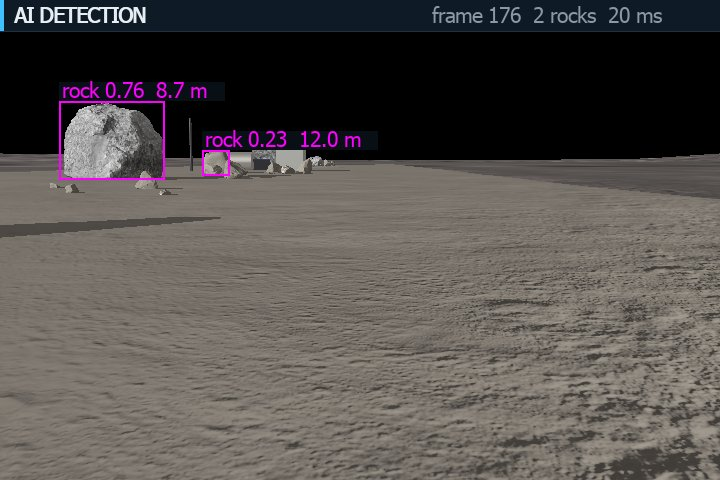
  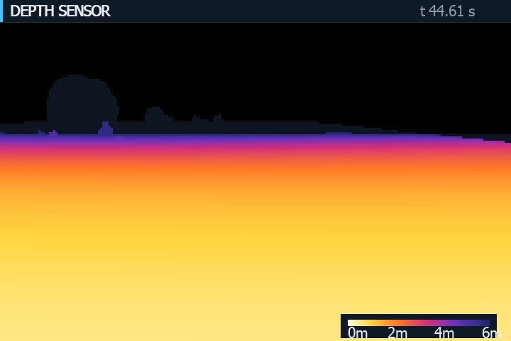
</p>
<p align="center"><sub>Onboard Webots panels captured during the R6 validation run: AI DETECTION (boxes, confidence, range) and DEPTH SENSOR.</sub></p>

### 8.4 Inference performance

All measurements are on an RTX 5060 Laptop GPU with Webots in fast mode, unless stated otherwise.

| Measurement | p50 | p95 | Source |
|---|---|---|---|
| Server inference, evaluation captures | 12.5–12.6 ms | 13.1–13.6 ms | R3 report |
| Frame → detections at the controller, scripted tour | 19 ms | 34 ms | R3 tour (1,994 / 1,996 frames OK) |
| Capture → fused track, simulated time | 0.128 s | 0.288 s | R4.4 fusion run |
| Frame → detections, full stack with dashboard and browser on the same machine | 34.3 ms | 50.3 ms | Latest jury run, 2026-10-11 (2,001 / 2,001 frames OK) |

**Observed limitations.**
- Pebbles are the main miss.
- Under low sun, a frame-filling boulder at 1.7 m produced 10 false-positive fragments. Under high sun it produced 3.
- YOLO labels a lander crate, a fuel tank and a mast as "rock". Depth maps them as obstacles anyway, so safety is
  unaffected, but the semantics are wrong.

---

## 9. Spatial Localization and Mapping

### 9.1 Reference frames

| Frame | Definition | Used by |
|---|---|---|
| `camera` | FLU at the sensor: x along the optical axis, y left, z up. Image u to the right, v downward. | Back-projection |
| `base` | Rover centre on the ground: x forward, z up | Mount extrinsics |
| `odom` | The rover's start pose is (0, 0, 0). It drifts with odometry. | Grid, tracks, telemetry, ground, dashboard |
| `map` | Identical to `odom` (no correction, SLAM or absolute fix exists) | — |
| `world` | Webots global frame | **Offline evaluation only.** A test fails if any mapping module touches the supervisor API. |

### 9.2 Pixels to the odometry frame

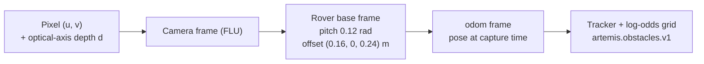

**Intrinsics.** The camera and RangeFinder share pose, field of view and resolution: W = 720, H = 480,
HFOV = 1.0 rad.

```math
f_x = f_y = \frac{W/2}{\tan(\mathrm{HFOV}/2)} \approx 659.0\ \text{px}, \qquad c_x = \frac{W-1}{2} = 359.5, \qquad c_y = \frac{H-1}{2} = 239.5
```

**Back-projection.** The depth $d$ is measured along the optical axis. This was confirmed in R2: the straight-line-range
hypothesis was off by 3.6–5.2 cm.

```math
x_c = d, \qquad y_c = -\frac{(u - c_x)\, d}{f_x}, \qquad z_c = -\frac{(v - c_y)\, d}{f_y}
```

**Camera → rover base.** The sensor is mounted 0.16 m ahead of and 0.24 m above the base, pitched down by
$\theta = 0.12$ rad:

```math
\begin{aligned}
x_b &= \cos\theta\, x_c + \sin\theta\, z_c + 0.16 \\
y_b &= y_c \\
z_b &= -\sin\theta\, x_c + \cos\theta\, z_c + 0.24
\end{aligned}
```

**Rover base → `odom`.** The transform uses the estimated pose $(x_r, y_r, \psi)$ *at the frame's capture time*. The
simulated rover never tilts, so z is unchanged.

```math
\begin{bmatrix} x_o \\ y_o \end{bmatrix} =
\begin{bmatrix} x_r \\ y_r \end{bmatrix} +
\begin{bmatrix} \cos\psi & -\sin\psi \\ \sin\psi & \cos\psi \end{bmatrix}
\begin{bmatrix} x_b \\ y_b \end{bmatrix}
```

### 9.3 Rover pose: wheel odometry and its uncertainty

`drive.Odometry` integrates the two encoders. The parameters are wheel radius $r = 0.0425$ m and track $b = 0.285$ m,
with a yaw scale $k_\psi = 0.958$ calibrated once from R2 ground truth.

```math
\Delta s = \frac{r\,(\Delta\varphi_L + \Delta\varphi_R)}{2}, \qquad
\Delta\psi = k_\psi\,\frac{r\,(\Delta\varphi_R - \Delta\varphi_L)}{b}, \qquad
\begin{aligned}
x &\leftarrow x + \Delta s \cos(\psi + \Delta\psi/2) \\
y &\leftarrow y + \Delta s \sin(\psi + \Delta\psi/2) \\
\psi &\leftarrow \psi + \Delta\psi
\end{aligned}
```

- **Capture-time poses.** A pose buffer interpolates the pose at each sensor sample instant. Projected obstacle points
  had a p95 error of 14.8 mm with the sample-time pose, against 24.3 mm with the pose from one period (64 ms) earlier.
- **Uncertainty.** The 1-σ design envelope grows by 2 % of the distance driven and 0.02 rad per radian turned. The
  safety layers use the *relative* σ since each cell was last observed. In fault tests, the measured error stayed inside
  2σ in 100 % of pairs, including ±3 % odometry-scale faults.
- **Honest caveat.** In the kinematic simulator, odometry agrees with ground truth to about 0.5 mm, because wheels never
  slip. This validates the control and transform logic, **not** real-world localization.

### 9.4 Depth scan, occupancy grid and hazard classification

| Element | Implementation (`src/artemis_x/sim/mapping/`) |
|---|---|
| Depth classification | 5,040 precomputed rays per frame. Height relative to local ground: **ground** within ±0.03 m, **obstacle** ≥ 0.05 m, **negative hazard** (crater bowl) ≤ −0.08 m. |
| Free-space evidence | A segment joins two pixel-consecutive ground samples only if the range grows as flat ground would. Any obstacle or larger jump breaks the chain. An **overhang rule** refuses free evidence under a nearer obstacle up to 0.40 m high. |
| Grid | `LogOddsGrid`: **0.10 m** cells, **120 × 120** cells (12 × 12 m) rolling window in `odom`. Recentred by integer-cell shifts once the rover is 1 m off-centre; cells entering the window start UNKNOWN. 183 KB of storage. |
| Update rule | At most one update per cell per cycle, hits first. Cycle every 0.256 s (3.9 Hz). |
| Cost layer | ROS-style codes: **0** free · 1–252 graded inflation · **253** inscribed · **254** lethal · **255** unknown. Collision radius 0.25 m (Koala circumscribed radius 0.210 m), plus a 0.15 m safety band and a 2σ_rel margin capped at 0.20 m. |
| Health monitor | OK / DEGRADED / STOP from 13 reasons: depth stale, frozen, invalid or degraded; no pose; obstacle in footprint or corridor; unobserved or stale corridor; inference disabled, unavailable or stale; cycle overrun. **Advisory.** |
| Map reset | `Mapper.reset_map(reason)` clears everything to UNKNOWN, drops tracks and logs a `map_reset` event, which is telemetered as CRITICAL. It is only ever an explicit action. |

```math
l_t = \operatorname{clamp}\!\left(l_{t-1} + \begin{cases} +0.85 & \text{hit} \\ -0.40 & \text{free evidence} \end{cases},\; -2.0,\; 3.5\right),
\qquad
\text{state} = \begin{cases} \text{OCCUPIED} & l > 0.85 \\ \text{FREE} & l < -0.85 \text{ and observed} \\ \text{UNKNOWN} & \text{otherwise} \end{cases}
```

**Unknown is never safe.** UNKNOWN cells have cost 255 and are never lowered by inflation. They are never treated as
traversable. Absence from the obstacle list does **not** mean free space.

### 9.5 Output contract and ground representation

`artemis.obstacles.v1` (`mapping/contract.py`) exports confirmed and lost tracks (`trk-<n>`, persistent, type `rock`,
source `yolo+depth`) and depth clusters (`dep-<i>_<j>`, **not persistent**, type `obstacle` or `negative_hazard`,
source `depth`). Each record carries:
- `x_m`, `y_m` in `odom`;
- `radius_m`;
- `confidence`: the YOLO EMA for tracks, the occupancy probability for clusters;
- `uncertainty_m` (1 σ);
- observation `timestamp_s`;
- `status` and the `protected` flag.

Tentative tracks are never exported.

**The ground receives obstacle records and poses, not the occupancy grid.** Mission Control draws three layers:
- **Unknown**, the default background;
- **Explored (camera)**: the camera footprint swept along received poses. It shows where the sensors looked, not proven
  free space.
- **Traversed (free)**: only the rover's own footprint counts as free.

<p align="center">
  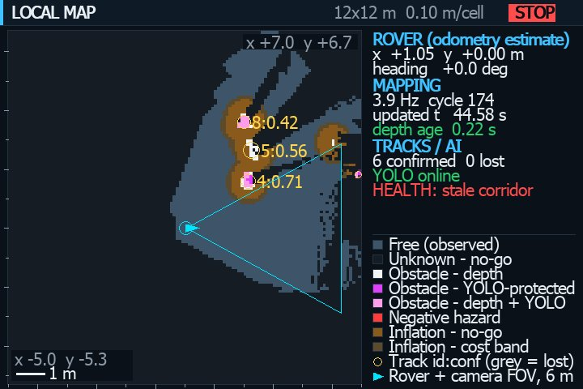
</p>
<p align="center"><sub>The onboard LOCAL MAP panel (R4.5): observed free space, unknown no-go space, obstacles by evidence source, inflation, tracks with ID and confidence, and the rover with its camera FOV. It stays onboard and is not downlinked.</sub></p>

### 9.6 Measured accuracy and limitations

| Measure (ground truth used **offline only**) | Result | Source |
|---|---|---|
| Positive obstacle points vs true surfaces (169,477 points) | p50 4.3 mm · p95 15 mm · max 40 mm | R4.1 |
| Free-cell / occupied-cell precision, observed area | 0.9968 / 0.925 strict (1.000 within one cell) | R4.2 |
| Obstacles ≥ 0.10 m mapped | 33 / 34 (occluded white ball missed) | R4.6 |
| Confirmed-track centre error | median 0.034 m · p95 0.162 m · 0 % duplicates | R4.6 |
| Occluded rock behind another rock | Tracked to 2.8 cm (R3's surface point had been up to 0.66 m too near) | R4.4 |
| Corridor reported clear while truly blocked | **0** cycles in 8 safety scenarios, including ±3 % odometry faults | R4.3 / R4.6 |

**Limitations.**
- Odometry is the only localization source, so absolute uncertainty grows without bound.
- The simulator has ideal depth and no wheel slip.
- Rocks under 5 cm are invisible to depth, and their recall is bounded by YOLO.
- 4 of 35 exported tracks sit on a crater rim or terrain.
- Of the cells that should be hazards, 70 are marked FREE. All 70 carry inscribed or lethal cost through inflation.
- 27–38 cells in the collision zone have unsafe cost. None is inside a hazard.

---

## 10. Binary Telemetry Protocol

**Why not JSON on the lunar link?** On real R4.6 exports, compact JSON carrying the same fields at the same precision
was **7.4 × larger**. Fixed-size binary records also make validation strict and cheap: a decoder knows every field's
size and range in advance. JSON is still used on the ground, for REST and WebSocket, where bandwidth is not the
constraint.

Implementation: `src/artemis_x/telemetry/protocol.py`, standard library only. Specification:
[docs/TELEMETRY_R5_1_PROTOCOL.md](docs/TELEMETRY_R5_1_PROTOCOL.md).

### 10.1 Packet layout (big-endian)

| Offset | Field | Type | Meaning |
|---|---|---|---|
| 0 | `magic` | 2 bytes | `"AX"` (0x41 0x58) |
| 2 | `version` | u8 | `1`; any other version is rejected |
| 3 | `type` | u8 | 1 POSE · 2 OBSTACLES · 3 EVENT · 4 ACK |
| 4 | `session` | u32 | Mission / session ID chosen by the rover |
| 8 | `seq` | u32 | Packet sequence number, +1 per packet, modulo 2³² |
| 12 | `t_obs_ms` | u32 | **Observation** time on the rover's simulation clock, in ms |
| 16 | `payload_len` | u16 | Payload size in bytes |
| 18 | payload | — | Type-specific |
| 18 + len | `crc16` | u16 | CRC-16/CCITT-FALSE (poly 0x1021, init 0xFFFF) over header + payload |

Fixed overhead is 20 bytes (18-byte header + CRC). The largest packet is 1,066 bytes: OBSTACLES with 40 records.
**Reception time is never in the packet.** The receiver records it, so the two clocks stay separate by construction.

### 10.2 Packet types

| Type | Payload | Packet size |
|---|---|---|
| **POSE** | `frame` u8 (0 = odom) · `x`, `y` i32 (1 mm) · `yaw` i16 (1e-4 rad) · `sigma_xy` u16 (1 cm; 0xFFFF = saturated) | **33 B** |
| **OBSTACLES** | 6-byte snapshot header: `frame` (bit 7 = FULL snapshot) · `part` · `parts` · `count` · `map_resets` u16. Then ≤ 40 records of 26 B. | 26 + 26·n B |
| **EVENT** | `code` u8 (health / map_reset / inference) · `state` u8 (OK / DEGRADED / STOP) · `reasons` u32 bitmask · `value` u16 | **28 B** |
| **ACK** (ground → rover) | `count` u8 (1–64) · `count` × `seq` u32. The header `session` is the acknowledged rover session. | 25–277 B |

**Obstacle record (26 B):**

| Field | Type | Encoding |
|---|---|---|
| `flags` | u8 | id namespace (track / depth cluster) · type (rock / obstacle / negative_hazard) · source (yolo+depth / depth) · status (confirmed / lost / observed) · protected · reserved bit (must be 0) |
| `id` | u32 | `trk-<n>` → n; `dep-<i>_<j>` → two signed 16-bit cell indices. The namespace bit prevents collisions. |
| `x`, `y` | i32 | 1 mm, `odom` |
| `radius` | u16 | 1 mm |
| `confidence` | u8 | round(c × 255) |
| `uncertainty` | u16 | 1 mm, 1-σ (0xFFFF = saturated) |
| `t_obs` | u32 | This record's own observation time, in ms |
| `link` | u32 | First linked track of a depth cluster (0 = none) |

### 10.3 Validation rules

- **Encode never clips silently.** A non-finite or out-of-range value, an unknown enum, a frame other than `odom` or a
  namespace mismatch raises `ProtocolError`. Only the two uncertainty fields saturate, explicitly.
- **Decode is strict, and the CRC is checked first.** The decoder rejects:
  - a wrong magic, version or type;
  - a length mismatch;
  - a payload whose size does not match its type;
  - more than 40 records, or inconsistent part counts;
  - unknown frames, set reserved bits, out-of-range enums or unknown reason bits.

### 10.4 Measured size: binary vs JSON

Source: the 16 `obstacles_final.json` exports of run `r4-validate-20261010-204718`, 426 obstacles.
"Equivalent JSON" means compact JSON carrying exactly the transmitted fields at the same precision.

| Snapshot | Obstacles | Equivalent JSON | Binary | Binary, deduplicated | zlib-9 of the JSON (reference) |
|---|---|---|---|---|---|
| Fusion, nominal | 48 | 9,608 B | **1,300 B** | 1,118 B | 1,501 B |
| Depth only | 12 | 2,464 B | **338 B** | 338 B | 511 B |
| After a map reset | 35 | 7,104 B | **936 B** | 754 B | 1,183 B |
| **All 16 runs** | **426** | **85,721 B** | **11,622 B** | **10,504 B** | 14,699 B |

| Message | Binary | Equivalent compact JSON |
|---|---|---|
| POSE | 33 B | 115 B |
| EVENT (health, two reasons) | 28 B | 144 B |
| One obstacle record | 26 B | ≈ 200 B |

The binary encoding is **86.4 % smaller** than equivalent JSON. Uncompressed, it is still 21 % smaller than
zlib-compressed JSON. Compressing the binary itself was not measured and is not claimed.

On the transport, unchanged observations are not re-sent: 4,005 per tour were filtered. 1,528 depth clusters that
duplicated tracked objects were also suppressed. A full mission produced 1,307 packets (1,001 POSE, 261 OBSTACLES,
45 EVENT), 112,371 bytes for 512 simulated seconds.

> [!CAUTION]
> **CRC-16 detects accidental corruption only.** It is not a cryptographic integrity check, authentication or
> encryption. A deliberate attacker could forge valid packets. See [Known Limitations](#24-known-limitations).

**Known protocol limits.**
- `t_obs` wraps after 49.7 days of simulation time, and `seq` after 2³² packets. A real mission would need an epoch
  field.
- There is no explicit deletion message. Vanished obstacles are removed by the next complete FULL snapshot or by a map
  reset.

---

## 11. Lunar Network Emulator

`src/artemis_x/telemetry/emulator.py` with the `scripts/lunar_link.py` CLI. It is a separate process between the rover
and the ground. It forwards bytes **unchanged**, with payload and CRC untouched, and only peeks at headers to log them.

### 11.1 Pipeline and presets

Each datagram passes through four stages, in order:
1. **Blackout:** the datagram is dropped.
2. **Random loss:** dropped with probability `loss`, using a seeded RNG.
3. **Bandwidth:** a token bucket in bytes per second, with a one-packet burst of 1,066 B, feeding a bounded FIFO
   (`queue_max` 64 by default). When the FIFO is full, the new packet is dropped.
4. **Propagation:** delivery after `latency_ms` ± uniform `jitter_ms`. Jitter can reorder packets.

| Preset | Loss | Added delay | Bandwidth |
|---|---|---|---|
| NORMAL | 0 % | 0 ms | Unlimited |
| DEGRADED | 30 % | 200 ± 50 ms | Unlimited |
| SEVERE | 50 % | 1,300 ± 300 ms | 1,000 B/s |
| BLACKOUT | 100 % | No delivery | — |
| RESTORE | Back to NORMAL | 0 ms | Unlimited |

These values are taken directly from `PRESETS` in the code. Custom settings are also possible, for example
`SET loss=0.1 latency_ms=50 jitter_ms=10 bandwidth_Bps=2000 queue_max=32`. Invalid values are rejected and the link
stays unchanged.

### 11.2 Properties

- **Seeded and reproducible loss.** Live runs used seed 2026, and the same seed gives the same drop pattern.
- **High-resolution scheduling** uses `time.perf_counter`, because Windows `time.monotonic` only resolves 15.6 ms. The
  rover's simulation clock is logged but never used for scheduling.
- **Blackouts are real.** Entering BLACKOUT discards everything queued or in flight (`dropped_blackout`). Packets
  never "secretly" arrive after the link went down.
- **Live switching without restarting Webots.** Presets can be applied in three ways:
  - typed at the emulator console;
  - sent over UDP control port 5792 (`lunar_link.py ctl SEVERE`);
  - requested through the ground API (`POST /api/v1/network/preset`), which confirms the change by reading the
    emulator status back.
- **Bidirectional.** `--reverse` carries ground ACKs from UDP 5794 to the rover on 5793 under the **same** blackout,
  loss and latency. This is why ACKs are lost too.
- **Statistics:**
  - packets received and forwarded;
  - drops by loss, blackout, queue and shutdown;
  - delivery ratio;
  - forward delay p50 / p95 / max;
  - throughput;
  - blackout duration;
  - per-preset counters;
  - reverse-path counters.

### 11.3 Measured behaviour

The measurements below come from four full Webots tours with real telemetry (R5.3, without store-and-forward).
Every rover sent the same 1,307 packets.

| | NORMAL | DEGRADED | SEVERE |
|---|---|---|---|
| Forwarded / received by ground | 1,307 / 1,307 | 934 / 934 | 645 / 645 |
| Configured → observed random loss | 0 → 0 % | 30 → 28.5 % | 50 → 50.6 % |
| Rover send → ground receive, p50 / p95 | ≤ 1 ms / 1.5 ms | 206 / 253 ms | 1,363 / 2,227 ms |
| Ground obstacle picture vs final export | 41 / 41 | 41 / 41 | 41 / 41 |

During a live-switching run, the BLACKOUT phase forwarded **0 of 264** packets over 12.0 s. Communication resumed
**23 ms** after RESTORE. The ground's `missing` sequence count matched the emulator's drops: 372 vs 373 and
660 vs 662.

> [!NOTE]
> **Configured delay is not measured application latency.** Preset delays are what the emulator adds. End-to-end figures
> include queueing: under SEVERE, the 1,000 B/s cap adds to the 1.3 s propagation. The rover's simulation clock and the
> ground's UTC clock are never subtracted to claim a one-way latency.

---

## 12. DTN-Inspired Resilience

The rover side is `src/artemis_x/telemetry/dtn.py` (`StoreForwardQueue`). The ground side is `GroundReceiver` with
selective ACKs, plus `ground_map.py`. Store-and-forward is opt-in with `ARTEMIS_TELEMETRY_DTN=1`; without it, R5.2/R5.3
behaviour is unchanged.

**Principle.** A successful `sendto()` proves nothing. A message counts as delivered only when the ground's ACK comes
back over the impaired reverse link. Until then, important messages are stored, retried and prioritized.

### 12.1 Priorities

| Priority | Messages | Retention |
|---|---|---|
| **CRITICAL** | Map-reset events; health **state** changes; obstacle packets announcing a hazard never sent before in this map epoch | Until ACKed · TTL 600 s · 60 attempts |
| **NORMAL** | Obstacle refreshes (full and changes-only); health **reason** changes | Until ACKed · TTL 60 s · 8 attempts |
| **LOW** | Poses | Fire-and-forget, **coalesced**: only the newest pose waits; older ones are stale and discarded |

### 12.2 Mechanisms

| Mechanism | Implementation |
|---|---|
| Selective ACKs | The ground ACKs **every** valid packet, duplicates included, since their first ACK may have been lost. ACKs are batched every 100 ms, with at most 64 sequence numbers per ACK packet. |
| Adaptive retransmission timeout | RFC 6298 smoothing (`rto = srtt + 4·rttvar`): initial 1 s, clamped to 0.3–10 s |
| Karn's algorithm | RTT samples come only from first transmissions. The RTO itself backs off on timeout, at most once per RTO; without this, a 1 s RTO could never grow to a 2.6 s lunar round trip. |
| Exponential backoff | Each entry backs off from the RTO it had at its first transmission, capped at 16 s |
| Link state | DOWN after 2 s without an ACK following a send. While DOWN, one **probe** per second carries the most important pending packet. The first ACK brings the link back UP. |
| Backlog drain | Priority order, at most 16 sends and 64 ACK datagrams per tick, all on idle simulation steps with a non-blocking socket |
| Bounded memory | 400 entries / 192 KiB. Evictions are counted, in this order: LOW → NORMAL → CRITICAL (redundant hazard packets first; map resets last). |
| Superseding & coverage | A FULL obstacle snapshot obsoletes older pending NORMAL obstacle packets. An ACKed FULL snapshot purges CRITICAL packets whose hazards it already contains. |
| Identity preserved | Retransmissions are byte-identical: same session, `seq`, `t_obs` and obstacle IDs |
| End of mission | The queue keeps draining for up to 3 s of wall time. Anything still pending is **reported as undelivered**. |

**Ground reconciliation.**
- Duplicates (same session and `seq`) are ignored.
- A record replaces the stored one only if it is not older, by *observation* time, never by arrival.
- A FULL snapshot removes vanished obstacles only when **all** its parts have arrived, and only if no newer full
  snapshot was already applied.
- A map reset removes everything observed before it and ignores late packets from the old map.
- For poses, the newest observation wins.

### 12.3 NORMAL → BLACKOUT → RESTORE, step by step

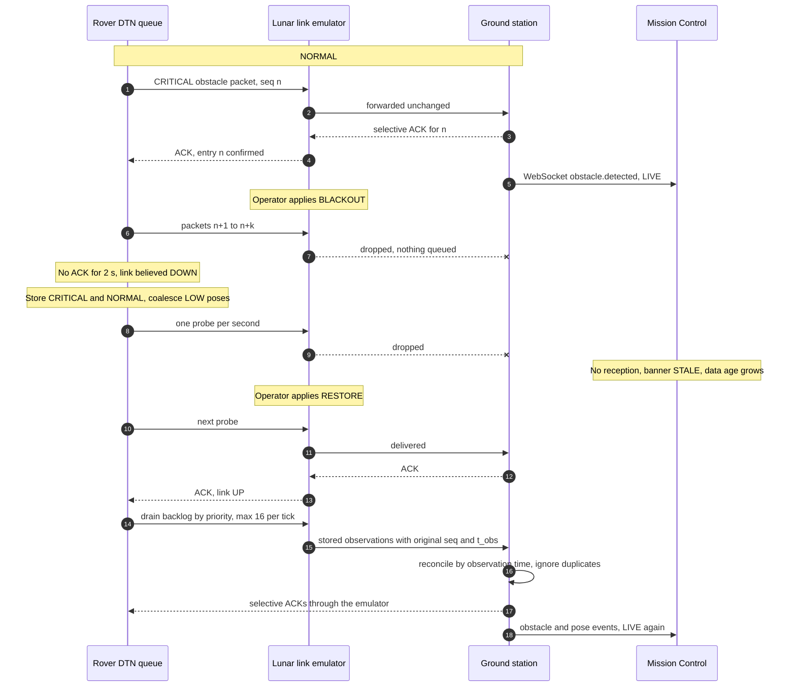

### 12.4 Why "DTN-inspired" and not Bundle Protocol v7

Artemis-X borrows DTN's core idea: store, carry and forward across disruptions, with prioritized custody of important
data. It does **not** implement BPv7 (RFC 9171):
- there are no bundles, endpoint IDs or convergence-layer adapters;
- there is no custody transfer across intermediate nodes;
- there is a single hop;
- storage is the controller's memory, not persistent storage.

**Delivery is best effort.** Critical data can still be lost through TTL or attempt caps, through eviction under the
memory limits, or because it was still pending at the end of the mission.

### 12.5 Measured results

These are R5.4 live Webots tours in fast mode, with YOLO on. All 9 tours completed 55/55 moves. Each figure was
measured **at the ground**, from what the receiver actually decoded.

| | No DTN (reference) | 12 s blackout | 3 × 6 s blackouts | 28 s blackout, 40-entry cap |
|---|---|---|---|---|
| EVENT packets generated in blackout → delivered | **0 / 7** | 5 / 5 | 12 / 12 | 15 / 15 |
| CRITICAL packets generated in blackout → delivered | — | **19 / 19** | **36 / 36** | **39 / 40** |
| Hazards announced in blackout → received | — | 18 / 18 | 37 / 37 | 39 / 39 |
| Recovery after RESTORE, p50 / max | — | 0.12 / 0.13 s | 0.07 / 1.00 s | 0.33 / 0.33 s |
| Ground map vs final export | 41 / 41 (by repetition) | 41 / 41 | 41 / 41 | 41 / 41 |

In the 40-entry overflow run, the single undelivered critical packet had been evicted as redundant. Every hazard it
announced still arrived (39/39).

| | 30 % loss, 200 ± 50 ms | 50 % loss, 200 ± 50 ms | SEVERE stress: 50 %, 1.3 ± 0.3 s, 1 kB/s | Receiver restarted |
|---|---|---|---|---|
| CRITICAL packets delivered | 107 / 111 | 97 / 109 | **82 / 110** | 111 / 111 |
| Hazards announced → received | 118 / 119 | 118 / 118 | **110 / 120** | 120 / 120 |
| Ground map vs final export | 41 / 41 | 40 / 40 + 17 stale extras | 40 / 41 + 20 stale extras | 41 / 41 |

With 30–50 % loss in **both** directions, most critical packets arrive, but **not all**. SEVERE is a stress case
beyond the link's capacity: in fast mode the rover produces about 1.9 kB/s of wall-clock traffic against a 1 kB/s cap.
At 50 % loss, full snapshots often lose a part, so vanished obstacles linger on the ground map as "stale extras" until
a complete snapshot arrives.

---

## 13. Ground Station Backend

`ground_station/` is a **separate uv project** (Python 3.12, its own lock), so the protected ML environment is never
modified. It reuses the rover-side telemetry code (`artemis_x.telemetry`): the protocol, the receiver, the ACK logic and
`GroundMap`.

### 13.1 Ingestion pipeline

```text
UDP 5790 ─► GroundReceiver thread ── CRC + strict decode ── selective ACK ─► UDP 5794 (emulator reverse path)
                │ on_packet(pk), valid packets only
                ▼
        per-mission GroundMap (dedup, observation-time order, FULL snapshots, map resets) ─► delta
                │ call_soon_threadsafe (never blocks the receiver)
                ▼
  asyncio event loop ─► WebSocket hub (per-client queue of 512 events, oldest dropped and counted)
                └────► bounded ingest queue (20,000 items) ─► single MongoDB writer (retry with backoff, up to 5 s)
```

| Module (`ground_station/artemis_ground/`) | Responsibility |
|---|---|
| `main.py` | FastAPI app factory, lifespan (receiver, writer, hub), routers under `/api/v1` and `/ws/v1`, unversioned `/health` |
| `ingest.py` | Receiver integration, per-session GroundMaps, translation of deltas into documents and events |
| `db.py` | MongoDB client (PyMongo async), index creation, writer with retry/backoff, queries |
| `hub.py` | WebSocket fan-out with bounded per-client queues |
| `network.py` | Emulator control client (UDP 5792), status and preset application |
| `api/v1.py`, `api/ws.py`, `api/common.py` | REST endpoints, WebSocket endpoint, envelopes, errors and request IDs |
| `schemas.py`, `config.py`, `logging.py` | Pydantic models, `ARTEMIS_GROUND_*` settings, structlog configuration |

### 13.2 Design properties

- **Only delivered packets are ingested.** A packet the emulator dropped never reaches the backend, and an invalid
  datagram is counted but never persisted.
- **Reception never waits on MongoDB.** UDP reception, ACKs and reconciliation run in the receiver thread. The database
  writer is a separate task. Overflow of the 20,000-item queue is dropped **and counted**.
- **Database outages are absorbed.** The writer retries the same item with backoff. WebSocket events are published at
  reception, so the live view keeps working while the database is down.
- **One reconciled picture per mission.** Each session has its own GroundMap, with an in-memory LRU of 16 sessions;
  MongoDB keeps every mission. A shared map once mixed two missions with identical obstacle IDs. That bug was found in a
  live run, fixed, and is now covered by a test.
- **Idempotent persistence.** Packet-derived documents use `_id = "<mission>:<seq>"` and unique
  `(mission_id, seq)` indexes, so retransmissions are stored once and counted as duplicates.
- **Versioned, enveloped API.** REST lives under `/api/v1` and WebSocket under `/ws/v1`, every response is a
  `{data, meta}` envelope, and OpenAPI is served at `/docs`.
- **Structured logging.** structlog writes JSON lines with UTC ISO timestamps. Each HTTP request gets an `X-Request-ID`,
  returned in the header and in `meta.request_id`, with method, path, status and duration. uvicorn and PyMongo logs use
  the same pipeline.

### 13.3 Freshness semantics: two clocks, never mixed

| Clock | Field | Meaning | Used for |
|---|---|---|---|
| Rover simulation clock | `t_obs_s` | When the rover **observed** the data (simulation seconds) | Ordering poses and obstacle versions; "rover clock" and "last observation" displays |
| Ground UTC clock | `*_utc`, `rx_utc` | When the ground **received** the data | Freshness (`last_rx_age_s`, `link_up`), LIVE / STALE, ages on screen |

### 13.4 Received is not persisted

The ground **ACKs at reception**, not after the MongoDB write. During a database outage, data is safe only in the
backend's memory queue. A backend crash loses whatever is queued, and the rover will not resend it, because it was
already acknowledged. In the validated run this window caused no loss, but it is a design limit, not a guarantee.

---

## 14. MongoDB Data Model

MongoDB 8.0.4 runs from `docker/compose.yml`: container `artemis-mongodb`, named volume `artemis-mongodb-data`, port
`127.0.0.1:27017` only, credentials from the git-ignored `docker/.env`, and a `mongosh` ping health check. The database
is `artemis_mission`. Indexes are created at backend startup.

| Collection | Purpose | Important fields | Indexes / dedup | Persistence behaviour |
|---|---|---|---|---|
| `missions` | One document per rover telemetry session | `_id` (mission ID = session), `session`, `status`, `created_utc`, `last_rx_utc`, first/last `t_obs_s`, counters (packets, poses, obstacles, events, duplicates, map resets), latest health, config (frame, receiver, ACK target, protocol) | `session` unique; `(status, last_rx_utc)` | Created from the first received packet and updated as packets arrive. `status` (active / idle) is computed from UTC freshness. |
| `rover_positions` | Received POSE packets | `mission_id`, `seq`, x, y, yaw, heading, σ (with saturation flag), frame `odom`, `t_obs_s`, `rx_utc` | `(mission_id, seq)` unique; `(mission_id, t_obs_s)`; `(mission_id, rx_utc)` | Append-only, idempotent per sequence number |
| `obstacles` | **Latest reconciled state** per obstacle | `mission_id`, `obstacle_id` (`trk-` persistent or `dep-` per snapshot), type, position, radius, confidence, uncertainty, source, status, protected, linked track, `present`, `removed {reason, t_obs, rx_utc}`, first/last times | `(mission_id, obstacle_id)` unique; `(mission_id, present, type)`; `(mission_id, last_rx_utc)` | Upserted from GroundMap deltas. Removals are kept as `present = false` with a reason (`full_snapshot` or `map_reset`). |
| `telemetry_events` | One document per received packet | `mission_id`, `seq`, type, kind, `t_obs_s`, `rx_utc`, `seq_flag`, provenance (transport, receiver, validation); full health / map-reset events; snapshot metadata | `(mission_id, seq)` unique; `(mission_id, kind, rx_utc)`; `(mission_id, t_obs_s)` | Each packet stored once; retransmissions counted as duplicates |
| `link_metrics` | Link and ingestion health every 2 s | Receiver counters (valid, invalid, gaps, missing, duplicates, reordered, ACKs), packets/s, `last_rx_age_s`, `link_up`, **emulator status** (preset, link state, configured loss, delivery ratio, delay, blackout time, drops), ingestion stats | `(mission_id, rx_utc)` | Time series sampled by the ground itself; never refreshes freshness |

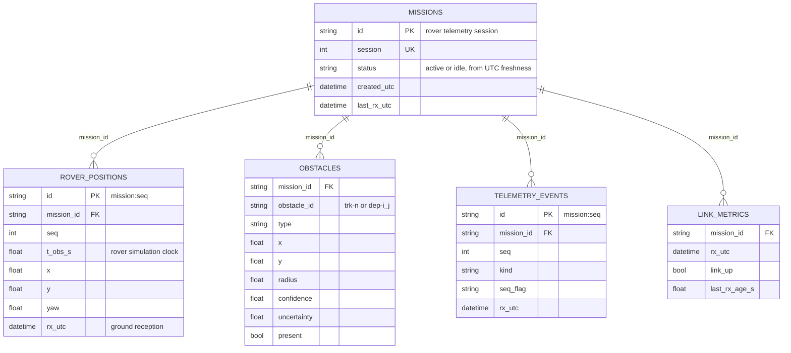

> [!NOTE]
> Only telemetry that **actually crossed the emulated lunar link** and passed CRC and strict decoding enters the normal
> ingestion pipeline. No collection is ever populated from Webots ground truth or from simulated values.

---

## 15. REST API and WebSocket

Interactive OpenAPI documentation is served at `http://127.0.0.1:8000/docs` while the ground station runs.

### 15.1 REST endpoints

| Method | Path | Content |
|---|---|---|
| GET | `/health` (also `/api/v1/health`) | `ok` or `degraded`, MongoDB up/down, receiver counters, ingestion stats (queue, drops, DB errors, retries), WebSocket clients |
| GET | `/api/v1/missions?status=&limit=&offset=` | Missions, newest first, with `status` computed from UTC freshness |
| GET | `/api/v1/missions/{id}` | One mission |
| GET | `/api/v1/missions/{id}/overview` | Mission, latest pose, obstacle counts by type and source, latest link metric, health, freshness |
| GET | `/api/v1/missions/{id}/positions?since_t_obs_s=&order=&limit=&offset=` | Received poses |
| GET | `/api/v1/missions/{id}/obstacles?present=&source=&type=&limit=&offset=` | Reconciled obstacles: present only by default; `present=false` lists removed obstacles with their reason |
| GET | `/api/v1/missions/{id}/telemetry?packet_type=` | Packet log (validated packets, each stored once) |
| GET | `/api/v1/missions/{id}/events?kind=health\|map_reset` | Health transitions and map resets |
| GET | `/api/v1/missions/{id}/link` | Link-metrics history |
| GET | `/api/v1/missions/{id}/stats` | Counters, document counts, present obstacles, latest receiver, emulator and ingestion stats |
| GET | `/api/v1/network/status` | The emulator's live status, read through its control port. **Local clients only.** |
| POST | `/api/v1/network/preset` | Body `{"preset": "NORMAL" \| "DEGRADED" \| "SEVERE" \| "BLACKOUT" \| "RESTORE"}`. Applies the preset **on the real emulator** and fails unless the emulator confirms it. **Local clients only.** |

Network control requires a `127.0.0.1` or `::1` client; uvicorn binds to `127.0.0.1`. It can be disabled with
`ARTEMIS_GROUND_NETWORK_CONTROL_ENABLED=false`.

### 15.2 Response envelopes

This is the shape of every successful response, as produced by `api/common.py`. The placeholders are types, not
measured values.

```json
{
  "data": "<endpoint payload: object or array>",
  "meta": {
    "api_version": "v1",
    "request_id": "<X-Request-ID of this request>",
    "generated_utc": "<ISO-8601 UTC timestamp ending in Z>",
    "pagination": { "limit": "<int>", "offset": "<int>", "total": "<int>", "next_offset": "<int or null>" }
  }
}
```

`pagination` is `null` on non-paginated endpoints. Errors use `{"error": {"code", "message", "details"}, "meta": {…}}`
with codes such as:

| Code | HTTP status |
|---|---|
| `mission_not_found` | 404 |
| `validation_error` | 422 |
| `local_only` / `network_control_disabled` | 403 |
| `emulator_unavailable` | 503 |
| `emulator_rejected` | 400 |

### 15.3 WebSocket: `ws://127.0.0.1:8000/ws/v1/missions/{id}`

Use `*` as the mission ID to subscribe to all missions. Every message shares one envelope:
`{"type", "api_version": "v1", "mission_id", "t_obs_s" (simulation seconds or null), "rx_utc" (UTC ISO "Z"), "data"}`.

| Event | When |
|---|---|
| `mission.snapshot` | **First message after every (re)connect:** latest pose, present obstacles and the mission document, read from MongoDB (`source: "unavailable"` if the database is down) |
| `rover.position` | Each received pose |
| `obstacle.detected` / `obstacle.updated` / `obstacle.removed` | Reconciled changes. `updated` is sent only when content changed; `removed` carries `reason` (`full_snapshot` or `map_reset`). |
| `map.reset` | A rover map reset was received |
| `health.changed` | Rover health state or reasons changed |
| `telemetry.received` | Every valid packet (seq, type, `seq_flag`) |
| `link.status`, `mission.stats` | Every 2 s, produced by the ground (they never refresh freshness) |

**Reconnection, isolation and incremental updates:**
- **Server side.**
  - Each client has a bounded queue of 512 events. A slow client loses its oldest events, which are counted. It never
    blocks ingestion or other clients.
  - The snapshot on every reconnect lets a client resynchronize without replaying history.
- **Client side (Mission Control).**
  - Reconnects use exponential backoff: 0.5, 1, 2, 4, 8, then 10 s. The browser's `online` event triggers an immediate
    retry.
  - After a reconnect, the snapshot resyncs obstacles, and a REST backfill (`since_t_obs_s`) adds poses persisted
    meanwhile, including late store-and-forward deliveries.
  - Events whose `mission_id` differs from the selected mission are dropped.
  - Incoming events are applied in 200 ms batches, so a telemetry burst costs one render.

### 15.4 Example calls (PowerShell)

```powershell
(Invoke-RestMethod 'http://127.0.0.1:8000/api/v1/health').data
(Invoke-RestMethod 'http://127.0.0.1:8000/api/v1/missions?limit=5').data
Invoke-RestMethod -Method Post -Uri 'http://127.0.0.1:8000/api/v1/network/preset' `
  -ContentType 'application/json' -Body '{"preset": "BLACKOUT"}'
```

---

## 16. Mission Control Dashboard

`frontend/apps/web` is built with Next.js 16 App Router, React 19, TypeScript, Tailwind CSS 4, shadcn/ui (Base UI),
Lucide icons, Recharts and TanStack Table.

> [!IMPORTANT]
> **Rule: the dashboard never shows a value it did not receive.** It uses no simulated telemetry, interpolated positions
> or Webots ground truth. Before data arrives, each panel shows an explicit empty, loading or error state. Decorative
> artwork, such as the sidebar terrain, header moon and rover illustration, is labelled as platform content, not
> telemetry.

### 16.1 Two display modes over one live session

| Mode | Selected by | What the operator gets |
|---|---|---|
| **Clean workspace** (default) | Settings › *Unified Mission Control* off | Focused pages: Overview, Rover, Mapping, Detection, Telemetry, Communication, Missions, Logs, Settings |
| **Unified Mission Control** | Settings › *Unified Mission Control* on | The R6 all-in-one command centre on `/`: map, overview, analytics, telemetry, network, history, log and rover panels together |

The preference is stored in `localStorage` (`artemis.workspace`) and read with `useSyncExternalStore`, so there is no
hydration mismatch. A single `MissionProvider` in the root layout owns **one WebSocket for the whole console**, so
changing pages or modes never opens a second socket. A pinned mission (`?mission=<id>`) and "follow newest" survive
navigation and mode changes.

| Page | Content (all from REST and WebSocket) |
|---|---|
| **Overview** | Signal rail linking the rover observation clock and the ground UTC clock, with the reception age (pulse when LIVE, hatched when STALE, broken when DISCONNECTED). KPIs, trajectory preview, rover facts, recent activity, mission record. |
| **Live map** (`/map`) | Interactive odometry-frame map (zoom, pan, Fit, Follow), legend, STALE / DISCONNECTED banner keeping the last picture, selected-obstacle evidence, nearest obstacles |
| **Detection** | Searchable, filterable, sortable obstacle catalog. Per-obstacle evidence sheet: geometry relative to the last received pose, provenance, both clocks, related events. It states plainly that no video is downlinked. |
| **Telemetry** | Position, heading, uncertainty, data age. Position over observation time (gaps not bridged). Packet counters, reception rate, latest stored packets. |
| **Communication** (`/network`) | Five preset controls, confirmed only by a fresh `GET /network/status`. Loss, delay, throughput and blackout readouts, charts, evidence ledger. Controls are disabled on controller errors. |
| **Missions** | Archive KPIs, session comparison, data table with dossier sheets. "Use this mission", follow-newest and refresh. |
| **Logs** | Retained-event KPIs, severity activity chart, filters, paginated table and timeline, event inspection with both clocks |
| **Rover**, **Settings** | Received health and odometry; display mode, motion effects, mission selection, ground endpoints and health |

### 16.2 Real-time behaviour

1. **REST initial load**, in parallel: the mission, the latest 5,000 poses (paginated), every present obstacle, 120 link
   samples and 100 stored events.
2. **WebSocket stream:** a `mission.snapshot`, then live events applied every **200 ms** in one state update.
3. **Reconnection:** backoff from 0.5 s to 10 s, a snapshot resync and a REST pose backfill. Poses are unique by
   `t_obs_s`, and late poses are inserted in observation order.
4. **No mixing:** events from other missions are dropped. A mission switch closes the socket and starts from an empty
   state.
5. **Network control:** a preset is reported as applied only after the emulator's status confirms it. Status is polled
   every 2 s while the tab is visible.

### 16.3 Freshness states

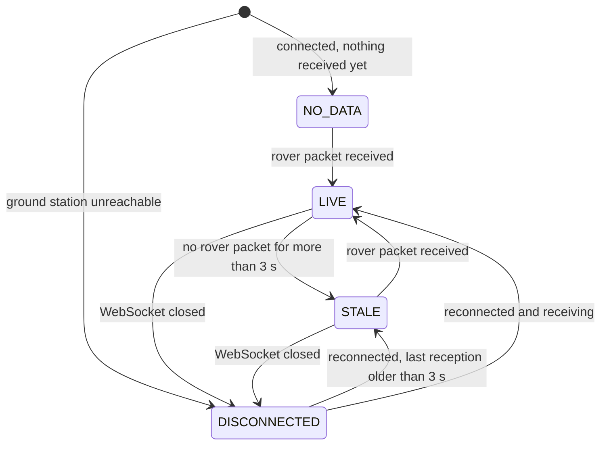

- **STALE** means the radio data stopped while the ground connection is still open: a blackout, link loss or stopped
  rover. The last map is kept and greyed, with its age.
- **DISCONNECTED** means the API or WebSocket transport itself stopped.
- `link.status` samples are produced by the ground, so they never refresh freshness. Only rover-packet receptions do.

### 16.4 Map semantics: confidence, uncertainty and provenance

- **Received path.** Only received poses are drawn, in observation order. A gap of more than 3 s in `t_obs_s` breaks the
  line, so no position is invented across a blackout.
- **Obstacles:**
  - Fill opacity follows confidence.
  - A dashed ring shows `radius + uncertainty`.
  - The stroke shows tracking status: confirmed is solid, observed is dashed, lost is faint.
  - Badges distinguish a rock (green triangle), a negative hazard (red) and a depth-only obstacle (amber diamond).
- **Removal.** An obstacle disappears only on `obstacle.removed`, on `map.reset`, or on a snapshot resync.
- **Axes** show odometry `+x` / `+y`. Rover odometry has no absolute north.

### 16.5 Gallery

These screenshots come from the R6 full-stack validation run, with the Unified Mission Control layout, real Webots
telemetry, the real emulator and MongoDB. Clean-workspace captures from later end-to-end runs are kept with their run
evidence and are not committed.

| | |
|---|---|
| 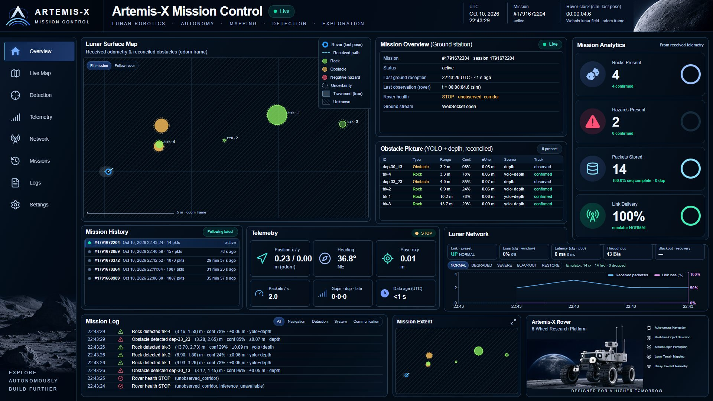 | 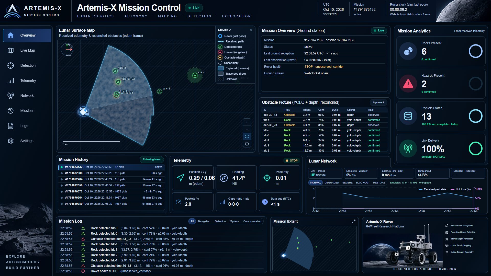 |
| **Live mission** followed automatically, LIVE 8.6 s after Webots start | **Detections flow to the ground**: dashboard IDs equal `GET /obstacles` IDs (8/8) |
| 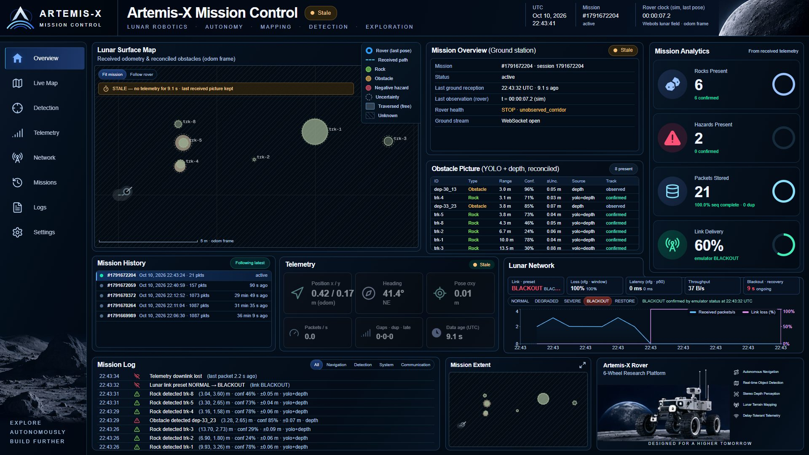 |  |
| **BLACKOUT**: STALE, "no telemetry for 10.0 s", pose count frozen 18 → 18 | **RESTORE**: LIVE again, poses 18 → 35 = REST, path not bridged across the gap |
| 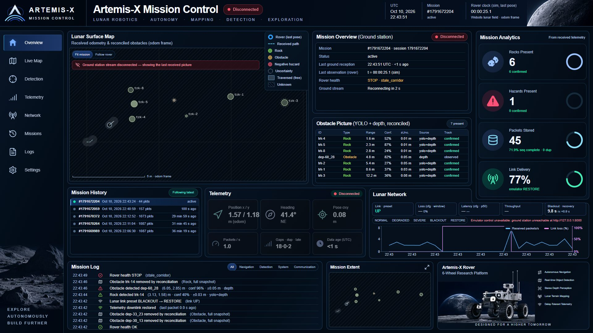 | 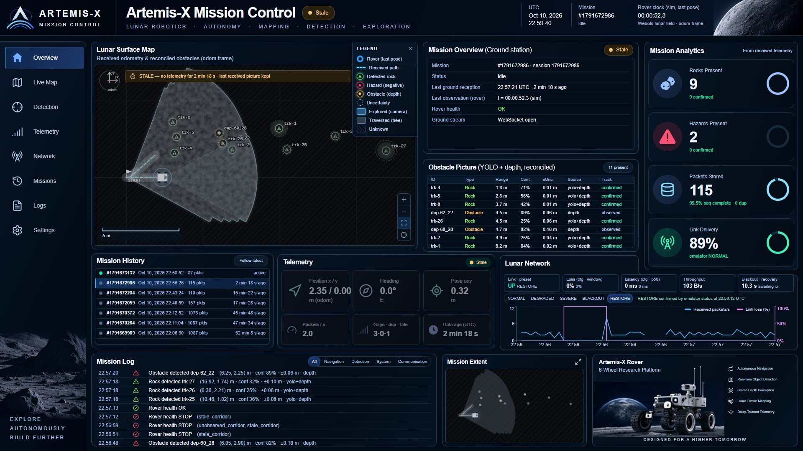 |
| **Ground station killed**: DISCONNECTED, last picture kept, reconnecting | **Mission isolation**: an archived mission stays unchanged while the live one flows |

---

## 17. Network Scenarios and Demonstration

### 17.1 The five scenarios

| Scenario | Configuration | Rover behaviour | Techniques engaged | Mission Control shows | What it demonstrates | Measured (source) |
|---|---|---|---|---|---|---|
| **NORMAL** | 0 % loss, 0 ms, unlimited | Perceives, maps, sends | Change-only snapshots, dedup, 10 s full refresh | LIVE, data age < 1 s, rising packet counters | Nominal end-to-end chain | 1,307 / 1,307 delivered; send → receive p50 ≤ 1 ms (R5.3) |
| **DEGRADED** | 30 % loss, 200 ± 50 ms | Unchanged | Selective ACK, retransmission, RTO adaptation | LIVE with visible loss and sequence gaps in the link panel and charts | Useful picture despite heavy loss | 934 / 1,307 delivered without DTN (28.5 % observed loss). With DTN: 107/111 critical, 118/119 hazards (R5.4). |
| **SEVERE** | 50 % loss, 1,300 ± 300 ms, 1,000 B/s | Unchanged | Karn back-off, priority drain, superseding by full snapshots | Higher loss and latency, slower updates | Graceful degradation near the Earth–Moon light time | p50 1,363 ms (R5.3). Stress with DTN: 82/110 critical, 110/120 hazards; **not all delivered** (R5.4). |
| **BLACKOUT** | 100 % loss, queue and in-flight packets discarded | **Keeps perceiving and mapping onboard** | Link DOWN detection, store CRITICAL/NORMAL, coalesce poses, 1 probe/s | **STALE** banner, growing UTC age, last picture greyed, pose count frozen | Ground never pretends to know more than it received | 0 / 264 forwarded in a 12 s blackout (R5.3) |
| **RESTORE** | Back to NORMAL | Drains backlog | First ACK → link UP, priority drain, observation-time reconciliation | LIVE again; stored observations appear with their original observation times; the path is not bridged | Delivery of observations made during the outage | Critical generated in blackout delivered 19/19 · 36/36 · 39/40; recovery p50 0.07–0.33 s (R5.4) |

### 17.2 The demonstration narrative

1. **Rover detects a rock.** In Webots, the AI DETECTION panel draws a YOLO box with confidence and range.
2. **Spatial coordinates.** Depth and the capture-time odometry pose turn the box into a confirmed `trk-<n>` track in
   `odom`, with radius and 1-σ uncertainty. It appears on the onboard LOCAL MAP.
3. **Binary telemetry.** The new hazard leaves as a CRITICAL 26-byte record in an OBSTACLES packet.
4. **Ground reception.** The packet passes CRC and decoding, is ACKed, reconciled, written to MongoDB and pushed over
   WebSocket.
5. **Mission Control.** The rock appears on `/map` and in `/detection`, with provenance `yolo+depth`, confidence,
   uncertainty, observation time and reception time.
6. **Blackout.** The operator applies BLACKOUT from `/network`, and the emulator confirms it. Reception stops, the map
   turns **STALE** and its age grows. Onboard, perception and mapping continue.
7. **Store-and-forward.** The rover detects the link as DOWN, retains critical and normal messages, coalesces poses
   and probes once per second.
8. **Restore.** The operator applies RESTORE. The first ACK brings the link UP and the backlog drains by priority.
9. **Map refresh.** Observations made during the blackout arrive with their original observation times and are
   reconciled. The dashboard returns to **LIVE**. The path shows the gap rather than invented positions.

The automated jury demonstration (`.\scripts\jury.ps1 -Step demo`) performs this sequence with the real stack. It
then adds an API shutdown (**DISCONNECTED**), a reconnect with resynchronization, historical-mission isolation,
dedicated-page and display-mode checks, and the full **55/55** Webots course. See
[docs/JURY_QUICKSTART.md](docs/JURY_QUICKSTART.md).

---

## 18. Measured Results and Benchmarks

Every figure below comes from a named report, artifact or run, under the stated conditions. Results from different
runs are **not** merged into a single benchmark. All simulator runs were on one Windows 11 laptop with an RTX 5060
Laptop GPU, with Webots in fast mode unless stated. Ground truth is used **only** by offline evaluators.

### 18.1 Perception: frozen YOLO11n on the held-out synthetic test split

Source: `artifacts/evaluation/test_results.json`, [docs/RESULTS.md](docs/RESULTS.md). 917 images, 25,987 VALID boxes,
evaluated once, primary ignore-aware policy, confidence 0.20.

| Precision | Recall | F1 | FP / image | AP50 | AP50-95 | Large-rock recall |
|---|---|---|---|---|---|---|
| 0.698 | 0.774 | 0.734 | 9.48 | **0.777** | 0.428 | 0.788 |

### 18.2 Perception: domain gap on Webots scenes (exploratory, frozen model)

Source: [docs/WEBOTS_R3_YOLO_REPORT.md](docs/WEBOTS_R3_YOLO_REPORT.md). Matching at IoU ≥ 0.5. AP is computed from the
frozen operating outputs only and is **not comparable** to the dataset AP50.

| Scene set | References | Precision | Recall |
|---|---|---|---|
| 40 paired captures, baseline spheres | 110 | 1.00 | 0.72 |
| 40 paired captures, procedural irregular rocks | 110 | 0.80 | 0.65 |
| 40 paired captures, Poly Haven rock scans | 117 | 0.71 | 0.60 |
| Test course v2, 11 hard viewpoints, low sun | 93 | 0.63 | **0.31** |
| Test course v2, 11 hard viewpoints, high sun | 93 | 0.72 | **0.33** |

The course deliberately stresses pebbles, clusters, shadows and near-field boulders. In those viewpoints, 41 of 93
references are smaller than 400 px, and only 2–4 of them are found. Large rocks (≥ 2,500 px) are found 18/26 under
both suns. These are failure-mode probes, not accuracy estimates.

### 18.3 Localization and mapping

| Measure | Result | Source / run |
|---|---|---|
| Mapping rate | **3.906 Hz** (2,001 cycles, 0 without pose or depth) | R4.2, `r4-map-20261010-083443` |
| Mapping cycle p95 | 10.8–14.9 ms nominal; 15.2–16.0 ms in 3 of 16 runs under machine load (rerun alone: 11.1–11.6 ms) | R4.6, `r4-validate-20261010-204718` |
| Free-cell / occupied-cell precision | 0.9968 / 0.925 | R4.2 |
| Track centre error, median / p95 | 0.034 m / 0.162 m, 0 % duplicates | R4.6 |
| Fault detection latency | Depth degraded 0.12 s · frozen 0.00 s · invalid 0.064 s · overrun 0.24 s · YOLO unavailable 0.42–0.43 s | R4.6 |
| Webots memory over 16 tours | Stable (first third mean 1.24 GB, last third 1.30 GB) | R4.6 |

**R4.6 verdict: 12 of 15 criteria pass.** The three failures are listed, not dropped:
- the cycle-time target was exceeded under load;
- 33 of 34 obstacles ≥ 10 cm were mapped (an occluded white ball was missed);
- 4 of 35 exported tracks are not on a true object (3 on a crater rim, 1 on terrain).

### 18.4 Telemetry size and transport

| Measure | Result | Source |
|---|---|---|
| Binary vs equivalent JSON, 426 real obstacles | 11,622 B vs 85,721 B (**−86.4 %**) | R5.1 benchmark |
| Mission telemetry volume | 1,307 packets, 112,371 B over 512 simulated seconds (**219 B per simulated second**) | R5.2, `r5-telemetry-20261010-214035` |
| Localhost UDP, no emulator | 1,307 / 1,307 received, 0 invalid, 0 gaps; 95.8 % ≤ 1 ms | R5.2 |
| Decoded pose vs controller odometry | max 0.5 mm (the 1 mm quantization) | R5.2–R5.5 |
| Mapping cost of telemetry | Cycle p95 within run-to-run variation (11.6–12.2 ms vs 12.2 ms with telemetry off) | R5.2 |

### 18.5 Lunar link and store-and-forward

| Measure | Result | Source |
|---|---|---|
| Delivery NORMAL / DEGRADED / SEVERE, no DTN | 1,307 · 934 · 645 of 1,307 | R5.3, `r5-link-20261010-215512` |
| Configured → observed loss | 30 → 28.5 % · 50 → 50.6 % | R5.3 |
| Resumption after RESTORE, first forwarded datagram | 23 ms | R5.3 |
| Blackout events delivered, without vs with DTN | **0 / 7** vs 5/5 · 12/12 · 15/15 | R5.4, `r5-dtn-20261010-223409` |
| Critical packets generated in blackout → delivered | 19/19 · 36/36 · 39/40 | R5.4 |
| Under heavy two-way loss | 30 %: 107/111 critical · 50 %: 97/109 · SEVERE stress: **82/110** | R5.4 |
| DTN queue peak | 70 entries / 17.3 kB of the 192 KiB allowed | R5.4 |

### 18.6 Ground station and database

Source: [docs/TELEMETRY_R5_5_GROUND_BACKEND.md](docs/TELEMETRY_R5_5_GROUND_BACKEND.md), run
`r5-ground-20261010-231241`. Webots → DTN → emulator → backend → MongoDB + WebSocket. The presets were switched through
the REST API, and MongoDB was stopped for 10 s.

| Check | Result |
|---|---|
| Rover unique packets → forwarded → decoded → **persisted** | 1,111 → 1,073 → 1,073 → **1,073** (38 dropped during the blackout, never forwarded) |
| Persisted packets the emulator did not forward | **0** |
| 10 s MongoDB outage | 7 write errors, 4 retries, recovered, **0 packets lost**, queue never full |
| Obstacles in MongoDB vs the rover's final export | 41 / 41, 0.0 mm, 0 stale extras |
| WebSocket, one connection for the whole run | 3,658 events, all with complete envelopes |

### 18.7 Mission Control end to end

| Run | Result | Source |
|---|---|---|
| R6 full stack, headless Edge driving the dashboard's own controls | **12/12** checks, 0 browser console errors | [docs/DASHBOARD_R6_MISSION_CONTROL.md](docs/DASHBOARD_R6_MISSION_CONTROL.md) |
| Latest official jury test, 2026-10-11 (`.\scripts\jury.ps1 -Step test`) | **24/24** real-stack checks, including the clean/unified mode checks, blackout STALE, restore, disconnect/reconnect, mission isolation and the 55/55 course; 2,001 / 2,001 frames inferred, 0 failed | Run evidence in the git-ignored `.jury/runs/` (`r6_dashboard_e2e.json`) |

Recovery times are defined differently in different runs:
- The **emulator-level** resumption (23 ms) and the **DTN-level** recovery (p50 0.07–0.33 s) are measured from the
  RESTORE command to the first forwarded or received datagram.
- The R6 dashboard figure (first rover packet 8.8 s after RESTORE) is measured on the **browser clock**, from the
  confirmed RESTORE to the next rover packet shown.

These figures are not interchangeable.

### 18.8 Mission completion

Every documented Webots tour completed the scripted course: 55 of 55 moves. This held across R4 (12/12 tours, 16/16 in
the R4.6 batch), R5.2–R5.5 (all tours) and the latest jury run. In the kinematic simulator, stop accuracy against
ground truth was within 3.0 mm and 0.21°. The true-path clearance to any object stayed at 0.601 m or more.

---

## 19. Repository Structure

```text
ATEC/
├── artemis-webots/              Webots project
│   ├── worlds/                  artemis_moon, artemis_moon_enhanced, artemis_test_course (+ _highsun),
│   │                            artemis_r4_monitor (course + four onboard panels)
│   ├── controllers/artemis_rover/   thin entry point → artemis_x.sim.rover.main()
│   ├── tools/                   make_world.py (world generator), fetch_polyhaven.py (locked CC0 asset fetch)
│   └── assets/                  ASSETS.json manifest; binary scans are fetched, not committed
├── src/artemis_x/               shared Python package
│   ├── sim/                     rover runtime: drive, sensors, perception, projection, inference client/protocol, monitor
│   │   └── mapping/             pose, depth scan, log-odds grid, cost layer, health, fusion, tracker, contract, snapshot
│   ├── telemetry/               protocol v1, adapter, UDP transport, lunar-link emulator, DTN queue, ground map
│   ├── ml/                      frozen model registry, RockDetector inference, guarded training reproduction
│   ├── evaluation/              ignore-aware evaluation, offline map evaluation (ground truth offline only)
│   └── config/, datasets/, reporting/   central paths, dataset contracts, plots and reports
├── ground_station/              FastAPI ground station (independent uv project and lock)
│   ├── artemis_ground/          main, config, ingest, db, hub, network, schemas, logging, api/{v1, ws, common}
│   └── tests/                   real-MongoDB and real-UDP integration tests
├── frontend/                    pnpm + Turborepo workspace
│   ├── apps/web/                Mission Control: app/ routes, components/{mission, workspace, ui}, lib/ground/
│   ├── apps/docs/               Turborepo starter app, retained (not the dashboard)
│   └── packages/                shared ui, eslint-config, typescript-config
├── backend/                     research pipeline, Tasks A–F (analysis/, training/, tests/), locked ML environment
├── models/                      frozen detector artemis_rock_yolo11n.pt + model card
├── artifacts/                   hash-verified evidence: evaluation, figures, provenance, reports, training, data
├── data/                        split manifests and dataset-release record (metadata only, no pixels)
├── notebooks/                   01–08 analysis and inference demo; 09 guarded, opt-in training reproduction
├── docker/                      compose.yml (MongoDB 8.0.4, localhost only) + .env.example
├── scripts/                     jury.ps1 / jury.py (official workflows), demo_atec.ps1 (one service per terminal),
│                                runtime services (inference_server, lunar_link, ground_receiver), R1–R6 runners and
│                                analyses, verify_artifacts and audit tools
├── tests/                       runtime test suite (unittest) + hash-pinned notebook-test requirements
├── docs/                        R1–R6.1 reports, contracts, quickstart, runbook, screenshots/, figures/, audits/
├── demo/                        optional Remotion/FFmpeg video project (generated media git-ignored)
├── future/                      historical pre-implementation Webots plan
├── CITATION.cff                 citation metadata
└── MIGRATION_REPORT.md          record of the 2026-10-09 research-workspace → repository migration
```

The following are git-ignored and local-only: `dataset/` (source and processed data), `experiments/` (full training
runs and checkpoints), `weights/`, `artemis-webots/output/` (run evidence), `.jury/` (official-workflow evidence and
process ownership), `demo/output/` (rendered video), `node_modules/`, `.venv/` and every `.env` file.

---

## 20. Installation and Prerequisites

### 20.1 Requirements

| Requirement | Version / note | Where it is defined |
|---|---|---|
| Operating system | **Windows 11** (validated). The orchestration scripts are PowerShell; Linux is not validated. | `scripts/*.ps1` |
| Python | **3.12** (`>=3.12,<3.13`) | `backend/pyproject.toml`, `ground_station/pyproject.toml` |
| uv | Recent release; creates both locked environments | `backend/uv.lock`, `ground_station/uv.lock` |
| Node.js / pnpm | Node **≥ 24**, pnpm **11.25.0** | `frontend/package.json` (`engines`, `packageManager`) |
| Docker Desktop | With Compose v2 (WSL 2 backend), running before MongoDB starts | `docker/compose.yml` |
| Webots | **R2025a**, default `C:\Program Files\Webots` or `WEBOTS_HOME` | World files, launch scripts |
| Microsoft Edge | Needed only for the automated browser E2E (`ARTEMIS_EDGE_EXE` for non-standard paths) | `scripts/r6_dashboard_e2e.py` |
| GPU | A CUDA-capable NVIDIA GPU is **recommended**. Validated on an RTX 5060 Laptop GPU. The ML lock installs PyTorch 2.14.1 **CUDA 13.0** wheels, a multi-GB download. | `backend/pyproject.toml` |
| Network access | Needed for package registries, the CC0 scene assets and Webots' remote PROTO and texture resources (cached after the first opening) | — |

**Without compatible hardware:**
- Inference can run on CPU (`.\scripts\demo_atec.ps1 -Step inference -Device cpu`), but real-time course performance
  is not guaranteed. CPU latencies must not be presented as GPU results.
- The research notebooks 01–08 render on GitHub without any installation.
- No training dataset is needed for the runtime demonstration.

### 20.2 Install

```powershell
git clone https://github.com/mehdi-lakhzouri/ATEC.git
cd ATEC
uv sync --project backend --locked                       # ML runtime (PyTorch CUDA 13.0, Ultralytics) - multi-GB
uv sync --project ground_station --locked --group dev    # FastAPI ground station + test tools
Push-Location frontend
pnpm install --frozen-lockfile                           # Mission Control workspace
Pop-Location
uv run --project backend --no-sync python artemis-webots/tools/fetch_polyhaven.py --locked   # CC0 scans, SHA-256 verified
uv run --project backend --no-sync python scripts/verify_artifacts.py                        # frozen model + evidence hashes
```

`fetch_polyhaven.py --locked` downloads the committed URLs, verifies each file's SHA-256 and converts the meshes. A
checksum mismatch is a failure; it never silently rewrites `ASSETS.json`.

### 20.3 Configuration and environment variables

On a **new** checkout, copy the templates. Never overwrite an existing configuration, and never commit these files.

```powershell
Copy-Item -LiteralPath docker/.env.example -Destination docker/.env
Copy-Item -LiteralPath ground_station/.env.example -Destination ground_station/.env
Copy-Item -LiteralPath frontend/apps/web/.env.example -Destination frontend/apps/web/.env.local
```

Replace the example password in `docker/.env` and the matching credentials in `ARTEMIS_GROUND_MONGO_URI` with the
**same** private secret. Percent-encode it in the URI if needed. An existing MongoDB volume keeps the credentials it was
initialized with.

| File / scope | Variables |
|---|---|
| `docker/.env` | `MONGO_ROOT_USERNAME`, `MONGO_ROOT_PASSWORD`, `MONGO_DB` (default `artemis_mission`), `MONGO_PORT` (default 27017) |
| `ground_station/.env` | `ARTEMIS_GROUND_MONGO_URI`, `ARTEMIS_GROUND_MONGO_DB`, `ARTEMIS_GROUND_UDP_HOST` / `_UDP_PORT` (5790), `ARTEMIS_GROUND_ACK_TO` (127.0.0.1:5794), `ARTEMIS_GROUND_EMULATOR_CONTROL` (127.0.0.1:5792), `ARTEMIS_GROUND_NETWORK_CONTROL_ENABLED`, `ARTEMIS_GROUND_CORS_ORIGINS`, `ARTEMIS_GROUND_LOG_LEVEL`, `ARTEMIS_GROUND_LOG_JSON` |
| `frontend/apps/web/.env.local` | `NEXT_PUBLIC_GROUND_API` (default `http://127.0.0.1:8000`), `NEXT_PUBLIC_GROUND_WS` (default `ws://127.0.0.1:8000`). These are inlined at build time, so rebuild after changing them. |
| Rover controller (set by the launch scripts) | `ARTEMIS_TELEMETRY=1`, `ARTEMIS_TELEMETRY_PORT=5791`, `ARTEMIS_TELEMETRY_DTN=1`, `ARTEMIS_TELEMETRY_ACK_PORT=5793`, `ARTEMIS_INFER_PORT=5761`, `ARTEMIS_MAPPING`, `ARTEMIS_MONITOR`; optional `ARTEMIS_DTN_MAX_ENTRIES` / `_MAX_BYTES` |
| Machine paths | `WEBOTS_HOME` (Webots installation), `ARTEMIS_EDGE_EXE` (Edge executable) |

**Model artifacts.** The frozen detector is tracked in Git and verified by hash. Nothing has to be downloaded or
trained. `verify_artifacts.py` is read-only by default. Do **not** pass `--baseline` during verification, because it
replaces the protected comparison baseline.

---

## 21. Quick Start

### Option A — official automated workflow (recommended)

```powershell
.\scripts\jury.ps1 -Step preflight                 # read-only PASS / WARN / FAIL report
docker compose -f docker/compose.yml up -d mongodb
docker compose -f docker/compose.yml ps mongodb    # wait for "healthy"
.\scripts\jury.ps1 -Step start                     # MongoDB, ground, emulator (with reverse ACK), inference, dashboard, Webots
.\scripts\jury.ps1 -Step status
```

`start` returns success only after the following are confirmed:
- MongoDB, the ground station and the emulator are ready, with authentication working;
- **real rover packets** have been received.

Then open **http://127.0.0.1:3000**. API health is at `http://127.0.0.1:8000/api/v1/health`, and OpenAPI at
`http://127.0.0.1:8000/docs`. If the Artemis dashboard is already running on port 3000, pass `-ReuseDashboard`
explicitly.

To run the complete scripted jury scenario **with the interactive stack stopped**:

```powershell
.\scripts\jury.ps1 -Step stop
.\scripts\jury.ps1 -Step demo        # fresh artemis_jury_* database, real Webots, real presets, 55/55 course
```

### Option B — one service per terminal (live presentation)

`scripts/demo_atec.ps1` launches each service in the foreground. It refuses occupied ports and never kills a process or
overwrites a previous take. Run every terminal from the repository root and use the **same** `-RunName` for `link` and
`webots`.

```powershell
.\scripts\demo_atec.ps1 -Step check                          # read-only preflight
.\scripts\demo_atec.ps1 -Step database                       # 1. MongoDB  -> wait for "healthy"
.\scripts\demo_atec.ps1 -Step ground                         # 2. FastAPI + UDP receiver on 5790, ACKs to 5794
.\scripts\demo_atec.ps1 -Step link -RunName take-01          # 3. lunar link emulator, reverse ACK path, preset NORMAL
.\scripts\demo_atec.ps1 -Step inference                      # 4. frozen YOLO11n on 127.0.0.1:5761 (add -Device cpu without GPU)
.\scripts\demo_atec.ps1 -Step dashboard                      # 5. Next.js on 127.0.0.1:3000 (skip if already running)
.\scripts\demo_atec.ps1 -Step webots -RunName take-01        # 6. artemis_r4_monitor.wbt, opens paused: choose Real-time
.\scripts\demo_atec.ps1 -Step status
```

<details>
<summary>Equivalent raw commands, without the helper scripts</summary>

```powershell
# 1. MongoDB
docker compose -f docker/compose.yml up -d mongodb
# 2. Ground station (receiver on UDP 5790, ACKs to the emulator, REST/WS on :8000; config in ground_station/.env)
uv run --project ground_station uvicorn artemis_ground.main:app --app-dir ground_station --host 127.0.0.1 --port 8000
# 3. Lunar link emulator with the reverse (ACK) path
uv run --project backend --no-sync python scripts/lunar_link.py serve --reverse --preset NORMAL --log artemis-webots/output/link/link.jsonl
# 4. Frozen YOLO11n inference server
uv run --project backend --no-sync python scripts/inference_server.py --port 5761
# 5. Webots with store-and-forward telemetry routed through the emulator
$env:ARTEMIS_TELEMETRY = "1"; $env:ARTEMIS_TELEMETRY_PORT = "5791"; $env:ARTEMIS_TELEMETRY_DTN = "1"
& "$env:WEBOTS_HOME\msys64\mingw64\bin\webots.exe" --mode=realtime artemis-webots\worlds\artemis_r4_monitor.wbt
# 6. Mission Control
Push-Location frontend; pnpm --filter web dev; Pop-Location
```

`artemis_r4_monitor.wbt` is the test course with the four onboard panels (RGB CAMERA, AI DETECTION, DEPTH SENSOR,
LOCAL MAP). If `WEBOTS_HOME` is not set, use `C:\Program Files\Webots`.

</details>

### Run the scenario: NORMAL → BLACKOUT → RESTORE

1. Open `http://127.0.0.1:3000`. Wait for a new mission, an advancing rover clock and a **LIVE** header.
2. Go to **Communication** (`/network`, or the Lunar Network panel in unified mode). Apply **DEGRADED** or **SEVERE**,
   and wait for the emulator confirmation.
3. Apply **BLACKOUT**. The map turns **STALE**, the pose count freezes and the UTC age grows. Webots keeps perceiving.
4. Apply **RESTORE**. The link comes back UP, stored observations are delivered and reconciled, and the header returns
   to **LIVE**.

The same presets can be applied with `POST /api/v1/network/preset` (see [15.4](#154-example-calls-powershell)) or with
`uv run --project backend --no-sync python scripts/lunar_link.py ctl BLACKOUT`.

### Shut down

```powershell
.\scripts\jury.ps1 -Step stop      # Option A: stops only processes this workflow started; MongoDB data survives
```

For Option B, press `Ctrl+C` in each service terminal and close Webots. Let the tour finish first if you need its final
`summary.json`. Then stop the database while keeping its data:

```powershell
docker compose -f docker/compose.yml stop mongodb
```

Never use `docker compose down -v`, because it deletes the mission database volume. Avoid mass process kills such as
`taskkill /IM python.exe`.

---

## 22. Automated Testing

### 22.1 Suites

| Suite | Location | Tests | Requires | Command |
|---|---|---|---|---|
| **Runtime**: binary protocol, UDP transport, emulator, DTN, mapping (frames, depth, grid, safety, fusion, contract), simulator logic, R3 inference link and real server parity, monitor, model loading, artifact integrity, dataset contracts, release workflows | `tests/` | 209 | Offline. Loads the tracked model. One live Webots smoke test runs only with `ARTEMIS_RUN_WEBOTS=1`. | `uv run --project backend --no-sync --with-requirements tests/requirements.txt python scripts/jury_unittest.py --suite runtime --out .jury/runtime.json` |
| **Research pipeline**: Tasks A–F regressions, training guards | `backend/tests/` | 52 | Offline | `uv run --project backend --no-sync --with-requirements tests/requirements.txt python scripts/jury_unittest.py --suite research --out .jury/research.json` |
| **Ground station**: indexes, REST, duplicates, out-of-order, full snapshots, map reset, mission isolation, invalid datagrams, WebSocket events, network control, no-database behaviour | `ground_station/tests/` | 9 | **MongoDB** (skips are reported, and `--require-integrations` makes them fail) | `.\ground_station\.venv\Scripts\python.exe scripts/jury_unittest.py --suite ground --require-integrations --out .jury/ground.json` |
| **Frontend unit**: state hydration, event application, dedup, isolation, freshness, trajectory gaps, summaries | `frontend/apps/web/lib/ground/__tests__/` | 23 | Node | `Push-Location frontend; pnpm --filter web test; Pop-Location` |
| **Frontend quality**: lint, type check, production build of every workspace package | `frontend/` | 8 Turbo tasks | Node | `Push-Location frontend; pnpm exec turbo run lint check-types build --force; Pop-Location` |
| **Full-stack E2E**: Webots → link → ground → MongoDB → browser, driven through the dashboard's own controls, plus the 55/55 course | `scripts/r6_dashboard_e2e.py` | 24 checks | MongoDB, Webots, Edge, GPU recommended | `.\scripts\jury.ps1 -Step demo` |
| **Artifact integrity** | `scripts/verify_artifacts.py` | — | Offline | `uv run --project backend --no-sync python scripts/verify_artifacts.py` |

**Aggregated official runs.**
- `.\scripts\jury.ps1 -Step unit` runs every offline suite. It labels the MongoDB, Webots and browser integrations as
  **NOT RUN**, never as passed.
- `.\scripts\jury.ps1 -Step test` adds the live Webots smoke test, the real-MongoDB ground suite and the full-stack E2E
  with the 55/55 course. Missing integrations make it fail.

Each command writes its log, exit code and JSON report under `.jury/runs/`.

**Historical scenario runners.** These reproduce the milestone evidence and need Webots; ground truth is used offline
only.
- `scripts/run_webots_r4.py` subcommands: `measure`, `map`, `safety`, `fusion`, `monitor`, `validate`, `telemetry`,
  `link`, `dtn`, `ground` and their `analyse*` counterparts.
- `scripts/run_webots_r3.py`: `demo`, `robustness`, `eval`, `tour`.

### 22.2 Latest recorded outcome

This is the official `.\scripts\jury.ps1 -Step test` run of **2026-10-11** (02:12–02:24 UTC). The evidence is kept in
the git-ignored `.jury/runs/` folder.

| Suite | Result |
|---|---|
| Runtime | **207 passed / 208**, 0 failures, 0 errors, 1 skip (`test_parity_with_task_f_cached_predictions`: historical cached predictions not present locally) |
| Research | **52 / 52** |
| Ground (real MongoDB) | **9 / 9**, no skips |
| Frontend unit | **23 / 23** |
| Frontend lint / types / build | **8 / 8** Turbo tasks, uncached |
| Full-stack E2E | **24 / 24**, including Webots course 55/55 and 2,001 / 2,001 frames inferred |

A later offline re-run of the same suites on the final tree, after one more release-workflow test was added, gave:
- runtime: **207 passed / 209**, 0 failures. The 2 skips are the historical parity test and the live Webots smoke test,
  which is opt-in outside `-Step test`.
- research: **52 / 52**.
- frontend unit: **23 / 23**.

**How this differs from earlier milestone reports.** The counts grew as each milestone added tests: 37 (R1/R2),
63 (R3), 81–138 (R4), 200 (R6) and 209 now. In the R6 report, the notebook smoke test failed to import because
`nbformat` was missing. It now runs through the hash-pinned `tests/requirements.txt` overlay, without changing the
protected ML lock.

> [!WARNING]
> **Lint coverage gap.** The shared frontend ESLint flat configuration currently matches no `.ts` or `.tsx` files.
> ESLint reports them as "File ignored because no matching configuration was supplied". A passing `lint` task
> therefore does **not** cover the TypeScript sources. The type check (`tsc --noEmit`) and the production build do
> cover them.

---

## 23. Engineering Decisions and Trade-offs

| Decision | Why we chose it | Trade-off |
|---|---|---|
| **YOLO11n** rather than larger models | Real-time on a laptop GPU (12.5 ms server inference). 5.48 MB of weights, a plausible size for constrained onboard compute. | Lower capacity: about 21 % of large rocks missed on the test split. Larger variants were not trained. |
| **Local inference** rather than cloud APIs | No dependence on the link for perception. Works through blackouts. Required by the challenge. | Perception quality is bounded by what runs onboard. The model can only be updated by an explicit new release. |
| **Binary protocol** rather than JSON | 7.4 × smaller than equivalent JSON. Fixed-size, strictly validated records. Explicit quantization. | Not self-describing. Requires versioning discipline and dedicated decoders. JSON stays on the ground side. |
| **UDP** rather than TCP for telemetry | No head-of-line blocking or connection state across blackouts and 1.3 s delays. Losses are visible and countable. | Reliability must be built in the application layer. |
| **Selective ACK + priorities** rather than always-reliable transport | Retention and retry where it matters (hazards, health, resets). Stale poses are coalesced instead of replayed. | Not every packet is delivered. LOW poses are fire-and-forget by design. |
| **DTN-inspired queue** rather than a full DTN stack | Small, testable and bounded. Fits a standard-library controller and one hop. | No BPv7 interoperability, no custody transfer, no persistent storage. |
| **FastAPI** for ground ingestion | Async-native, typed, OpenAPI. The UDP receiver thread and the event loop coexist cleanly. | A single sequential writer bounds throughput (ample for about 20 packets/s, not tuned for fleets). |
| **MongoDB** for mission observations | Heterogeneous documents (poses, obstacle states, packets, link metrics). Unique indexes give idempotent writes. | Schema discipline lives in code and Pydantic models rather than the database. |
| **WebSocket** for real-time delivery | Push-based, one connection per console, snapshot-on-connect for resync | Bounded per-client queues drop the oldest events for slow clients (counted). Needs reconnection logic. |
| **Software-only lunar link** | Seeded, repeatable impairments and live switching on real sockets. Every scenario can be rerun. | Independent (Bernoulli) loss, uniform jitter, no burst or Gilbert–Elliott model, no real radio. |
| **Kinematic rover + ideal depth** | Deterministic, byte-identical runs. Exact ground truth for offline evaluation. | No wheel slip, sensor noise or collisions, so results do not transfer to hardware as-is. |
| **Advisory safety layer** | Keeps the validated scripted course reproducible while the safety logic is measured | The rover does not stop or replan on STOP. Navigation remains future work. |

---

## 24. Known Limitations

**Navigation and platform**
- The rover follows a **scripted 55-move course**. There is no path planning, obstacle avoidance or perception-driven
  motor control. The health monitor's STOP is advisory.
- The simulator is **kinematic**: no physics contact, wheel slip or terrain following. The ground has no collision
  geometry.
- Everything runs on **one Windows machine**. Timing figures come from Webots fast mode and vary about ±15 % with
  machine load.

**Perception**
- The detector was trained on a **synthetic dataset with automated, non-human-verified labels**, with one seed and one
  configuration.
- About 21 % of large rocks are missed on the test split. Recall drops to 0.31–0.33 on the hard Webots course viewpoints.
- Known failure modes are pebbles, dark or shadowed scenes, near-field boulders under low sun, and engineered objects
  labelled "rock".

**Localization and mapping**
- **Odometry is the only localization source.** Its uncertainty grows without bound, and coordinates are relative to the
  start pose.
- Simulator depth is ideal; real sensor noise is not modelled.
- Rocks under 5 cm are not resolved by depth. One occluded object is missed, and some exported tracks sit on crater rims.

**Communication**
- **Delivery is best effort.** Under severe two-way loss, some critical packets are not delivered (82/110 in the SEVERE
  stress case).
- **The DTN queue lives in memory.** A controller crash loses it. There is no congestion control: retries are budgeted
  per tick, not rate-limited to the link bandwidth.
- **The ground map lags under heavy loss.** Vanished obstacles linger until a complete newer full snapshot arrives.
- **CRC-16 is not security.** There is no authentication, integrity protection against tampering, or encryption.

**Ground and dashboard**
- **ACK means received, not persisted.** A backend crash loses its in-memory ingest queue.
- **Local-only and unauthenticated.** The API, network control and MongoDB are bound to localhost. They must not be
  exposed beyond it.
- **No camera downlink, and no occupancy-grid downlink.** Only poses, obstacle records and events reach the ground.
- The first dashboard load is capped at the latest 5,000 poses, and the in-memory trajectory at 20,000.
- Frontend ESLint does not currently lint TypeScript files ([22.2](#222-latest-recorded-outcome)).

**Licensing and data**
- The project licence has not yet been chosen by the owner.
- The training-data redistribution licence is unconfirmed, so the prepared dataset is not published.
- The frozen checkpoint embeds training-machine paths recorded by Ultralytics. Changing them would change the frozen
  hash.

---

## 25. Added Value and Potential Applications

### 25.1 Engineering contribution (validated in simulation)

- **End-to-end integration of all four pillars**, measured with real processes and real sockets, from rover photons to
  the operator's screen.
- **Edge processing that replaces video downlink.** Structured hazard knowledge costs about 219 B per simulated second,
  instead of about 1.38 MB per frame.
- **Compact, strictly validated communication**, 7.4 × smaller than equivalent JSON.
- **Prioritized recovery of critical observations.** Blackout-generated critical packets were delivered after
  restoration (19/19, 36/36, 39/40), where fire-and-forget telemetry delivered 0/7 events.
- **Ground-side situation awareness that represents freshness and uncertainty.** Two separate clocks, a STALE and
  DISCONNECTED vocabulary, uncertainty rings, provenance, and no invented positions across gaps.
- **Reproducible experimentation with network impairments.** Seeded presets can be switched live from the dashboard or
  API, and the evidence is counted at every hop.
- **Scientific hygiene.** A frozen, hash-pinned model, a once-only test, pre-registered selection rules, ground truth
  restricted to offline evaluators, and failures reported rather than dropped.

### 25.2 Potential applications (future potential, not validated deployments)

| Domain | Need | What Artemis-X could contribute | Status |
|---|---|---|---|
| Planetary exploration (lunar and Mars rovers, landers) | Onboard hazard perception; ground segments that cope with delay and outages | Perception → compact telemetry → delay-tolerant ground picture | Potential; simulation-validated only |
| Underground mining robotics | Operation with intermittent, low-bandwidth links | Store-and-forward telemetry and an honest freshness model | Potential |
| Remote industrial inspection | Structured findings instead of raw video over constrained links | Edge detection + binary reporting + Mission Control | Potential |
| Search-and-rescue robotics | Situation awareness when communication degrades | Priority delivery of critical observations; STALE / LIVE semantics | Potential |
| Research and simulation environments | Repeatable testing before hardware exists | Webots digital twin + seeded lunar-link emulator as a test bench | Directly usable today as a research prototype |

No customers, revenue, partnerships, flight certification or real deployments are claimed.

---

## 26. Future Improvements

The following items are **future work**. None of them is implemented.

1. **Data and perception:** human review of the annotations; more diverse visual datasets, including validated real or
   analogue imagery; multi-seed training and a Configuration B ablation, each with its own validation-only selection and
   locked test.
2. **Localization:** visual or inertial odometry, landmark-based correction, and SLAM to bound odometry drift.
3. **Navigation:** perception-driven obstacle avoidance and path planning on the existing cost layer, with
   collision-capable simulation.
4. **Communication:**
   - persistent rover-side DTN storage;
   - congestion control matched to link bandwidth;
   - richer link models (burst losses, long-tail delay);
   - an epoch field for long missions.
5. **Security:** authentication and cryptographic integrity protection for telemetry and control; authenticated API
   access.
6. **Scale:** multi-rover missions and a fleet-capable ingestion path.
7. **Validation:** hardware-in-the-loop tests over a real radio link and on a physical rover.

---

## 27. Team, Acknowledgements and References

### Team

| Name | Role |
|---|---|
| Mahdi Lakhzouri | Author (listed in [`CITATION.cff`](CITATION.cff)) |
| *To be completed by the team* | *Roles are not recorded in the repository* |

### Acknowledgements and third-party components

- **ATEC'26 — Project C.R.A.T.E.R**, for the challenge framing.
- **Cyberbotics Webots R2025a**, its lunar sample world and the K-Team Koala robot model.
- **Ultralytics YOLO11** (AGPL-3.0) and **PyTorch** (BSD-style), used for training and inference.
- **Artificial Lunar Landscape dataset** (Kaggle), used for training, validation and test. Its licence is unconfirmed;
  no pixels are redistributed.
- **NASA POLAR** dataset ([IRG PolarDB](https://ti.arc.nasa.gov/dataset/IRG_PolarDB/)), explored only. Its terms are
  unconfirmed.
- **POLAR-Sim** labels ([uwsbel/POLAR-Sim](https://github.com/uwsbel/POLAR-Sim), CC0 1.0). Please cite the POLAR-Sim
  paper listed in its README when using these labels.
- **Poly Haven** lunar rock, boulder and regolith scans (CC0 1.0, [polyhaven.com/license](https://polyhaven.com/license)).
  Authors, URLs and hashes are recorded in `artemis-webots/assets/polyhaven/ASSETS.json`.
- **FastAPI, Pydantic, PyMongo, structlog, MongoDB, Next.js, React, Tailwind CSS, shadcn/ui, Base UI, Lucide, Recharts,
  TanStack Table, Turborepo**: the open-source ground and frontend stack.

### Licence and citation

- **Project licence: not yet chosen by the owner.** Until a `LICENSE` file is added, all rights are reserved by the
  author.
- The frozen model was trained with Ultralytics YOLO, whose AGPL-3.0 terms apply unless an enterprise licence covers
  it. See [models/model_card.md](models/model_card.md) and
  [docs/MODEL_PRIVACY_AND_LICENSING.md](docs/MODEL_PRIVACY_AND_LICENSING.md).
- To cite this work, see [CITATION.cff](CITATION.cff).

### References

1. Paxson, V., Allman, M., Chu, J., Sargent, M. *Computing TCP's Retransmission Timer*. RFC 6298, IETF, 2011.
2. Karn, P., Partridge, C. *Improving Round-Trip Time Estimates in Reliable Transport Protocols*. ACM SIGCOMM, 1987.
3. Cerf, V. et al. *Delay-Tolerant Networking Architecture*. RFC 4838, IETF, 2007.
4. Burleigh, S., Fall, K., Birrane, E. *Bundle Protocol Version 7*. RFC 9171, IETF, 2022.
5. Elfes, A. *Using Occupancy Grids for Mobile Robot Perception and Navigation*. IEEE Computer 22(6), 1989.
6. Thrun, S., Burgard, W., Fox, D. *Probabilistic Robotics*. MIT Press, 2005.
7. Lin, T.-Y. et al. *Microsoft COCO: Common Objects in Context*. ECCV, 2014.
8. Michel, O. *Webots: Professional Mobile Robot Simulation*. International Journal of Advanced Robotic Systems 1(1), 2004.
9. Ultralytics. *YOLO11* documentation and source code, https://github.com/ultralytics/ultralytics.

<div align="center">

<sub>Artemis-X · ATEC'26 — Project C.R.A.T.E.R · Perceive. Localize. Transmit. Visualize.</sub>

</div>
