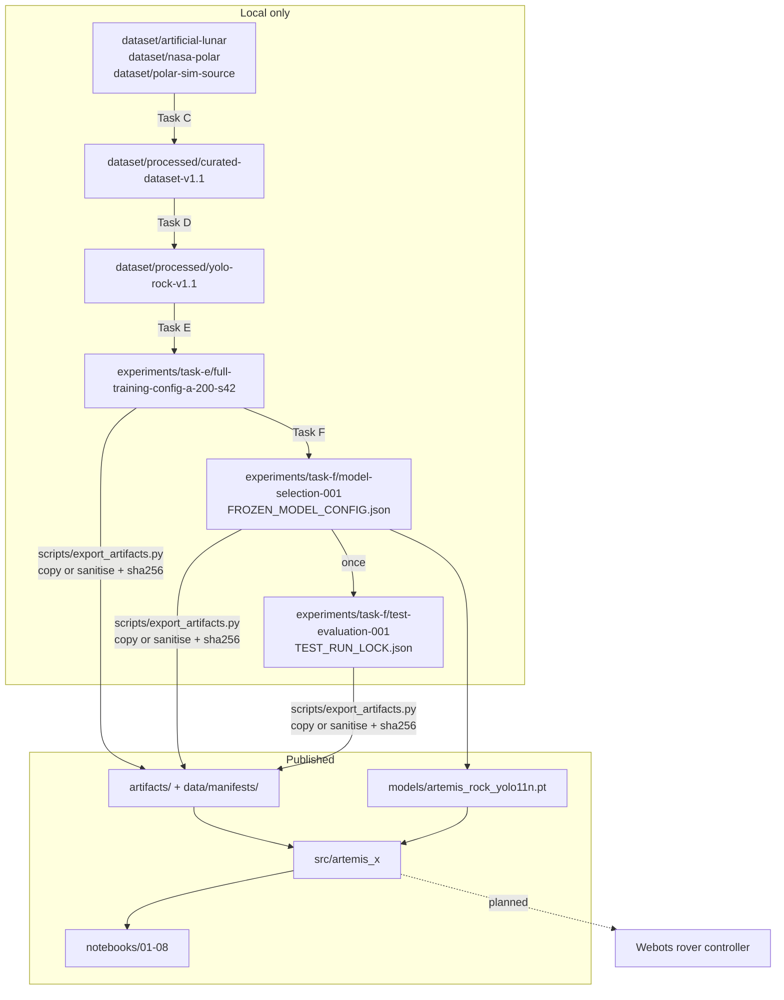
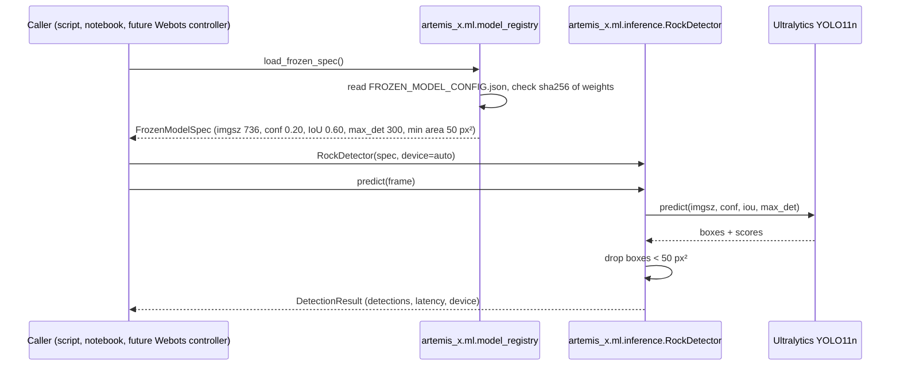

# Architecture

Current R6/R6.1 runtime: Webots RGB + depth / odometry → frozen local inference → `src/artemis_x/sim/mapping`
→ binary UDP / lunar emulator / selective ACK → `ground_station` FastAPI + MongoDB → REST/WebSocket →
`frontend/apps/web` Mission Control. See [jury quickstart](JURY_QUICKSTART.md) for launch/ports and
[ground contract](TELEMETRY_R5_5_GROUND_BACKEND.md). The diagrams below describe the **historical research pipeline**;
their original “planned” integration labels are not the current implementation status.

## Component boundaries

| Component | Location | Responsibility | Published |
|---|---|---|---|
| Public package | `src/artemis_x/` | Frozen model registry and checksum, inference with frozen settings, ignore-aware evaluation wrapper, metric helpers, artifact loaders, plots | yes |
| Research pipeline | `backend/analysis/`, `backend/training/` | Tasks A–F: exploration, annotation strategy, cleaning, YOLO export, remediation, guarded training, selection, locked test evaluation | yes (code only) |
| Notebooks | `notebooks/` | Scientific narrative over published artifacts | yes |
| Evidence | `artifacts/`, `data/manifests/`, `models/` | Hash-verified copies of results, figures, reports, split metadata, frozen model | yes |
| Local data | `dataset/`, `experiments/` | Source and processed datasets, full run outputs | **no** (size, licence) |
| Frontend | `frontend/` | Unmodified Turborepo starter (future Mission Control) | not part of the ML submission |

`src/artemis_x` **wraps** the research pipeline instead of moving it. `artemis_x.evaluation.ignore_aware` re-exports
`backend/analysis/evaluation/ignore_eval.py` (the identity is unit-tested). Paths are resolved centrally in
`artemis_x.config.paths`, with `ARTEMIS_ROOT` and `ARTEMIS_DATA_ROOT` overrides, so no module depends on a machine-specific
location. The 52 historical regression tests and every documented `backend` command keep working unchanged.

## Data flow

## Inference path

## Safety mechanisms preserved from the research pipeline

| Mechanism | What it does |
|---|---|
| Training authorisation | `ARTEMIS_TRAINING_AUTHORIZED=1` plus `--authorized`, `--fresh`, and limit callbacks (epochs, batch, OOM retry, NaN replay) |
| `TEST_RUN_LOCK.json` and hash verification | `task_f_test_eval.py` refuses any second test run |
| `scripts/verify_artifacts.py` | Frozen model, both Task F checksum sets, protected-file baseline, every published artifact, run registry |
| `scripts/demo_inference.py` | Refuses images from the held-out test split |
