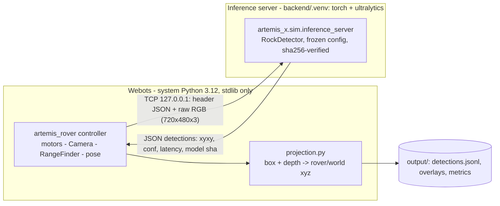

# R3 Technical Plan: YOLO Camera Integration (not started)

**Goal:** run the **frozen** YOLO11n rock detector on the Webots rover camera, localise each detection in 3-D with the aligned
depth image, and **measure** how well the detector transfers to simulator imagery.

**Out of scope:** training or fine-tuning, dataset changes, any change to the frozen model or configuration, and navigation or
obstacle avoidance.

## 1. Architecture: separate inference process

**Why a separate process:**
- **The Webots runtime stays untouched:** system Python, no numpy or torch. PyTorch 2.14 + CUDA is used only where it is already
  installed and locked (`backend/uv.lock`).
- **The control loop stays responsive:** inference (≈ 9–15 ms on GPU, much slower on CPU) runs out of process. The controller sends
  every N-th frame and keeps stepping.
- **Reuse:** the same server can later feed Mission Control or replay recorded frames without Webots.

**Alternative considered: a Webots `<extern>` controller launched from the venv.** It is simpler, but it couples simulation stepping
to inference latency and to the torch environment. Keep it only as a fallback for debugging.

## 2. Components to build

| Component | Where | Notes |
|---|---|---|
| Wire protocol | `src/artemis_x/sim/protocol.py` | Stdlib only (`socket`, `struct`, `json`). Message = 4-byte length + JSON header (`frame_id`, `sim_time_s`, `width`, `height`, `encoding: rgb8`) + payload. Reply = JSON `{frame_id, detections[{xyxy, conf}], inference_ms, device, model_sha256}`. Version field; timeouts |
| Inference server | `src/artemis_x/sim/inference_server.py`, run with `uv run --project backend python -m artemis_x.sim.inference_server` | Loads `RockDetector()`, which verifies SHA-256 `413d0481…` and applies imgsz 736, conf 0.20, NMS 0.60, max_det 300 and the 50 px² filter. Binds **127.0.0.1 only**. One client. Logs latency. Read-only on the model. Refuses images larger than a set limit |
| Client in controller | `src/artemis_x/sim/rover.py` (`DetectionClient`) | Non-blocking by default, with frame-ID matching. A `--sync` mode (wait for each reply) gives deterministic test runs. If the server is unavailable the controller **continues without detections** and records why |
| Depth projection | `src/artemis_x/sim/projection.py` (pure Python) | For each box: robust depth = a low percentile (e.g. p20) of the valid optical-axis depths in the box's lower-central region, with sky and `inf` excluded. Back-project the box centre: `X = d`, `Y = −(u−cx)/fx · d`, `Z = −(v−cy)/fy · d` (camera FLU), then camera → rover (mounting from `make_world.py`) → world (ground-truth pose, evaluation only). Distances **never** come from box size |
| Webots ground truth | Supervisor | Rock poses and sizes from the scene tree. Project each rock's 3-D extent into the image to get GT boxes; keep the GT 3-D centres |
| Diagnostics | `output/<run>/` (git-ignored) | `detections.jsonl` (per frame: detections, depth, xyz, latency), overlay PNGs, `metrics.json` |
| Runner and tests | `scripts/run_webots_yolo.py`, `tests/test_sim_r3.py` | The runner starts the server, then Webots headless, then shuts both down. Unit tests cover protocol round-trip, projection maths and client timeout; opt-in end-to-end test |

## 3. Validation (acceptance criteria)

| # | Check | Pass criterion |
|---|---|---|
| V1 | Protocol | Round-trip of a 720×480 frame is lossless (byte-identical); malformed or oversized messages are rejected |
| V2 | Inference parity | Server detections on validation PNGs equal `RockDetector` called directly (same boxes and scores). The **test split is never used** |
| V3 | Projection accuracy | On Webots frames, detection 3-D centres vs supervisor ground truth: report median and p95 error. The R2 depth check (≤ 4 mm per pixel) bounds the depth term |
| V4 | Domain-gap measurement | Webots-only scene set (fixed seeds or poses). Precision, recall and AP50 against projected GT boxes, using the same matching rules (IoU 0.5). Reported as **a measurement, with no pass threshold**. No claim that YOLO detects Webots rocks unless these numbers show it |
| V5 | Latency | End-to-end frame → detection, p50 and p95, on GPU and on CPU fallback. The controller loop must never block more than one step in async mode |
| V6 | Robustness | Server down or killed mid-run: the rover still completes its sequence, and the gap is logged |
| V7 | Regression | Root and backend suites, `verify_artifacts.py` 8/8, frozen model SHA unchanged |

## 4. Expected risks

1. **Large domain gap.** The test rocks are smooth spheres, the lighting is dim (mean ≈ 42/255), and the textures differ from the
   Artificial Lunar renders. **Low recall is likely.**
   - Before any judgement, make the scene closer to the training data. This changes only the world, never the model: a low-angle
     directional "sun" light and rock-like meshes.
   - No rock PROTO is bundled in the local Webots install, so a Webots asset or a CC0 mesh must be verified first.
   - If the gap remains large, propose a separately approved fine-tuning experiment with its own validation-only selection and its own
     locked test.
2. **Resolution:** 720×480 frames match the training resolution; the model letterboxes to 736.
3. **Synchronous vs asynchronous detections:** in async mode a detection refers to an older frame. Each reply carries its `frame_id`
   and pose, and projection uses the depth and pose **of that frame**.
4. **Kinematic rover:** there are no collisions, which is acceptable because R3 does not navigate.

## 5. Order of work

1. Protocol, server and client, with unit tests and V1–V2.
2. Projection module and supervisor ground truth, with V3.
3. Diagnostics, overlays and runner, with V5–V6.
4. Scene realism (light, rock meshes), as a world change only.
5. Domain-gap measurement (V4) and an R3 report with honest results.
6. Commit only after your review.

**Needs your decision before starting R3:**
- the inference port (default 127.0.0.1:5761);
- whether to make scene-realism changes (lighting, rock meshes);
- the size of the Webots evaluation scene set.
