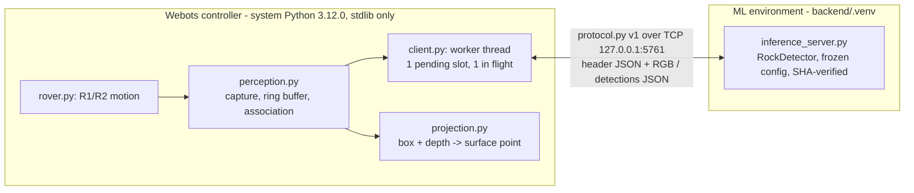

# Webots R3 Report: YOLO Camera Integration

| | |
|---|---|
| Date | 2026-10-10 |
| Status | **Implemented and verified; not committed** (awaiting your review) |
| Unchanged | Frozen YOLO11n, frozen configuration, datasets, notebooks, historical results |
| Not done | No training, no threshold change, no use of the historical test split, no navigation |

## 1. Summary: integration success vs detection accuracy

**Technical integration: all 7 success criteria met.**

| # | Criterion | Evidence |
|---|---|---|
| 1 | Webots sends real camera images to the YOLO server | Demo: 45 frames submitted, 45 answered (720×480 RGB over `127.0.0.1:5761`) |
| 2 | Server returns verified model predictions | `hello` handshake reports SHA-256 `413d0481…`; the client refuses any other hash (tested). The server uses `load_frozen_spec()` (historical checkpoint, never the sanitised copy). On validation PNGs its output is **identical** to `RockDetector` file-path inference (test V2) |
| 3 | Bounding boxes visualised | 40 evaluation overlays (`output/r3-eval-*/overlays/`): YOLO boxes, confidence and depth range, plus reference boxes |
| 4 | Detections associated with depth and projected | Every detection carries the **same capture's** depth and pose (ring buffer keyed by frame ID). Visible-surface point in camera and rover frames, with validity flags. 150/150 matched evaluation detections had valid depth |
| 5 | Simulation responsive when inference is slow or unavailable | No-server and +400 ms-server runs both complete the R1/R2 motion (all checks pass). Controller work p50 0.16 ms per step; frames are dropped, never queued |
| 6 | Domain gap measured honestly | Section 4 |
| 7 | Regression and integrity | Root 63/63 (including the live Webots test), backend 52/52, `verify_artifacts.py` all PASS, R1/R2 world byte-identical, frozen model SHA unchanged |

**Detection accuracy on Webots scenes:** moderate and scene-dependent (section 4). These numbers come from a **limited exploratory
simulator evaluation**, not a real-world benchmark.

## 2. Architecture as implemented



**Imports:**
- The controller modules import under Webots' **system Python 3.12.0 without numpy** (verified).
- The server and tests run in the ML environment.
- Both use the same `src/artemis_x` package via `sys.path`, so no module is duplicated.

**Threading:** Webots APIs are called only on the simulation thread. The client's worker thread does socket I/O only.

**Backpressure and staleness:**
- one pending slot (a newer frame replaces an unsent one) and one request in flight;
- a reply whose frame ID doesn't match is discarded;
- a reply older than 1 s of simulation time is flagged `stale`;
- a reply for a frame already evicted from the 8-frame ring buffer is marked `evicted` and never associated with another frame's depth.

**Fix discovered during R3:**
- Ultralytics treats numpy arrays as **BGR**. `RockDetector.predict_rgb()` now converts RGB to BGR, and the old docstring that
  wrongly said RGB was accepted was corrected.
- Historical results are unaffected, since they all used file paths.
- The parity test proves that server output on RGB frames equals file-path inference.

## 3. Scenes

| Scene | Content |
|---|---|
| `worlds/artemis_moon.wbt` | R1/R2 baseline, **unchanged** (regenerated byte-identically) |
| `worlds/artemis_moon_enhanced.wbt` | Demo variant: seed-0 field of 10 irregular rocks, low-angle sun |
| Evaluation worlds (generated, git-ignored) | `eval_s{0..4}_{baseline,enhanced}.wbt` + manifests (seed, rock geometry, viewpoints, lighting, camera) |

**How the variants differ:**
- **Baseline variant:** Webots spheres (subdivision 2), with the sample's office-HDR fill light.
- **Enhanced variant:**
  - **procedural irregular meshes**: an icosphere with seeded anisotropic scaling and radial bumps, generated in
    `make_world.py`, so there are no external assets or licences;
  - textured with the Webots moon-ground texture already used by the sample world;
  - a **~20° directional sun** with shadows, and HDR fill reduced to 0.15.

**Pairing:** the same seed gives the same rock centres, sizes and four camera viewpoints. Only geometry, material and lighting
change.

**Ground truth (evaluation only):** Webots *recognition segmentation* (per-rock colours) gives occlusion-aware visible-extent
reference boxes. It is never sent to YOLO.

**Known issue:** dereferencing the recognition objects' colour pointers crashed the controller natively in R2025a, so only the
object count is read.

## 4. Domain-gap evaluation: limited, exploratory, synthetic

**Protocol:**

| Item | Value |
|---|---|
| Captures | 40 = 5 seeds × 4 viewpoints × 2 variants (10 Webots runs, all exit 0) |
| Model | Frozen settings, unchanged |
| Reference boxes | Rocks with ≥ 50 visible pixels. Smaller slivers are ignore regions |
| Matching | IoU ≥ 0.5, greedy by confidence (`artemis_x.evaluation.ignore_aware.match_image`) |
| AP | Computed from the frozen operating outputs only (conf ≥ 0.20). It is truncated and **not comparable** to the dataset AP50 |

**Reference-box verification:** segmentation boxes vs boxes projected from the known rock geometry, for 187 reliable,
non-truncated rocks. Median IoU **0.94**, p10 0.72; 5 below 0.5 (occlusion).

| | Baseline (spheres) | Enhanced (irregular + sun) |
|---|---|---|
| Captures / reference boxes | 20 / 110 | 20 / 110 |
| Predictions / TP / FP / FN | 79 / 79 / 0 / 31 | 89 / 71 / 18 / 39 |
| **Precision** | **1.00** | **0.80** |
| **Recall** | **0.72** | **0.65** |
| AP50 (frozen outputs only) | 0.71 | 0.63 |
| Captures with no detections | 0 | 0 |
| Recall by visible area: < 400 px | 6/10 | 6/14 |
| Recall by visible area: 400–2500 px | 34/47 | 35/56 |
| Recall by visible area: ≥ 2500 px | 39/53 | 30/40 |

**Per seed (TP / reference):**

| Seed | Baseline | Enhanced | Enhanced FP |
|---|---|---|---|
| 0 | 11/19 | 11/19 | 4 |
| 1 | 12/19 | 8/19 | 1 |
| 2 | 13/23 | 12/23 | 4 |
| 3 | 19/24 | 21/24 | 3 |
| 4 | 24/25 | 19/25 | 6 |

**Paired, per viewpoint:** enhanced recall was higher at 5 viewpoints, lower at 9, and equal at 6.

**Errors:**
- **False negatives:**
  - mostly very near, very large rocks that fill the frame and are cut off at the image edge (11/31 baseline FNs touch the border;
    up to 82,000 visible px at 0.8–2 m);
  - rocks partly hidden behind a nearer rock (YOLO draws one box);
  - a few distant rocks (5.8–6.5 m).

  This matches the near-field and large-rock weakness measured on the dataset test split.
- **False positives:** all 18 enhanced FPs overlap no rock. They are small, low-confidence boxes on dark terrain-texture patches
  (14/18 have conf < 0.31).

**Interpretation:**
- On these simulator scenes, the detector finds roughly two thirds to three quarters of reliably visible rocks.
- Its precision is high on smooth spheres but drops when terrain and rock textures are similar.
- The "enhanced" scene is **not** closer to the training renders in every respect: its procedural rocks have a streaky texture
  mapping (no texture coordinates).
- With 20 captures per variant and large seed-to-seed variation (recall 0.42–0.96), **no general claim** about YOLO on Webots
  or real lunar imagery is supported.

## 5. Spatial localisation (visible surface, not centres)

**Estimator:** the median of the back-projected *foreground* depth pixels (the nearer half of valid pixels) in the central 50 %
of the box. The result is given in camera and rover frames. Boxes with < 20 % valid depth are rejected with a reason.

**Accuracy:** the estimate was compared with a **ray-cast of the true rock geometry through the same pixels**. For the baseline
this uses the analytic sphere; for the enhanced variant, ray–mesh intersection. This measures the visible-surface estimate.
It is **not** a centre error: no centre estimate is made in R3.

| Matched detections with valid depth | Surface error median | p95 | max | Foreground pixels on target |
|---|---|---|---|---|
| Baseline 79 | 2.4 mm | 4.3 mm | 4.9 mm | 100 % (median and p05) |
| Enhanced 71 | 0.0 mm | 0.1 mm | 16.7 mm | 100 % |

The baseline's few millimetres are the polygonal Webots sphere versus the analytic sphere used as reference. The simulator depth
is effectively exact. **Real-sensor noise is not modelled**, so these numbers bound the geometry pipeline, not a real camera.

## 6. Latency (RTX 5060 Laptop GPU, Webots fast mode)

| Measure | p50 | p95 |
|---|---|---|
| Server inference (evaluation) | 12.5–12.6 ms | 13.1–13.6 ms |
| End-to-end frame → detections at the controller (evaluation) | 14.0–14.2 ms | 29.6–34.1 ms |
| End-to-end, demo run (async) | 22.4 ms | 27.1 ms |
| Controller work per simulation step (demo) | 0.22 ms | 12.1 ms |

The demo's 3 steps over 50 ms (~140 ms each) are **exactly** the 3 R1/R2 diagnostic PNG exports, not inference.

## 7. Reliability tests (`tests/test_sim_r3.py`, 17 tests, all pass)

| Area | Tests |
|---|---|
| Protocol | Lossless 720×480 round-trip; bad magic, bad version, oversized header and payload rejected **before** reading the payload; bad JSON; frame validation (encoding, negative ID, size mismatch, missing fields, oversize geometry) |
| Client | Server not started (non-blocking submit, failure recorded); server dies mid-request; timeout (connection reset, never mismatched later); wrong frame ID discarded; wrong model SHA refused; backpressure (dropped > 0, ≤ 3 sent, newest frame served); clean shutdown (`bye`, thread joined) |
| Association and projection | Transforms; infinite and NaN depth rejected, not invented; foreground surface point on a synthetic scene; stale and evicted replies flagged |
| Real server | `hello` reports the frozen SHA and settings; **parity with `RockDetector` on 3 validation PNGs**; a malformed frame gets an error reply and the server keeps serving |

**End-to-end runs:**

| Run | Result |
|---|---|
| Demo | 45/45 replies, R1/R2 6/6 PASS |
| No server | Motion unchanged, 1 connect failure logged |
| Slow server (+400 ms) | 5 sent, 40 dropped, 3 stale or evicted, motion unchanged |

## 8. Commands

```powershell
# 1. Start the inference server (ML environment)
uv run --project backend --no-sync python scripts/inference_server.py
# 2. Open in Webots: artemis-webots/worlds/artemis_moon.wbt  (or artemis_moon_enhanced.wbt)
# 3. Press Run: R1/R2 motion with live detections
# 4. Inspect
#    artemis-webots/output/demo-<ts>/inference/detections.jsonl   detections, depth validity, surface points, latency
#    artemis-webots/output/r3-eval-<ts>/overlays/*.jpg             40 annotated captures
#    artemis-webots/output/r3-eval-<ts>/r3_eval_results.json       metrics, per-capture results, FN/FP analysis, localisation
# Automated
uv run --project backend --no-sync python scripts/run_webots_r3.py demo | robustness | eval
uv run --project backend --no-sync python scripts/run_webots_r3.py analyse artemis-webots/output/r3-eval-<ts>
# 5. Tests
uv run --project backend --no-sync python -m unittest tests.test_sim_r3
$env:ARTEMIS_RUN_WEBOTS="1"; uv run --project backend --no-sync --with nbformat python -m unittest discover -s tests -t .
```

## 9. Scene realism v2: Poly Haven CC0 lunar assets and a test course

**Asset check (before import):**

| Asset | Polygons | Native size | Licence | Format used |
|---|---|---|---|---|
| `moon_rock_01` | 18.7k triangles | 21 × 11 × 7.5 cm | CC0 | glTF 1K, converted to OBJ |
| `moon_rock_02` | 3.3k triangles | 25 × 25 × 20 cm | CC0 | glTF 1K, converted to OBJ |
| `moon_rock_03` | 5.6k triangles | 11 × 9 × 6 cm | CC0 | glTF 1K, converted to OBJ |
| `moon_01` regolith | — | 3.1 m tile | CC0 | JPG: diffuse and normal 2K, roughness 1K |

- **Download:** 11.3 MB in total, MD5-verified, with SHA-256 recorded in `artemis-webots/assets/polyhaven/ASSETS.json`.
- **Not in Git:** the binary files are git-ignored and re-fetched by `artemis-webots/tools/fetch_polyhaven.py` (see
  `artemis-webots/assets/README.md`).
- **Import:** Webots R2025a loads the OBJ meshes and textures cleanly (no warnings).
- **Conversion check:** converted extents match the published dimensions.
- **Ground truth:** ray casts and projected boxes use the same transformed vertices as the rendered mesh.

**Enhanced variant v2:** Poly Haven rocks (a random scan per rock, scaled to the paired footprint) plus a regolith patch and the
low sun. It replaces the procedural rocks in the 40-capture plan, and the procedural run is kept for comparison. The baseline is
unchanged and reproduced exactly.

| Enhanced scene | Reference boxes | Precision | Recall | AP50 (frozen outputs) | FP: partial or merged box / background |
|---|---|---|---|---|---|
| v1 procedural rocks (`r3-eval-20261010-021543`) | 110 | 0.80 | 0.65 | 0.63 | 0 / 18 |
| **v2 Poly Haven rocks (`r3-eval-20261010-022630`)** | 117 | **0.71** | **0.60** | **0.56** | 24 / 4 |
| Baseline spheres (both runs, identical) | 110 | 1.00 | 0.72 | 0.71 | 0 / 0 |

- **Recall by size (v2):** < 400 px 13/26 · 400–2500 px 30/55 · ≥ 2500 px 27/36.
- **Surface error (v2):** median 0.1 mm, max 0.4 mm.
- **Latency (v2):** end-to-end p50 16.8 ms, p95 24.5 ms.

**What the screenshots show** (`docs/figures/webots/enhanced_polyhaven_raw_vs_detections.jpg`):
- Sunlit Poly Haven rocks are detected with tight boxes.
- The misses are mainly rocks whose visible face is turned away from the low sun, and small distant rocks.
- Most "false positives" are boxes covering part of a rock or two adjacent rocks, not hallucinations.

**Test course v1** (superseded by v2, §10; the v1 world is no longer generated): 21 rocks in 6 zones plus 5 non-rock distractors, 8 viewpoints.
Screenshots: `docs/figures/webots/test_course_camera_views.jpg` and `docs/figures/webots/test_course_detections.jpg`.

| Viewpoint (zone) | Reliable rocks visible | TP | FP | Notes |
|---|---|---|---|---|
| Z1 isolated | 9 | 3 | 1 | Overlapping pair merged into one box; distant pebbles missed |
| Z2 small scatter | 11 | 4 | 3 | Small pebbles mostly missed |
| Z3 large boulder (close) | 8 | 5 | 1 | Frame-filling boulder only partly boxed |
| Z3 large boulder (farther) | 5 | 3 | 4 | One FP on the **lander crate** (conf 0.22) |
| Z4 occlusion / cluster | 6 | 4 | 1 | One large FP box over a shadow edge |
| Z5 non-rock distractors | 1 | 1 | 0 | **No detection** on fuel tank, crate, mast, panel or white ball from this view |
| Z6 shadowed | 3 | 0 | 0 | Rocks in shadow not detected |
| Overview | 8 | 4 | 0 | |
| **Total (8 captures)** | **51** | **24** | **10** | Precision 0.71, recall 0.47 |

The test course is deliberately hard: it stresses pebbles, clusters, near-field boulders, shadows and distractors. Its numbers
characterise failure modes; they are **not** an accuracy estimate.

## 10. Test course v2: more rocks, craters, two suns, and a scripted tour

**What changed in the environment:**

| Area | v1 | v2 |
|---|---|---|
| Rock assets | 3 Poly Haven scans | 7 lunar scans (`moon_rock_01`…`07`) + 2 real boulder scans (`namaqualand_boulder_04/05`, greyed into a "lunar" texture), all CC0 |
| Objects | 21 rocks, 5 distractors, 6 zones | **39 rocks**, 5 distractors, **9 zones** |
| Ground | flat textured plane over the sample terrain | **height-field regolith** (ElevationGrid, 0.15 m grid, ±1.2 cm relief) with **two craters**; the sample ground is lowered 0.35 m under it, and the edges blend into it |
| Lighting | low sun only | **low sun** (≈ 20°, long shadows) and **high sun** (≈ 55°, short shadows), as two worlds |
| Viewpoints | 8 | 11 |
| Driving | none (rover at origin) | a clear lane at y = −2.6 m and a **scripted 9-stop tour** embedded in the world (`customData`) |

New zones:
- **Z7 craters:** a 2.4 m crater with rocks on its rim and in its bowl, plus an **empty** 1.1 m crater as a false-positive probe.
- **Z8 boulder field:** two boulders (1.1 m and 1.8 m) among 8 mixed rocks.
- **Z9 half-buried:** 4 rocks sunk 45–60 % into the regolith.

Engineering fixes found while building it:
- **Boulders cast no shadow at first.** Webots casts no shadow from a mesh above 21,845 triangles, and the boulders have 59k and
  90k. The converter now simplifies meshes to ≤ 20,000 triangles by vertex clustering, keeping the original UVs. Shadows are now
  correct (zone Z6); the price is slight faceting closer than 2 m.
- **Lighter world files.** The terrain is an ElevationGrid, so each world is 0.3 MB instead of 2.4 MB with a triangle mesh.
- **Placement-based manifests.** Manifests store each rock's placement, not its vertices (20 KB instead of 7 MB). The analyser
  rebuilds each mesh with the generator's own transform.
- **Occlusion-aware localisation check.** The localisation check now ray-casts against **every** rock overlapping the box. That
  exposes a real failure mode (below) that the earlier target-only check hid.

**Screenshots** (`docs/figures/webots/`):
- `course_v2_lowsun_viewpoints.jpg`: 10 viewpoints with YOLO (magenta) and reference (green) boxes.
- `course_v2_lowsun_vs_highsun.jpg`: zones Z6–Z9 under both suns.
- `course_v2_tour_stops.jpg`: the camera at each of the 9 tour stops.

**Detection results (frozen model, unchanged; run `course-20261010-024200`)**

| | Low sun | High sun |
|---|---|---|
| Reliable reference boxes (11 captures) | 93 | 93 |
| TP / FP / FN | 29 / 17 / 64 | 31 / 12 / 62 |
| Precision / recall | **0.63 / 0.31** | **0.72 / 0.33** |
| Recall < 400 px · 400–2500 px · ≥ 2500 px | 2/41 · 9/26 · 18/26 | 4/41 · 9/26 · 18/26 |
| FP categories | 11 partial or merged · 5 background · 1 on a distractor | 7 background · 4 partial · 1 duplicate |
| FP on the empty crater | 0 | 0 |
| Surface-point error vs first surface hit (matched, n) | median 0.1 mm, max 0.7 mm (29) | median 0.0 mm, max 0.1 mm (31) |

| Viewpoint (zone) | Reliable rocks | Low sun TP / FP | High sun TP / FP |
|---|---|---|---|
| v7 overview | 10 | 2 / 0 | 2 / 1 |
| v0 Z1 isolated | 12 | 3 / 1 | 4 / 0 |
| v1 Z2 small scatter | 13 | 5 / 1 | 5 / 0 |
| v2 Z3 large boulder (1.7 m away) | 10 | 4 / **10** | 2 / 3 |
| v3 Z3 large boulder (farther) | 9 | 3 / 2 | 4 / 1 |
| v4 Z4 occlusion / cluster | 8 | 4 / 0 | 4 / 0 |
| v5 Z5 non-rock distractors | 0 | 0 / 0 | 0 / 0 |
| v6 Z6 shadowed | 11 | 3 / 0 | 3 / 3 |
| v8 Z7 craters | 8 | 1 / 2 | 2 / 3 |
| v9 Z8 boulder field | 8 | 2 / 0 | 3 / 1 |
| v10 Z9 half-buried | 4 | 2 / 1 | 2 / 0 |

**What it shows:**
1. **Pebbles are the main miss.** Most references are small or distant: 41 of 93 have fewer than 400 visible pixels, and only 2–4
   of those are found. Large rocks (≥ 2500 px) are found 18/26 under both suns.
2. **The near-field boulder breaks the detector under low sun.** At 1.7 m the frame-filling boulder, with hard shadow edges,
   produces 10 false positives: fragments of the boulder and of its shadow. Under high sun it produces 3. This is the
   single biggest failure mode for a rover approaching an obstacle.
3. **Lighting changes which rocks are found, not how many.** The totals are similar, but individual rocks flip between found and
   missed with the sun angle (e.g. in Z9 and Z6). Low sun gives more merged or partial boxes; high sun gives more background FPs
   on bright terrain.
4. **Engineered objects and the empty crater are mostly ignored.** From the Z5 viewpoint there is no detection on the crate,
   tank, mast, panel or ball. There is one FP on the lander crate at a distance under low sun, and none on the empty crater.
5. **Occlusion corrupts localisation, not detection.** Rock `crs_rock_14` stands behind `crs_rock_13` (Z4) and is detected
   correctly. But only 16–59 % of the depth pixels in its box belong to it. The reported 3-D point therefore lies on the occluding
   rock, up to 0.66 m nearer than the detected rock. The sensor geometry itself is exact (≤ 0.7 mm against the first surface hit).
6. **Not comparable with v1.** v1 had recall 0.47 on 51 references. v2 shows many more small and distant rocks per frame. Both
   are failure-mode probes, **not** accuracy estimates.

**Scripted tour (run `tour-20261010-024436`):**
- 37/37 moves completed in 282 s simulated.
- Every stop is within 1.6 mm (forward), 0 mm (lateral) and 0.2° (heading) of the plan, measured against ground truth.
- 1,097 frames were answered with 0 failures; end-to-end latency p50 20 ms, p95 33 ms.
- The first version planned each drive relative to the previous planned stop, so the forward error grew 3.4 mm per stop (30 mm by
  Z9). Drives now target absolute lane positions.

`docs/ROVER_BEHAVIOUR.md` describes the robot's behaviour in every mode and what it does not do.

## 11. Limitations and next steps (none started)

- **Kinematic rover:** no collisions or dynamics, and no wheel slip. That is why the tour's odometry is perfect; it would drift on
  real regolith. The motion is scripted, which is **not** safe autonomous navigation.
- **Detections are not used for control.** No reaction, avoidance or re-planning.
- **Simulator depth is ideal:** real stereo or ToF noise is not modelled.
- **Synthetic scene realism is still limited:**
  - the rocks are 9 scans, rescaled, and two of them are greyed desert boulders;
  - two fixed sun directions;
  - gentle synthetic relief;
  - no dust;
  - simplified boulders look faceted up close.
- **Recognition API crash:** recorded and worked around (count only).

**Proposed next steps:**
1. Treat the near-field boulder failure (FP fragments under low sun) and the occlusion-biased 3-D point as the two issues to
   address first. Example for the 3-D point: take the depth mode of the box instead of the near half.
2. Use a larger paired scene set (more sun azimuths and seeds) before drawing conclusions.
3. Estimate rock centres or sizes from depth clusters, a defensible method that is validated separately.
4. Only then consider a separately approved fine-tuning experiment on Webots frames, with its own validation-only selection and
   its own locked test.
