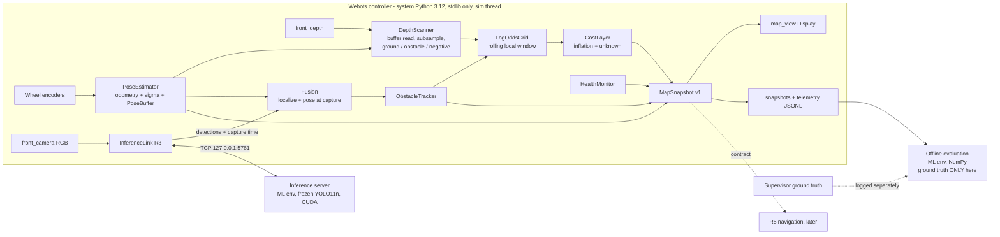

# Webots R4 Plan: Autonomous Perception, Sensor Fusion & Obstacle Mapping

| | |
|---|---|
| Date | 2026-10-10 |
| Status | **Approved 2026-10-10** with the recommended decisions. R4.1-R4.4 implemented; R4.5 display part (live 2D map, 2 x 2 monitoring layout) implemented; R4.6 final validation done (12/15 criteria on the batch, failures documented); progress and deviations in [WEBOTS_R4_PROGRESS.md](WEBOTS_R4_PROGRESS.md) |
| Baseline | R3 + test course v2, committed and pushed as `c425125` (decision D0 done) |
| Unchanged by R4 | Frozen YOLO11n and its configuration, datasets, historical results, the validated R1/R2 and R3 worlds |
| Out of scope | Path planning (A*), obstacle avoidance, autonomous motor commands. These belong to R5 |

Every statement in section 1 was checked against the code or a run on 2026-10-10. Everything in sections 2–15 is a
**proposal**. Numbers marked *target* are goals, not measurements.

---

## 1. R3 baseline audit

### 1.1 What exists and can be reused

| Component | File | Verified behaviour | Reuse in R4 |
|---|---|---|---|
| Sensor capture | `src/artemis_x/sim/sensors.py` | Camera 720×480 and RangeFinder share pose, FOV (1.0 rad) and resolution. `capture()` returns RGB bytes and depth as a **Python list of 345,600 floats**. Out-of-range or `inf` depth is treated as invalid | Reuse the class. Add a fast depth read (see 1.2, item 4) |
| Camera model | `src/artemis_x/sim/projection.py` | `CameraModel` (fx = 658.98), `pixel_to_camera`, `camera_to_rover` (mount 0.16, 0, 0.24 m, pitch 0.12 rad). `rover_to_world` is documented as **evaluation only (ground-truth pose)** | Reuse the intrinsics and extrinsics as-is. Add an estimated-pose transform |
| Detection localisation | `projection.localize` | Median of the near half of valid depth pixels in the central 50 % of the box. Gives a **visible-surface point**, not a centre. Marked invalid if < 20 % of the depth is valid | Reuse as the YOLO measurement. Its occlusion bias is known (1.3, item 5) |
| Async inference link | `src/artemis_x/sim/perception.py` `InferenceLink` | Submits a frame every 0.256 s sim time. Ring buffer of 8 frames keyed by frame ID. Flags `stale` (> 1.0 s), `evicted` and failed frames. Optional live `yolo_view` Display | Reuse the plumbing. **Gap:** it stores the pose passed by the caller, and both callers (`rover.py` lines 121, 310) pass the **supervisor ground-truth** pose |
| Inference client | `src/artemis_x/sim/client.py` | One pending slot and one frame in flight; newer frames replace older ones. Frame-ID matching, timeouts, reconnect, model SHA-256 check, status counters | Reuse unchanged. Its counters feed the health monitor |
| Inference server | `src/artemis_x/sim/inference_server.py` | Separate process (ML env, NumPy, CUDA), 127.0.0.1:5761, frozen model only | Unchanged |
| Odometry | `src/artemis_x/sim/drive.py` `Odometry` | Encoder dead reckoning, yaw scale 0.958 (calibrated). Frame starts at (0, 0, 0). **No timestamps, no uncertainty** | Wrap it with a timestamped pose buffer and an uncertainty model |
| Scripted tour | `src/artemis_x/sim/rover.py` `run_tour`, `drive.tour_moves` | Closed loop on odometry. Lane, then a clear approach to each of 9 zones, observe, then reverse. Plan comes from the world's `customData` | The mapping data-collection route for all of R4 (R4 adds no driving logic) |
| Course worlds and manifests | `artemis-webots/tools/make_world.py`, `worlds/artemis_test_course*.wbt/json` | 39 rocks, 5 non-rock objects, 2 craters, height-field terrain, two sun angles. Exact placements: asset, x, y, yaw, scale, z0, sink | Ground truth for **offline** map evaluation (rasterise the footprints) |
| Evaluation harness | `scripts/run_webots_r3.py` | Headless runs, server lifecycle, overlays, ground-truth path clearance (`min_clearance_along_true_path_m`) | Extend into `run_webots_r4.py` |
| Tests | `tests/test_sim.py` (8), `test_sim_r3.py` (17), `test_sim_scenes.py` (9) | Pass | Pattern for the new stdlib-testable modules |

### 1.2 Verified constraints that shape the design

1. **The controller cannot use NumPy.** Webots launches `python`, which is system Python 3.12.0; `import numpy` fails there.
   The ML environment (NumPy 2.5.3) only runs the inference server and offline tools. Everything in the controller is stdlib-only
   by design (`sim/__init__.py`).
2. **Timing.** `basicTimeStep` is 32 ms. The controller currently takes p50 0.25 ms per step, with a max of 199 ms only on steps
   that write PNGs. Real time needs the controller's work per step to stay well under 32 ms.
3. **Depth arrives as a Python list.** `getRangeImage()` builds a list of 345,600 floats. In NumPy, converting such a list takes
   about 12 ms (micro-benchmark on this machine).
4. **Fast depth read is available.** `getRangeImage(data_type='buffer')` returns the raw `ctypes` float pointer, so
   `ctypes.string_at(ptr, w*h*4)` copies the frame as bytes without building a list. A pure-Python loop over a 1/16 subsample of
   a list frame took about 2.2 ms (micro-benchmark).
5. **No collision anywhere in the course.** The Koala has no `Physics` node (kinematic). The course rocks have **no
   `boundingObject`**: 0 in `artemis_test_course.wbt`, versus 3 in `artemis_moon.wbt`. The rover passes through everything.
6. **The IR sensors cannot see the rocks.** The Koala's 16 IR sensors `ds0`–`ds15` (0–0.5 m) are unused, and they only detect
   collision geometry, so they currently see nothing in the course.
7. **Blind zone in front of the rover (computed).** The bottom image row looks 0.12 + 0.349 = 0.469 rad below the horizon from
   0.24 m height. Ground nearer than **≈ 0.48 m from the camera (≈ 0.64 m from the rover centre)** is never in view. Side areas
   outside the ±0.5 rad horizontal FOV are never in view either.
8. **The ground plane is known exactly in the rover frame.** The rover is kinematic at z = 0 and never tilts. The terrain varies
   by ±1.2 cm, except the crater bowls (down to −25 cm) and rims (+10 cm).

### 1.3 Measured R3 results R4 builds on (achieved, not targets)

| Item | Result |
|---|---|
| Latest scripted tour (`tour-20261010-030127`) | 55/55 moves; observation points within 7.3 mm and 0.21° of plan; minimum true clearance 0.601 m over 16,005 steps |
| Detection stream during the tour | 1,996 frames submitted, 1,994 OK, 0 failed, 0 stale; 5,994 detections, 5,872 localised with depth; latency p50 19 ms, p95 34 ms |
| YOLO on course v2 (fixed viewpoints) | Precision 0.63 / 0.72, recall 0.31 / 0.33 (low / high sun). Rocks < 400 px: 2–4 of 41 found. 10 false positives near a frame-filling boulder under low sun |
| Localisation geometry | Surface point within 0.7 mm of the true first surface along the same rays |
| Occlusion bias | A rock behind another was detected, but 16–59 % of its box depth belonged to the occluder, putting the 3-D point up to 0.66 m too near |

### 1.4 What R4 must add (gaps)

No estimated-pose path into perception. No map. No depth-only obstacle layer. No tracking, inflation or health state. No map
visualisation. No collision ground truth in the worlds.

---

## 2. Scope

**In scope (R4)**
- An estimated pose, with timestamps and uncertainty, from wheel encoders. Every live transform uses it.
- A depth-based obstacle layer that works with YOLO switched off:
  - positive obstacles (rocks, objects, crater rims);
  - negative obstacles (crater bowls).
- A local 2D log-odds occupancy grid with FREE, OCCUPIED and UNKNOWN states, ray-based free-space updates and a rolling window.
- YOLO + depth fusion, with labelled, tracked obstacles (confidence, size estimate, no duplicates).
- A cost layer: inflation for the rover footprint and safety margin, with explicit unknown handling.
- A health monitor: data freshness, inference connection, depth validity, pose uncertainty. States OK / DEGRADED / STOP, as advice
  only.
- A live map view inside Webots, map snapshots and telemetry on disk, and a versioned data contract for R5 and the dashboard.
- Offline evaluation against ground truth, including fault injection (server loss, delays, invalid depth, odometry noise).

**Out of scope (R4)**
- Path planning, obstacle avoidance and any motor command derived from the map. The rover keeps following the scripted tour, and
  the health state is logged, not acted on.
- SLAM, loop closure or visual odometry. Wheel odometry is the only pose source.
- ROS 2, external SLAM frameworks or new heavy dependencies.
- Retraining or re-thresholding YOLO; changes to datasets or frozen artefacts.
- The Next.js Mission Control dashboard (R4 only defines what it would consume).
- Physical collision handling. R4 only prepares a collision-capable world variant (decision D6).

---

## 3. Architecture



**Where mapping runs (key decision, D1):** recommended in the controller, stdlib-only.
- **Why not in the inference server?** Mapping must survive the server's loss: that is the whole point of the depth safety layer.
  Merging it into the server makes hazard detection depend on YOLO's process.
- **Why not a separate NumPy process?** It would ship 1.4 MB of depth per frame plus poses over IPC and add a second
  synchronisation problem. That is not justified for a 120 × 120 grid.
- **Why not install NumPy into system Python?** It would work, but it changes the user's system interpreter and the "stdlib
  controller" contract. It stays as a fallback if the pure-Python budget fails (risk R1).
- **What makes stdlib feasible:**
  - reduce depth to a subsampled point set (about 2,000–5,000 points);
  - collapse it to about 90 column rays;
  - update about 4,000 cells per frame using `array` storage;
  - work at 4 Hz, not every 32 ms step.

---

## 4. Data flow: camera to occupancy map

Each mapping cycle runs every 0.256 s of simulation time (the same cadence as `InferenceLink`), at a known sim time *t*.

| # | Step | Detail | Budget (*target*) |
|---|---|---|---|
| 1 | Pose | `PoseEstimator.update()` runs every 32 ms step from encoders. The pose at *t* goes into `PoseBuffer` (2 s of history) | < 0.05 ms per step |
| 2 | Depth read | `RangeFinder.getRangeImage('buffer')`, then `string_at`, then `array('f')`. RGB and depth come from the same sensor step, as in R3 | < 1 ms |
| 3 | Sample | Grid of pixels: every 8th column (90 columns) × every 6th row in the lower 70 % of the image (about 5,000 pixels). Drop invalid values (`inf`, out of range, > 6 m mapping range) | < 4 ms |
| 4 | Back-project | `pixel_to_camera`, then `camera_to_rover`. This gives the height *z_b* above the rover's ground plane (exact here, see 1.2 item 8) | included above |
| 5 | Classify | Ground if \|z_b\| ≤ 0.03 m. Obstacle if z_b ≥ h_obs (0.05 m, D3). Negative hazard if z_b ≤ −0.08 m (crater bowl). Points in between are uncertain and ignored for occupancy | included above |
| 6 | Column scan | Per column: the nearest obstacle (or negative) range, and the farthest valid ground range. Free space runs from the sensor to the nearer of the two | < 1 ms |
| 7 | To odometry frame | The pose at *t*, from the buffer, transforms rays and points into the `odom` frame | < 0.5 ms |
| 8 | Grid update | Ray-trace each column with integer DDA/Bresenham: cells along the ray get `l_miss`; obstacle cells get `l_hit`, once per cell per cycle | < 5 ms |
| 9 | YOLO evidence (async) | When a detection result for frame *f* arrives: run `localize` on frame *f*'s **own** depth, then transform with the **pose at the capture time of *f*** (not the pose now). Update the tracker and add the track footprint to the grid (section 6.4) | < 2 ms per result |
| 10 | Cost and health | Re-inflate only the dirty window; evaluate health | < 3 ms |
| 11 | Publish | Every cycle: snapshot in memory and redraw the `map_view` Display. Every 2 s: snapshot to disk (binary grid + JSON header) | < 4 ms draw; disk on a separate cadence |

The total mapping work per cycle *target* is p95 ≤ 15 ms, spread so that no single 32 ms step exceeds 20 ms of controller work.
If needed, steps 8 and 10 can be split across two consecutive simulation steps.

---

## 5. Proposed modules and file structure

All new runtime code goes in a stdlib-only subpackage, unit-testable without Webots. The evaluation code may use NumPy.

```
src/artemis_x/sim/mapping/
  __init__.py
  config.py        MappingConfig dataclass: every threshold and size in one place, logged with each run
  frames.py        Pose2D, SE(2) compose/inverse, camera->base->odom transforms (reuses projection.py constants)
  pose.py          PoseEstimator (wraps drive.Odometry, adds sigma model), PoseBuffer (timestamped, interpolating)
  depth_scan.py    fast depth read, sampling, back-projection, ground/obstacle/negative classification, column scan
  grid.py          LogOddsGrid: rolling window, array storage, DDA ray update, clamping, decay, observed-age layer
  costmap.py       footprint, inflation (precomputed kernel), cost encoding, unknown policy
  fusion.py        detection -> measurement (pose at capture time), footprint evidence, small-rock rule
  tracker.py       ObstacleTracker: gating, greedy nearest-neighbour association, confirmation/deletion
  health.py        HealthMonitor: freshness, connection, depth validity, pose sigma -> OK / DEGRADED / STOP + reasons
  snapshot.py      MapSnapshot v1 schema, binary + JSON serialisation, versioning
  view.py          map_view Webots Display renderer (cells, rover, FOV, tracks, inflation, status bar)
  mapper.py        Mapper: orchestrates one cycle; the only object rover.py talks to
src/artemis_x/evaluation/map_eval.py   (ML env) ground-truth raster from manifests, cell/obstacle/track metrics, plots
scripts/run_webots_r4.py               headless scenarios, fault injection, analysis, report figures
tests/test_mapping_frames.py, test_mapping_grid.py, test_mapping_depth.py, test_mapping_fusion.py,
tests/test_mapping_tracker.py, test_mapping_costmap.py, test_mapping_health.py, test_mapping_snapshot.py, test_sim_r4.py
artemis-webots/worlds/artemis_test_course_r4*.wbt   (D7) course copies with map_view display (+ collision variant, D6)
docs/WEBOTS_R4_MAPPING_REPORT.md                    written at the end of R4.6
```

Changes to existing files stay small:
- `rover.py`: create the `Mapper` and call `mapper.tick()` in `run_tour` and `run_controller`; pass the **estimated** pose to
  `InferenceLink`, with ground truth logged under a separate key.
- `perception.py`: expose the capture time and the frame's depth to the fusion callback.
- `sensors.py`: an optional `capture(depth_buffer=True)`.
- `make_world.py`: an option to emit R4 world variants. The R1/R2 world must stay byte-identical (an existing test).

---

## 6. Algorithms and design trade-offs

### 6.1 Coordinate frames

| Frame | Definition | Source |
|---|---|---|
| `camera` | FLU, origin at the sensor, x along the optical axis | Webots convention (verified in R2) |
| `base` | Rover centre on the ground, x forward, z up | `camera_to_rover`: pitch 0.12 rad, offset (0.16, 0, 0.24) m |
| `odom` | The rover's start pose = (0, 0, 0). Drifts with odometry | `PoseEstimator` |
| `map` | Same as `odom` in R4 (no correction exists, so no separate frame) | Kept as a name so R5 can add corrections later |
| `world` | Webots global frame | **Evaluation only**, via the logged initial ground-truth pose |

Transforms are explicit functions with frame names in their signatures (`T_odom_base(pose)`, …); there is no global state.
Every measurement carries `(frame, stamp_sim_s)`.

### 6.2 Occupancy representation: log-odds grid

| Option | Verdict |
|---|---|
| Binary "last write wins" | Rejected. It flickers on noise and disagreeing sensors and has no confidence |
| Hit/miss counts | Workable but needs a normalisation rule. Log-odds is the same cost with a sound model |
| **Log-odds per cell** | **Chosen.** Additive updates, clamped (reversible), cheap, standard |
| 2.5-D elevation map | Deferred. Better on rough terrain, but the ground plane is exact in this simulation (1.2 item 8); can be revisited in R5 for real-terrain realism |

Parameters (*initial*, in `MappingConfig`):
- `l_hit` +0.85, `l_miss` −0.40, clamp [−2.0, +3.5];
- OCCUPIED if l > 0.85 (p > 0.70); FREE if l < −0.85 (p < 0.30); otherwise UNKNOWN;
- a separate `observed` flag/age layer distinguishes "never observed" from "observed but inconclusive".

Geometry:
- resolution **0.10 m** (D2);
- rolling window **12 × 12 m** (120 × 120 cells) centred on the rover, with its origin snapped to whole cells, so recentering is
  an integer shift (no resampling);
- cells leaving the window are dropped (local map). Optionally they are archived to the snapshot log.

Storage is `array('f')` plus `array('H')`, about 115 KB.

**Decay (D4):** an optional slow decay toward 0 for cells not observed for longer than T (e.g. 60 s half-life), to limit damage
from odometry drift. Off by default in simulation (no slip), on in the odometry-noise experiments.

### 6.3 Depth layer and ground/obstacle separation

| Rule | Detail |
|---|---|
| Height test | Each point is classified by its height *z_b* above the known ground plane (thresholds in section 4, step 5). This is valid because the rover never tilts and the terrain varies by only ±1.2 cm. The limitation is documented: a tilting rover on real terrain needs a ground-plane fit per frame (RANSAC on the ground band), which is an R5 or realism item |
| Free space | Per column, the ray from the sensor's ground projection to min(first obstacle, last valid ground return) is marked free. A ground return proves the line of sight to it was clear, so beyond the last ground return nothing is marked |
| Invalid depth | Never marked free or occupied. Sky and no-return pixels give no free space |
| Negative obstacles | Points below −0.08 m (crater bowls) mark their cell as a hazard, stored as OCCUPIED with `kind = negative`. Crater rims (+10 cm) are already positive obstacles |
| Blind zone | The 0.64 m blind zone ahead and everything outside the FOV keep their last value or stay UNKNOWN. They are never assumed free |

### 6.4 YOLO + depth fusion

Principle: **depth decides occupancy, YOLO adds meaning and sensitivity.** YOLO never clears space.

1. A detection is accepted if the result is OK, not stale (capture age ≤ 1.0 s), the frame is still in the ring buffer, and
   `localize().valid`. Otherwise it is counted and discarded.
2. Measurement:
   - the surface point in `base`, then `odom`, using the pose at the frame's capture time;
   - estimated radius ≈ ½ × box width × range / fx;
   - estimated centre = surface point + radius along the horizontal viewing ray (a stated approximation: R3 measured surface
     points only).
3. Small-rock rule:
   - inside a YOLO box, the obstacle threshold drops from 0.05 m to 0.02 m;
   - for a confirmed track with no depth obstacle, a low-weight footprint (`l_yolo` +0.4 per update) is added with
     `kind = small_rock`.

   This is how YOLO improves on depth alone for small rocks.
4. False positives:
   - a YOLO "rock" on a crate is still an obstacle in the depth layer, so it is a labelling error, not a safety error, and it is
     reported in the evaluation;
   - a YOLO box on bare terrain with no depth support and no confirmation adds nothing to the grid;
   - its track simply never confirms.
5. Known bias: occluded rocks borrow the occluder's depth (1.3). Mitigation for the tracker: reject a measurement whose depth
   spread inside the box is bimodal (near/far split > 0.3 m), or take the depth mode instead of the near-half median. The choice
   is evaluated in R4.4. YOLO itself is never changed.

### 6.5 Obstacle tracking and data association

| Item | Choice |
|---|---|
| Track state | id, class (`rock`, `obstacle`, `small_rock`), centre (x, y) in odom, σ, radius, height estimate, confidence (YOLO confidence EMA), depth-support flag, hits, misses, first/last seen, status (tentative / confirmed / lost) |
| Association | Greedy nearest-neighbour, sorted by distance, gate = 0.25 m + 0.05 × range (sparse scenes). Hungarian or JPDA is unnecessary at this density |
| Update | Inverse-variance weighted mean (measurement σ grows with range: 0.03 m + 0.02 × range), radius by EMA |
| Lifecycle | Confirm after 2 hits within 2 s. Count a miss only when the predicted centre is inside the FOV, within 5 m, and not occluded by nearer depth. Mark lost after 4 misses. Keep lost tracks in the map evidence (rocks do not move) |
| Duplicates | Merge two confirmed tracks whose discs overlap by more than 50 %. Report the merge count as a KPI |

### 6.6 Inflation and cost

- Koala footprint: circumscribed radius `r_robot` = 0.25 m (D3, to confirm with a proto measurement in R4.3).
- Safety margin `m_safe` = 0.15 m.
- Pose-uncertainty margin = 2σ_xy, capped at 0.2 m.
- Cost encoding (costmap_2d style, so R5 can reuse standard planners):

| Cost | Meaning |
|---|---|
| 0 | free |
| 1–252 | decaying cost out to `r_robot + m_safe + 2σ` |
| 253 | inscribed: the rover centre here would overlap the obstacle |
| 254 | lethal |
| 255 | unknown |

- The inflation kernel is precomputed once and applied only to changed cells.

### 6.7 Time, staleness and synchronisation

| Item | Rule |
|---|---|
| Timestamps | Simulation time only, never wall clock, for every measurement |
| Depth layer | Synchronous by construction (same step) |
| YOLO results | Arrive later (latency p50 19 ms wall, up to several steps of sim time in fast mode). Using the pose at capture time removes the motion error from the latency. Staleness only limits what is used for *decisions* |
| Pose buffer | Holds 2 s. Results older than the buffer are dropped and counted |

### 6.8 Uncertainty and odometry drift

| Item | Detail |
|---|---|
| σ model | σ_xy += 0.02 × distance travelled; σ_yaw += 0.01 × \|Δyaw\| + 0.002 rad per metre |
| Where σ is used | Inflation margin, snapshot confidence, health |
| Simulation behaviour | The simulation has no slip, so true drift is about 0 here (measured ≤ 7.3 mm over 34 m). Robustness is therefore tested by **injecting** odometry noise (scale error, yaw bias) offline-configurable (D5) |

### 6.9 Infrared sensors

- **Useful:** they cover the 0.64 m blind zone that the camera cannot see.
- **Not useful today:** the rocks have no collision geometry, so the IR sensors return nothing.
- **Plan:** add a read-only `ir` layer (marks cells occupied within 0.5 m) only in the collision-capable world variant (D6).
- **Status:** optional, never required for an acceptance criterion in R4.

### 6.10 Performance strategy

- **Algorithmic choices:** stdlib `array` buffers, integer DDA, a fixed-size window and a precomputed inflation kernel.
- **Cadences:** depth subsampling with configurable strides, a 4 Hz mapping cadence, and disk writes on a separate 2 s cadence.
- **Measurement:** per-stage timing in telemetry (p50/p95/max) and a `tracemalloc` peak at the end of each run.

---

## 7. Data contracts (all versioned, `schema: "artemis.<name>.v1"`)

```python
@dataclass(frozen=True)
class Pose2D:            # frame "odom"
    x: float; y: float; yaw: float; stamp_s: float
    sigma_xy: float; sigma_yaw: float; source: str = "wheel_odometry"

@dataclass(frozen=True)
class DepthObservation:  # one mapping cycle, after classification
    stamp_s: float; frame_index: int; pose: Pose2D
    columns: list        # [(bearing_rad, free_range_m, hit_range_m | None, hit_kind)]
    obstacle_points: list  # [(x_odom, y_odom, z_b, kind)]  kind in {"positive", "negative"}
    valid_fraction: float; n_sampled: int

@dataclass(frozen=True)
class RockMeasurement:   # one YOLO detection fused with its own depth
    stamp_s: float; frame_index: int; conf: float; box_xyxy: tuple
    surface_odom: tuple; centre_odom: tuple; radius_m: float; range_m: float
    sigma_m: float; depth_bimodal: bool

@dataclass
class Track:
    id: int; cls: str; x: float; y: float; sigma: float; radius_m: float; height_m: float | None
    confidence: float; depth_supported: bool; hits: int; misses: int
    first_seen_s: float; last_seen_s: float; status: str   # tentative | confirmed | lost

@dataclass(frozen=True)
class MapHealth:
    state: str           # OK | DEGRADED | STOP
    reasons: tuple       # e.g. ("inference_disconnected", "depth_stale")
    depth_age_s: float; inference_age_s: float | None; inference_connected: bool
    depth_valid_fraction: float; pose_sigma_xy: float

MapSnapshot (JSON header + binary layers, schema "artemis.map.v1"):
    stamp_s, frame "odom", resolution_m 0.10, width, height, origin_xy (corner of cell 0,0), axis-aligned
    layers: state uint8 (0 unknown, 1 free, 2 occupied, 3 negative hazard), log_odds int8 (x10),
            cost uint8 (section 6.6), observed_age_ds uint16
    pose: Pose2D, tracks: [Track], health: MapHealth, config_hash, counters
```

Telemetry (`mapping.jsonl`, one line per cycle) records:
- stage timings, cells updated, valid fraction and track counts;
- health and inference age;
- the **estimated** pose, plus `gt_pose_eval_only` written in a separate key.

The live code never reads that key; a unit test checks that no mapping module references the supervisor API.

---

## 8. Sprint breakdown (6 sprints, revised order)

**Order change from the brief:** the depth-only safety and cost layer moves **before** YOLO fusion. That makes the
YOLO-independent hazard layer the first navigation-relevant release, and fusion then improves an already-safe map.

**Definition of Done for every sprint:**
- unit tests green;
- full regression green (root, backend, `verify_artifacts`, R1/R2 smoke, R1/R2 world byte-identical);
- the headless Webots scenario has run, with numbers in a short sprint note;
- no ground-truth use in live code (test-enforced from R4.1);
- docs updated;
- nothing committed without the owner's review.

### R4.1 Frames, estimated pose and measurement pipeline

| | |
|---|---|
| Objective | Every live measurement is expressed in `odom` with the **estimated** pose at its capture time. Ground truth is removed from the live path |
| Reuse | `drive.Odometry`, `projection.*`, `SensorSuite`, `InferenceLink` |
| New | `mapping/config.py`, `frames.py`, `pose.py`, `depth_scan.py` (read, sample, back-project, classify; no grid yet) |
| Tasks | PoseEstimator with σ. PoseBuffer with interpolation. `capture(depth_buffer=True)`. Point classification. `InferenceLink` receives the estimated pose (ground truth moves to `gt_pose_eval_only`). Telemetry stage timings |
| Inputs / outputs | Encoders, depth buffer → `Pose2D` stream, `DepthObservation` per cycle, written to `mapping.jsonl` |
| Unit tests | SE(2) round trips. Buffer interpolation and expiry. Back-projection of synthetic depth (flat plane, a box obstacle, a pit) gives the expected heights and kinds. Invalid and `inf` handling. Buffer read equals the list read on a fixture. AST check: no supervisor calls under `mapping/` |
| Integration | Headless tour. Offline, project every obstacle point to `world` (logged initial ground truth) and measure the distance to the nearest true rock surface |
| Webots demo | The tour runs as before. Detections log the estimated pose |
| Acceptance | Tour unchanged (55/55, same stop accuracy). *Target:* obstacle points ≥ 0.05 m high are within 0.05 m of a true surface (p95). Per-cycle measurement cost p95 ≤ 6 ms. No ground truth in the live path (test) |
| Risks | Speed of the buffer read path (fallback: larger strides). Pose-to-frame timestamp off-by-one step (covered by tests) |

### R4.2 Local occupancy grid engine (depth only)

| | |
|---|---|
| Objective | A log-odds map built from depth alone while the rover tours, with YOLO disabled |
| Reuse | R4.1 pipeline |
| New | `mapping/grid.py`, `mapping/mapper.py`, `mapping/snapshot.py`, `evaluation/map_eval.py` (ground-truth raster + cell metrics), `scripts/run_webots_r4.py map` |
| Tasks | DDA ray update, clamping, observed layer, rolling recentre, column-scan free space, negative hazards, snapshot export, offline PNG with ground-truth overlay |
| Algorithms | Section 6.2 and 6.3 |
| Unit tests | Single ray: free cells then a hit. Repeated hits saturate at the clamp. Contradicting evidence flips state with the expected count. Window shift keeps world-anchored cells. Unknown stays unknown without observation. Snapshot round trip |
| Integration | Tour with `ARTEMIS_INFERENCE=0`. Map compared with the rasterised manifest footprints |
| Webots demo | Map PNG sequence and the final map overlaid on ground truth (offline figure) |
| Acceptance (*targets*) | In observed area: free-cell precision ≥ 0.99, occupied-cell precision ≥ 0.90. Recall of true obstacles ≥ 0.10 m high and observed within 4 m: ≥ 0.95. Craters appear as negative hazards. Mapping p95 ≤ 15 ms per cycle; controller max step ≤ 20 ms excluding disk writes |
| Risks | The pure-Python budget (fallback D1-b). Low rocks below the height threshold (reported, addressed in R4.4) |

### R4.3 Safety layers, inflation and uncertainty (YOLO-independent)

| | |
|---|---|
| Objective | A navigation-grade cost layer and health state that need neither YOLO nor ground truth |
| New | `mapping/costmap.py`, `mapping/health.py`, fault-injection hooks (`ARTEMIS_FAULT_*`: depth dropout fraction, depth freeze, odometry noise) |
| Tasks | Footprint measurement from the Koala proto. Inflation with the 2σ margin. Unknown cost 255. Blind-zone tracking (cells must have been observed FREE within T seconds). Health rules (section 10). σ-driven inflation. Optional decay |
| Unit tests | Inflation radii and costs on synthetic maps. Unknown is never 0. Each health rule triggers on its fault and clears after recovery (with hysteresis) |
| Integration | Tour with injected faults: 30 % depth dropout, depth frozen for 2 s, odometry scale +3 % and yaw bias, server killed mid-run |
| Acceptance (*targets*) | Every injected fault produces the expected health state within 0.5 s sim time. No FREE cell is created from invalid depth. With 3 % odometry error, obstacles re-observed after 20 m are within the inflation margin, or the σ inflation covers the error. Rover kinematics unchanged |
| Risks | Over-inflation hiding narrow passages; this is a parameter choice and is reported |

### R4.4 YOLO/depth fusion and obstacle tracking

| | |
|---|---|
| Objective | Labelled, de-duplicated rock tracks with confidence. Better sensitivity to small rocks |
| Reuse | `InferenceLink`, `localize`, client counters |
| New | `mapping/fusion.py`, `mapping/tracker.py` |
| Tasks | Pose at capture time. Centre and radius estimate. Bimodal-depth test (occlusion). Small-rock rule. Track lifecycle and merge. Tracks in the snapshot |
| Unit tests | Association gating. Confirmation and deletion counts. A stale or evicted result is ignored. Merge of overlapping tracks. A YOLO box with no depth support does not create occupancy. The occlusion fixture is flagged as bimodal |
| Integration | Tour with YOLO on, and the 400 ms delayed-server run (existing `--delay-ms`) |
| Acceptance (*targets*) | Confirmed-track centre error vs ground truth: median ≤ 0.10 m, p95 ≤ 0.25 m. Duplicate rate ≤ 5 % of matched rocks. Small rocks (Z2) mapped with YOLO on: more than with depth only (report the delta). With a 400 ms delay, track error grows by no more than 0.05 m |
| Risks | YOLO's low recall on small and shadowed rocks limits the gain. Measured, not hidden |

### R4.5 Live map visualisation and data contract

| | |
|---|---|
| Objective | See the map live in Webots, and freeze the contract for R5 and the dashboard |
| Reuse | The `yolo_view` Display pattern (`perception.draw_detections`) and the overlay layout in `.wbproj` |
| New | `mapping/view.py`, a `map_view` Display (240 × 240) in R4 world variants (D7), `docs/MAP_CONTRACT.md`, optional local publisher (D8) |
| Rendering | Unknown dark grey, free light, occupied white, negative red, inflation yellow ring. Rover arrow with σ circle. FOV wedge. Tracks with id, confidence and range. Status bar: health state, depth age, inference connected/age, update rate. Built as one RGB `bytes` image per cycle (a single `imageNew`) |
| Unit tests | Colour mapping. Image size. Rendering of an empty map, a full map and a map with tracks (pixel checks on the produced bytes) |
| Integration | GUI session (manual) plus a headless run with the view enabled. Rendering cost appears in telemetry |
| Acceptance (*targets*) | View refreshes at least 2 Hz. Rendering p95 ≤ 4 ms. The status bar flips within 0.5 s when the server is killed. The snapshot passes schema validation. A sample consumer script reads the snapshots |
| Risks | Overlay layout differs by screen size (cosmetic) |

### R4.6 End-to-end mapping evaluation and release

| | |
|---|---|
| Objective | Reproducible evidence across the whole course, both suns and all faults, then the R4 report |
| New | Scenarios and the report in `run_webots_r4.py`. Optional collision-capable world variant (D6) and ground-truth footprint-contact monitor |
| Scenarios | See section 9 |
| Acceptance | Every KPI in section 11 measured and reported against its target, with failures explained. Regression green. Report written (`docs/WEBOTS_R4_MAPPING_REPORT.md`) with figures |
| Risks | Simulator-only validity, stated in the report like in R3 |

Relative size, as a planning aid rather than a schedule:

| Size | Sprints |
|---|---|
| M | R4.1, R4.3, R4.4, R4.6 |
| L | R4.2 (core engine and evaluation tooling) |
| S | R4.5 |

---

## 9. Test matrix and acceptance

| Scenario (course zone / condition) | Layer under test | Metric | R4 sprint |
|---|---|---|---|
| Z1 isolated rocks | depth + fusion | Obstacle recall, centre error | 4.2 / 4.4 |
| Z2 small scatter (8–18 cm) | depth threshold, small-rock rule | Recall by height bin, depth-only vs fused | 4.2 / 4.4 |
| Z3 / Z8 large boulders, dense field | depth, inflation | Occupied precision, inflation overlap, duplicates | 4.2 / 4.3 / 4.4 |
| Z4 occlusion cluster | fusion bias, unknown behind rocks | Bimodal flag rate, unknown cells behind occluders | 4.2 / 4.4 |
| Z5 non-rock objects | depth (must map), YOLO labels | Mapped as obstacles; rock-label error rate | 4.2 / 4.4 |
| Z6 shadowed rocks | depth (lighting-independent) | Depth recall vs YOLO recall | 4.2 |
| Z7 crater edges (bowl, rim, empty crater) | negative hazards | Bowl and rim cells flagged; no false free inside the bowl | 4.2 / 4.3 |
| Z9 half-buried rocks | height threshold | Recall by visible height | 4.2 |
| High-sun world | all | Same KPIs; depth layer should be unchanged | 4.6 |
| Inference disabled from start | depth only | Depth KPIs within ±2 % of the YOLO-on run; health DEGRADED | 4.3 / 4.6 |
| Server killed mid-run | health, fusion | Detection within 0.5 s; mapping continues | 4.3 |
| Server +400 ms delay | stale handling | Track error delta; stale count | 4.4 |
| Depth dropout 30 % / depth frozen 2 s | depth validity, health | No false FREE; STOP on a frozen depth stream | 4.3 |
| Odometry noise (scale 3 %, yaw bias) | uncertainty | Re-observation error vs inflation margin | 4.3 |

Ground truth used offline only:
- rasterised manifest footprints, rebuilt from each placement mesh above z0 + h_obs;
- crater discs;
- distractor boxes and cylinders;
- the logged initial pose, to align `odom` with `world`.

---

## 10. Failure handling and safety approach

| Condition | Detection | Map behaviour | Health (advice to R5) |
|---|---|---|---|
| Inference server unreachable or disconnected | Client `connected == false`, no result for > 1 s | Depth layer continues; tracks age normally | DEGRADED (`inference_unavailable`) |
| YOLO result stale (> 1.0 s) or evicted | Existing flags | Ignored for tracks; counted | OK unless > 50 % stale over 5 s, then DEGRADED |
| Depth invalid fraction > 60 % in the lower image | DepthObservation | No updates from invalid pixels | DEGRADED; STOP if it lasts > 1 s |
| Depth stream frozen (no new data > 0.5 s) | Stamp age, identical-buffer hash | No update | STOP (`depth_stale`) |
| Pose σ_xy > 0.3 m | PoseEstimator | Inflation already widened | STOP (`pose_uncertain`) |
| Lethal or negative cell within 0.35 m of the footprint ahead | Cost query | — | STOP (`obstacle_close`) |
| Corridor ahead (1 m) contains UNKNOWN, or FREE older than 10 s | Observed-age layer | — | STOP (`unobserved_path`): unknown is never treated as safe |
| Mapping cycle overrun (> 50 ms) | Timer | Cycle skipped, counted | DEGRADED if repeated |

### What the missing collision physics means for validation

In R4 the rover cannot physically hit anything (kinematic Koala, rocks without `boundingObject`). Consequences:
- the only collision evidence is **geometric**: ground-truth footprint vs obstacle distance, computed offline (already done for
  the tour: 0.601 m minimum);
- the IR sensors are unusable.

Before R5 may claim "successful autonomous avoidance", all of the following must hold:
1. **Collision-capable world.** A world variant (new file, the validated worlds untouched) gives every rock a simplified
   `boundingObject`: a convex hull or a few spheres derived from the placement mesh, and boxes or cylinders for distractors.
2. **Contact detection.** Either:
   - the Koala gets a `Physics` node, so contacts become real and odometry slip appears (re-calibrate yaw); or
   - it stays kinematic, with a supervisor contact monitor that fails the run on any footprint/obstacle intersection.

   The monitor is the minimum; physics is preferred for realism (D6).
3. **Independent judge.** Success is judged by that contact monitor and ground-truth clearance, never by the rover's own map.
4. **No ground truth in control.** The ground-truth clearance check stays in evaluation tooling only.

---

## 11. Performance targets (*proposed*; none measured yet)

| KPI | Target | How it is measured |
|---|---|---|
| Map update rate | ≥ 3.9 Hz sim (every 0.256 s) | Telemetry cycle stamps |
| Depth capture-to-map latency | Same cycle (≤ 1 step, 32 ms sim) | Stamps |
| YOLO detection-to-map latency | p95 ≤ 0.5 s sim; p95 ≤ 100 ms wall in real-time mode | Capture stamp vs track update stamp |
| Mapping CPU per cycle | p50 ≤ 8 ms, p95 ≤ 15 ms | `perf_counter` per stage |
| Controller step time | Max ≤ 20 ms excluding scheduled disk writes | Existing step timer |
| Controller memory for mapping | ≤ 20 MB peak (`tracemalloc`) | End-of-run report |
| Free-cell precision (observed area) | ≥ 0.99 | Ground-truth raster |
| Occupied-cell precision (observed area) | ≥ 0.90 | Ground-truth raster |
| Obstacle recall: ≥ 0.10 m high, observed ≤ 4 m | ≥ 0.95 (depth only) | Per ground-truth object |
| Obstacle recall: 0.05–0.10 m high | Reported; must be ≥ depth-only when fused | Per ground-truth object |
| Track centre error (confirmed) | Median ≤ 0.10 m, p95 ≤ 0.25 m | Matched to ground-truth centres |
| Duplicate tracks | ≤ 5 % of matched rocks | Matching |
| False obstacle area | ≤ 2 % of observed free ground | Ground-truth raster |
| YOLO disabled | Depth-layer KPIs within ±2 % of YOLO-on | Paired runs |
| Safety-critical misses | 0 obstacles ≥ h_obs inside the inflated corridor along the driven path left FREE or UNKNOWN-as-free | Corridor audit |

---

## 12. R5 integration contract

**What R5 can consume directly:**

| Item | Detail |
|---|---|
| `MapSnapshot v1` | `cost` layer (uint8, costmap_2d semantics) at 0.10 m, origin and frame `odom`, timestamp, per-cell observed age |
| Pose | `Pose2D` with σ (same frame and clock) |
| Tracks | For semantic goals ("go to rock #12") |
| `MapHealth.state` | With reasons |

**Navigation-facing API (in-process, stdlib):**

```python
class MapProvider(Protocol):
    def snapshot(self) -> MapSnapshot: ...                       # latest complete map (immutable copy)
    def cost_at(self, x: float, y: float) -> int: ...            # odom frame
    def footprint_cost(self, pose: Pose2D) -> int: ...           # max cost under the inflated footprint
    def corridor_clear(self, path: list[Pose2D], max_age_s: float = 10.0) -> tuple[bool, list[str]]: ...
    def health(self) -> MapHealth: ...
```

**Rules R5 must follow:**
- Cost 253–255 is never entered.
- UNKNOWN (255) is not traversable. A planner may only plan *toward* unknown space to observe it, with a STOP before entering.
- Any STOP reason from `health()` stops motion.
- Inputs older than 0.5 s are invalid.

**Navigation must stop when any of these holds:**
- health is STOP;
- the snapshot is older than 0.5 s;
- the footprint cost at the next pose is ≥ 253;
- the corridor is not clear (unknown or stale-free cells);
- inference loss happens while the mission requires semantic targets (otherwise DEGRADED allows depth-only motion, D9).

**Still to implement in R5:**
- a global planner (A* or Theta* on the cost grid) and a local controller (pure pursuit or DWA) producing motor commands;
- replanning and recovery behaviours (back-off, rotate-to-observe the blind zone);
- goal management;
- the collision-capable validation world and contact monitor (section 10);
- the dashboard transport, if not done in R4.5.

---

## 13. Technical risks and mitigation

| # | Risk | Impact | Mitigation |
|---|---|---|---|
| R1 | Pure-Python mapping too slow for real time | Sim slows down below 1.0× | Strides and cadence in config. Work split across steps. Fallback D1-b: NumPy in the controller interpreter (approval) |
| R2 | Height threshold misses low or half-buried rocks | Missed small hazards | YOLO small-rock rule. Report recall by height. Traversability policy decision (D3) |
| R3 | Flat-ground assumption fails on slopes (not in this course) | False obstacles or holes | Documented. Plane-fit upgrade path (6.3) |
| R4 | Occlusion bias in YOLO localisation | Misplaced tracks | Bimodal test or depth mode. Depth layer stays authoritative |
| R5 | Simulator odometry is unrealistically perfect | Over-optimistic map consistency | Injected noise experiments (D5). σ-based inflation |
| R6 | Blind zone (0.64 m) and side areas | Unobserved hazards next to the rover | Observed-age requirement in corridor checks. IR layer in the collision world |
| R7 | No collision physics | Avoidance cannot be proven | Section 10 prerequisites before any R5 claim |
| R8 | Uncommitted R3 baseline | R4 diffs mixed with R3 | D0: review and commit R3 first |
| R9 | Scope creep into planning | R4 delays | A* and motor commands explicitly out of scope. The health state is advice only |

---

## 14. Recommended implementation order

1. **D0:** review and commit the R3 + course v2 baseline.
2. **R4.1:** frames, estimated pose, depth measurement. This removes ground truth from the live path first.
3. **R4.2:** grid engine plus offline evaluation tooling. This defines the measurement loop every later sprint uses.
4. **R4.3:** cost, inflation, health and fault injection. The YOLO-independent safety layer is complete here.
5. **R4.4:** YOLO fusion and tracking.
6. **R4.5:** live map view and frozen contract. It can start in parallel with R4.4 once the snapshot exists (end of R4.2).
7. **R4.6:** full evaluation and report.

---

## 15. Decisions requiring your approval

| # | Decision | Recommendation | Alternatives |
|---|---|---|---|
| D0 | Commit the R3 + course v2 work before R4 starts | Yes, after your review | Build R4 on the uncommitted tree |
| D1 | Where mapping runs | **(a) Controller, stdlib-only** | (b) Install NumPy into the Webots interpreter. (c) A separate mapping process |
| D2 | Grid geometry | 0.10 m cells, 12 × 12 m rolling window | 0.05 m (4× the cost); a fixed whole-course grid |
| D3 | Obstacle thresholds and footprint | h_obs 0.05 m, negative −0.08 m, r_robot 0.25 m, margin 0.15 m. Rocks below 0.05 m treated as traversable unless YOLO-confirmed | Stricter 0.03 m (more false obstacles from relief) |
| D4 | Cell decay | Off in clean simulation, on in noise experiments | Always on |
| D5 | Odometry-noise injection in evaluation | Yes (scale ±3 %, yaw bias), evaluation-only switch | No noise (optimistic) |
| D6 | Collision-capable world variant | Build it in R4.6 as a new file, with a supervisor contact monitor. Koala physics deferred to R5 | Physics in R4; or defer everything to R5 |
| D7 | Where the `map_view` display lives | New `artemis_test_course_r4*.wbt` variants; validated worlds unchanged | Add the display to the existing course worlds |
| D8 | Dashboard transport | Files (snapshots + JSONL) in R4; local TCP/JSON publisher (port 5762) only if you want it now | WebSocket in R4 |
| D9 | Behaviour advised on inference loss | DEGRADED: depth-only allowed | STOP on any inference loss |
| D10 | Use IR sensors | Only in the collision world, as an optional layer | Ignore IR in R4 |

**Nothing in R4 will be implemented until you approve this plan and these decisions.**
