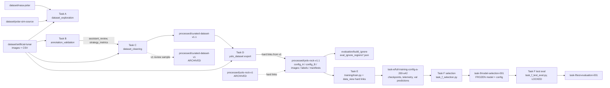

# Dependency Map

This map comes from a static scan of every `backend/**/*.py` file for path literals and module imports, plus the root scripts. It shows who reads what, so a deletion or move can be checked against it.

## 1. Pipeline data flow

## 2. Path consumers (code → path)

| Path | Read by | Kind of dependency |
|---|---|---|
| `dataset/artificial-lunar/images/{render,ground}` | `dataset_cleaning/__main__`, `annotation_validation/__main__`, `remediation/{scene_investigation,masking_audit}` | data input |
| `dataset/artificial-lunar/bounding_boxes.csv` | `dataset_cleaning/__main__` | data input |
| `dataset/artificial-lunar`, `dataset/nasa-polar`, `dataset/polar-sim-source` | `training/preflight.py` (PROTECTED fingerprints), `dataset_exploration` | integrity check, exploration |
| `polar-sim-source` (root) | `dataset_exploration/inventory.py` (only reports that it is a duplicate) | none functional |
| `dataset/processed/VERSIONS.json` | `preflight.py` | integrity |
| `processed/curated-dataset-v1` | `preflight.py` fingerprint; `dataset_cleaning/config.py` (`PREVIOUS_DATASET`, provenance only) | provenance |
| `processed/curated-dataset-v1.1` | `remediation/{scene_investigation,masking_audit}`, `preflight.py` | data input |
| `processed/yolo-rock-v1` | `remediation/ai_review.py` (split manifest), `yolo_dataset/__main__` (`--link-from` default), `preflight.py`, `collect_taskd_review_images.ps1` | **needs re-pointing before deletion** |
| `processed/yolo-rock-v1.1` | `evaluation`, `training/*`, `task_f_*`, tests | core |
| `experiments/annotation-validation/{assistant_review,strategy_metrics.json}` | `dataset_cleaning/__main__` | input to Task C |
| `experiments/dataset-cleaning` | `dataset_cleaning/config.py` (`REVIEW_SAMPLE_FROM`) | input to Task C v1.1 |
| `experiments/yolo-dataset/ai_review/*.json` | `yolo_dataset/__main__`, `tests/test_review_provenance.py` | input + test fixture |
| `experiments/yolo-dataset/cache/orb_features.npz` | `yolo_dataset` near-duplicate grouping (regenerable) | cache |
| `experiments/yolo-dataset-v1.1/review_gallery/index.html` | `tests/test_review_provenance.py` | test fixture |
| `experiments/remediation/threshold_study/threshold_study.json` | `remediation/threshold_study.py` | own output |
| `experiments/task-e/smoke-test-001/weights/best.pt` | `tests/test_training_guard.py` (must be rejected: class `item`) | test fixture (skips if absent) |
| `experiments/task-e/{smoke-test-001,benchmark-e1a-001}` | `preflight.py` fingerprints | integrity |
| `experiments/task-e/full-training-config-a-200-s42/ignore_aware_val/{best,epoch_completed_120,130,140}` | `task_f_selection.py`, `task_f_test_eval.py --selftest-val` | cached inputs |
| `experiments/task-e/runs_registry.jsonl` | `training/train.py` (append) | provenance |
| `experiments/task-f/model-selection-001/{FROZEN_MODEL_CONFIG.json,CHECKSUMS.sha256,model/*.pt,selection_analysis.json}` | `task_f_test_eval.py` (hash-verified) | **frozen, critical** |
| `experiments/task-f/test-evaluation-001/TEST_RUN_LOCK.json` | `task_f_test_eval.py` (refuses a second run) | **critical** |
| `backend/yolo11n.pt` | `train.py`, `preflight.py` (sha pinned) | provenance |

## 3. Hard-coded locations to fix for publication

| Location | Hard-coded content | Fix |
|---|---|---|
| Every module | Resolves `ROOT = Path(__file__).resolve().parents[N]` | Portable, but tied to the `backend/` depth. A move into `src/artemis_x/` needs one central `paths.py` |
| Generated JSON reports | Contain absolute user-profile Windows paths | Historical artefacts: keep as is; strip only from newly published copies |
| `audit-artemis.ps1` | Defaults to `$HOME\Documents\hackathon` | PowerShell, Task A only |

## 4. Python import graph

| Module | Imports |
|---|---|
| `training.train` | `.env_check`, `.monitor` |
| `training.preflight` | standalone |
| `training.e1c_analysis` | `.evaluate`, `.smoke_report_data`, `analysis.evaluation.ignore_eval` |
| `training.task_f_selection` | `analysis.evaluation.ignore_eval`, `.smoke_report_data` |
| `training.task_f_test_eval` | `analysis.evaluation.ignore_eval`, `.preflight`, `.task_f_selection` |
| `analysis.*` | Self-contained per task, with shared helpers in `dataset_exploration/common.py` |
| Tests | Import `training` and `analysis` as top-level packages from `backend/` |

**Implication for Phase 2:** a new `src/artemis_x` package can wrap `analysis.evaluation.ignore_eval` and the Task F inference settings without moving the proven modules. Moving them would break the 52 regression tests and every documented command, unless compatibility shims are kept.
